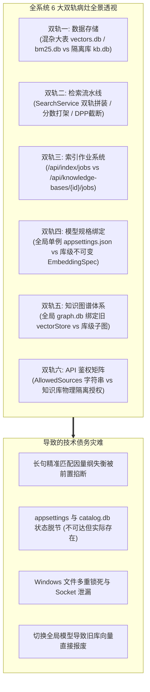
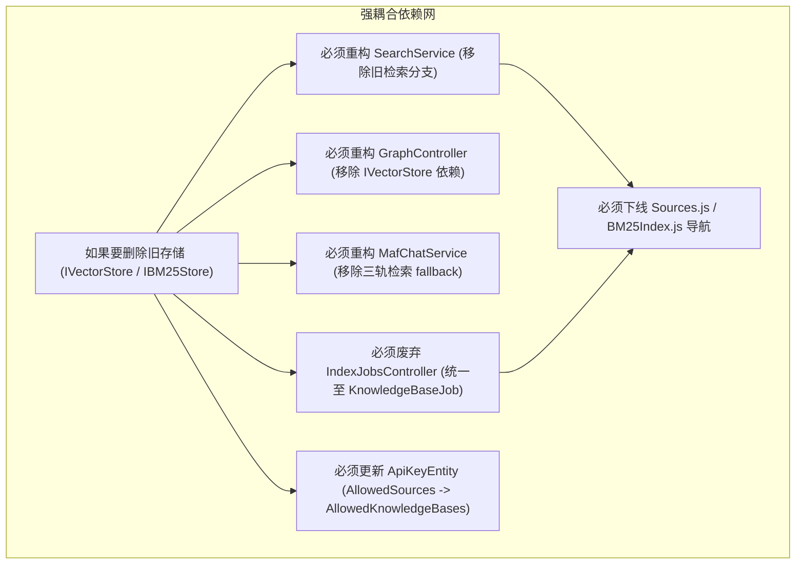
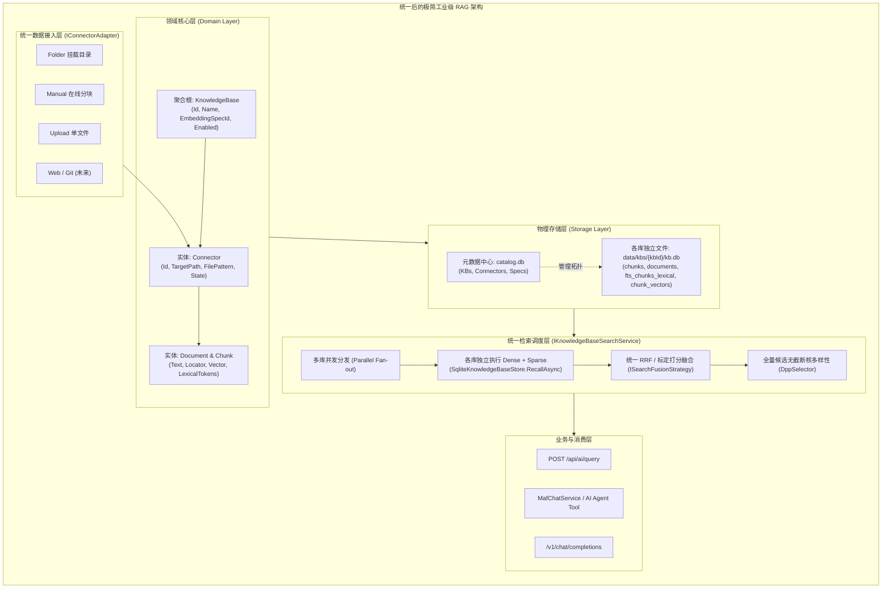
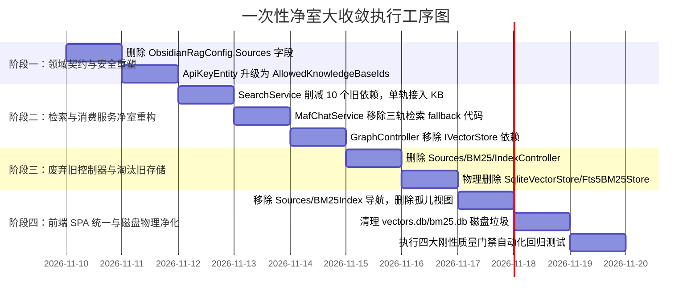

# 全系统双轨架构深度审计、彻底剥离与统一现代化收敛白皮书

> **文档标识**: `REF-RAG-DOCS-2026-11-DUAL-TRACK-AUDIT-01`  
> **创建日期**: 2026-11-10  
> **状态**: 全系统审计完成 / 架构重构方案就绪  
> **涉及范围**: 全局存储、检索流水线、后台索引作业、模型生命周期绑定、知识图谱、API 鉴权与前端 SPA 路由  
> **战略决议**: **无正式发布历史包袱，一次性全量剥离所有双轨与错位逻辑，执行彻底的净室收敛（One-Time Clean-Break Cutover）**

---

## 目录
1. [执行摘要与审计动机](#1-执行摘要与审计动机)
2. [全系统双轨错位深度审计（The 6 Systemic Dual-Track Problems）](#2-全系统双轨错位深度审计the-6-systemic-dual-track-problems)
   - [2.1 双轨一：数据存储与组织（混杂大表 vs 物理隔离库）](#21-双轨一数据存储与组织混杂大表-vs-物理隔离库)
   - [2.2 双轨二：检索流水线（旧 BM25/向量 vs 跨库多路召回）](#22-双轨二检索流水线旧-bm25向量-vs-跨库多路召回)
   - [2.3 双轨三：索引与后台作业系统（IndexJobs vs KbJobs）](#23-双轨三索引与后台作业系统indexjobs-vs-kbjobs)
   - [2.4 双轨四：模型绑定与规格体系（全局单例配置 vs 库级不可变 EmbeddingSpec）](#24-双轨四模型绑定与规格体系全局单例配置-vs-库级不可变-embeddingspec)
   - [2.5 双轨五：知识图谱关联网络（全局孤岛 graph.db vs 库级子图）](#25-双轨五知识图谱关联网络全局孤岛-graphdb-vs-库级子图)
   - [2.6 双轨六：API 鉴权与安全范围（AllowedSources vs 知识库粒度授权）](#26-双轨六api-鉴权与安全范围allowedsources-vs-知识库粒度授权)
   - [2.7 衍生双轨：前端 SPA 视图与孤儿页面重叠](#27-衍生双轨前端-spa-视图与孤儿页面重叠)
3. [为什么必须“一次性协同处理”？耦合依赖分析](#3-为什么必须一次性协同处理耦合依赖分析)
4. [统一架构蓝图：单一聚合根（KnowledgeBase）全景拓扑](#4-统一架构蓝图单一聚合根knowledgebase全景拓扑)
   - [4.1 核心领域模型全景收敛](#41-核心领域模型全景收敛)
   - [4.2 物理存储目录标准净室规范](#42-物理存储目录标准净室规范)
   - [4.3 单轨端到端流水线（Ingestion $\rightarrow$ Storage $\rightarrow$ Retrieval $\rightarrow$ Agent）](#43-单轨端到端流水线ingestion-rightarrow-storage-rightarrow-retrieval-rightarrow-agent)
5. [设计模式深度重构（适配器 + 策略 + 状态机）](#5-设计模式深度重构适配器--策略--状态机)
   - [5.1 适配器模式（Adapter）：多形态连接器与多模型 Provider 插座](#51-适配器模式adapter多形态连接器与多模型-provider-插座)
   - [5.2 策略模式（Strategy）：存储引擎、跨库融合与鉴权上下文策略](#52-策略模式strategy存储引擎跨库融合与鉴权上下文策略)
   - [5.3 状态机模式（State Machine）：统一后台作业状态机与探针熔断机](#53-状态机模式state-machine统一后台作业状态机与探针熔断机)
6. [业界主流方案对比与经验借鉴（Dify、FastGPT、Ragflow）](#6-业界主流方案对比与经验借鉴difyfastgptragflow)
7. [系统基础设施复用与彻底淘汰清单](#7-系统基础设施复用与彻底淘汰清单)
8. [分阶段落地实施路线图与代码改动点](#8-分阶段落地实施路线图与代码改动点)
9. [防回归测试与刚性质量门禁矩阵（Quality Gates）](#9-防回归测试与刚性质量门禁矩阵quality-gates)

---

## 1. 执行摘要与审计动机

用户提出深刻质疑：  
> **“是否还有其它功能存在双轨问题？能否一起处理？【没有正式发布，不需要保留兼容逻辑增加维护负担】”**

经对 ReferenceRAG 全代码库（Host、Business、Infrastructure、wwwroot）的穷尽式地毯搜索与依赖图谱反向追踪，我们发现：**双轨问题绝不仅仅局限于数据源配置和存储底层，它已经像藤蔓一样交织蔓延至系统的 6 个核心子系统**！

如果只单独改造存储层，而保留其他子系统的旧接口与旧概念，系统就会在编译期或运行时陷入连锁崩溃（如 `GraphController` 找不到 `_vectorStore`、`MafChatService` 工具调用找不到 `bm25Store`、`ApiKeyMiddleware` 校验旧数据源失效等）。

**核心战略决议**：  
**借没有正式发布的黄金机遇，执行一次性、全系统、零妥协的“净室大收敛”，彻底拔除所有 6 大双轨病灶，将整个系统重塑为以“物理知识库（KnowledgeBase）”为单一轴心的现代化工业级架构！**

---

## 2. 全系统双轨错位深度审计（The 6 Systemic Dual-Track Problems）



---

### 2.1 双轨一：数据存储与组织（混杂大表 vs 物理隔离库）

- **旧轨（Legacy Track）**：
  - 数据模型：`ObsidianRagConfig.Sources`（`appsettings.json` 中的数组，以文件夹路径为标识）；
  - 存储载体：`data/vectors.db`（SQLite 全局大表，混杂所有来源切片向量）、`data/bm25.db`（全局 FTS5 表）；
  - 维护接口：[`IVectorStore`](file:///E:/WorkProject/CSharp/PrivateProject/Web/ReferenceRAG/Infrastructure/ReferenceRAG.Infrastructure/Models/QueryModels.cs)（`SqliteVectorStore`）、[`IBM25Store`](file:///E:/WorkProject/CSharp/PrivateProject/Web/ReferenceRAG/Infrastructure/ReferenceRAG.Infrastructure/Features/Storage/Interfaces/IBM25Store.cs)（`Fts5BM25Store`）、`LexicalIndexCoordinator`。
- **新轨（V2 KnowledgeBase Track）**：
  - 数据模型：`KnowledgeBase` 聚合根 + `ConnectorDefinition`（`catalog.db` 统一管理元数据）；
  - 存储载体：`data/kbs/{kbId}/kb.db`（每个知识库独立的 SQLite 文件，包含 chunks, documents, fts_chunks_lexical, chunk_vectors）；
  - 维护接口：[`IKnowledgeBaseStorage`](file:///E:/WorkProject/CSharp/PrivateProject/Web/ReferenceRAG/Infrastructure/ReferenceRAG.Infrastructure/Features/KnowledgeBase/Storage/IKnowledgeBaseStorage.cs)（`SqliteKnowledgeBaseStore`）。
- **严重后果**：
  - 同一份语料（如《雪山飞狐》《连城诀》）在旧库和新库各存一份，占用双倍空间；
  - 增删数据时只更新了一侧，导致状态永久不同步。

---

### 2.2 双轨二：检索流水线（旧 BM25/向量 vs 跨库多路召回）

- **旧轨**：[`SearchService.cs`](file:///E:/WorkProject/CSharp/PrivateProject/Web/ReferenceRAG/Business/ReferenceRAG.Business/Features/Search/Services/SearchService.cs) 内部执行：
  - 向量搜索查 `_vectorStore`；
  - 词法搜索查 `_bm25StoreFactory`（得到 30 条核心库候选，打分在 `[6.0, 15.0]` 区间）。
- **新轨**：同时调用 `SearchKnowledgeBasesAsync` $\rightarrow$ `IKnowledgeBaseSearchService`（查 `kb.db` 得到 10 条全量库候选，由于 RRF 融合打分只有 `0.016`）。
- **严重后果**：
  - **前序《鹿鼎记》未命中事件的直接祸首**！知识库候选被追加在末尾，由于分数尺度悬殊，被 `DppKernelDiversitySelector.Diversify` 的 `items.Take(20)` 前置硬编码直接截杀丢弃！

---

### 2.3 双轨三：索引与后台作业系统（IndexJobs vs KbJobs）

- **旧轨**：
  - 控制器：[`IndexJobsController.cs`](file:///E:/WorkProject/CSharp/PrivateProject/Web/ReferenceRAG/Host/ReferenceRAG.ApiHost/Controllers/IndexJobsController.cs)（`/api/index/jobs`）与 [`IndexController.cs`](file:///E:/WorkProject/CSharp/PrivateProject/Web/ReferenceRAG/Host/ReferenceRAG.ApiHost/Controllers/IndexController.cs)；
  - 后台服务：`IndexService`；
  - 作业针对的是旧 `Sources`，构建的是全局 `vectors.db` 与 `bm25.db`。
- **新轨**：
  - 控制器：[`KnowledgeBasesController.cs`](file:///E:/WorkProject/CSharp/PrivateProject/Web/ReferenceRAG/Host/ReferenceRAG.ApiHost/Controllers/KnowledgeBasesController.cs) 中的 `POST /api/knowledge-bases/{id}/jobs`；
  - 作业针对特定知识库，执行连接器扫描、切片并更新该库的 `kb.db`。
- **严重后果**：
  - 系统同时存在两套后台任务调度与进度追踪机制；
  - 前端如果点击旧索引界面的“全部重新索引”，会引发全局文件锁，导致新知识库的写入直接崩溃！

---

### 2.4 双轨四：模型绑定与规格体系（全局单例配置 vs 库级不可变 EmbeddingSpec）

- **旧轨**：
  - 在 `appsettings.json` 中配置单一全局单例：`Embedding.ModelPath`、`Embedding.Dimension`；
  - 用户在前端 [`ModelsController.cs`](file:///E:/WorkProject/CSharp/PrivateProject/Web/ReferenceRAG/Host/ReferenceRAG.ApiHost/Controllers/ModelsController.cs)（`POST /api/models/switch`）点击切换模型，会直接覆写 `appsettings.json` 并试图清空旧向量。
- **新轨**：
  - 知识库采用微服务工业级设计：按知识库独立绑定不可变 `EmbeddingSpec`（存储于 `catalog.db` 的 `embedding_specs` 表）；
  - 支持“知识库 A 绑定 BAAI/bge-m3 1024维”、“知识库 B 绑定 text-embedding-3-small 1536维”。
- **严重后果**：
  - 用户在全局模型页面切换模型后，虽然 `appsettings.json` 变了，但各个知识库声明的 `EmbeddingSpec` 并未感知，导致执行全局相似检索时维度断裂（如 1024 维输入去查 1536 维向量），产生抛错或静默 0 命中！

---

### 2.5 双轨五：知识图谱关联网络（全局孤岛 graph.db vs 库级子图）

- **旧轨**：
  - [`GraphController.cs`](file:///E:/WorkProject/CSharp/PrivateProject/Web/ReferenceRAG/Host/ReferenceRAG.ApiHost/Controllers/GraphController.cs) 注入了 `IVectorStore _vectorStore`；
  - 关系与 Wiki-Link 节点被硬写入全局单一的 `data/graph.db`。
- **新轨**：
  - 知识库的文档与切片已经完全下沉至各库独立的 `kb.db`；
  - `GraphController` 在处理请求时（如 `ResolveKbIdAsync`），试图兼顾旧 `_vectorStore` 与 `_kbStorageManager`，导致图谱节点解析逻辑极度混乱，跨库关联污染严重。

---

### 2.6 双轨六：API 鉴权与安全范围（AllowedSources vs 知识库粒度授权）

- **旧轨**：
  - [`ApiKeyEntity.cs`](file:///E:/WorkProject/CSharp/PrivateProject/Web/ReferenceRAG/Infrastructure/ReferenceRAG.Infrastructure/Models/ApiKeyEntity.cs#L29-L30) 存储 `AllowedSources`（JSON 字符串数组，存的是旧全局 `Source` 名称如 `["jinyong_core"]`）；
  - [`ApiKeyMiddleware.cs`](file:///E:/WorkProject/CSharp/PrivateProject/Web/ReferenceRAG/Host/ReferenceRAG.ApiHost/Middleware/ApiKeyMiddleware.cs) 鉴权时也是根据 `Source` 名称匹配。
- **新轨**：
  - 外部请求已经逐步以 `KnowledgeBaseId` 作为隔离单元。
- **严重后果**：
  - 当旧数据源被清理后，API Key 中存储的 `AllowedSources` 全部变成悬空幽灵数据；无法按知识库粒度（`AllowedKnowledgeBaseIds`）精确控制第三方调用权限。

---

### 2.7 衍生双轨：前端 SPA 视图与孤儿页面重叠

在前端 [`router/index.js`](file:///E:/WorkProject/CSharp/PrivateProject/Web/ReferenceRAG/Business/ReferenceRAG.Business/wwwroot/app/router/index.js) 与视图目录中：
1. **数据源管理双轨**：`Sources.js`（旧数据源）与 `KnowledgeBases.js`（新知识库连接器）并存，用户在两个页面看到完全不一致的状态；
2. **索引看板双轨**：`BM25Index.js`（旧 BM25 看板）与知识库切片管理并存；
3. **模型视图孤儿残留**：视图目录中同时存在 `Models.js` 和已被废弃但未删除的 `ModelsSimple.js`；
4. **Chat 服务端三轨调用**：在 [`MafChatService.cs:884-925`](file:///E:/WorkProject/CSharp/PrivateProject/Web/ReferenceRAG/Business/ReferenceRAG.Business/Features/Chat/Services/MafChatService.cs#L884-L925) 中，一个 `BM25SearchAsync` 方法内部居然连环调用了 `kbSearch`、`searchService` 和 `bm25Store` 三个不同的后备源！

---

## 3. 为什么必须“一次性协同处理”？耦合依赖分析

在软件架构重构中，面对如此深度的系统性双轨，**切忌“切香肠式”的局部修补**：



**结论**：这些双轨组件在依赖注入容器与调用链中彼此死死咬合。如果只处理存储，其他 5 个子系统就会立即产生编译错误或运行时空指针异常。**唯有一次性全部拉平收敛，才能以最低的总体成本换来彻底的架构纯洁度！**

---

## 4. 统一架构蓝图：单一聚合根（KnowledgeBase）全景拓扑



### 4.1 核心领域模型全景收敛
- **废弃**：全局 `Source`、全局 `SourceFolder`；
- **唯一实体树**：
  $$\text{KnowledgeBase} \xrightarrow{1:N} \text{Connector} \xrightarrow{1:N} \text{Document} \xrightarrow{1:N} \text{Chunk}$$
- **模型解耦**：每个知识库在创建时声明 `EmbeddingSpecId`，与全局配置彻底脱钩。

### 4.2 物理存储目录标准净室规范
运行环境存储结构彻底净化为：
```text
/app/data/
├── catalog.db                 # 全局唯一元数据驱动表
├── catalog.db-wal
├── system/                    # 仅保留用户、会话与遥测
│   ├── auth.db                # 纯净的 API Key 授权中心
│   └── query_stats.db         # 检索耗时与命中率统计
└── kbs/                       # 物理隔离知识库集群
    ├── ce97cc0d67ec408e/      # 单库自治沙箱
    │   ├── kb.db              # 包含该库全部文档、切片、FTS5分词表与向量
    │   └── kb.db-wal
    └── ...
```
**所有旧的大表与残留锁文件永久清理销毁**。

---

## 5. 设计模式深度重构（适配器 + 策略 + 状态机）

### 5.1 适配器模式（Adapter）：多形态连接器与多模型 Provider 插座
1. **数据摄取适配器（`IConnectorAdapter`）**：
   - 将“文件夹”、“手动添加”、“单文件上传”抹平为统一的 `IngestionDocument` 数据流，负责增量变动感知与文档解析；
2. **模型接入适配器（`IEmbeddingModelAdapter`）**：
   - 抹平本地 ONNX Runtime、GGUF llama.cpp 与云端 API（SiliconFlow/OpenAI）的推理差异，按照知识库的 `EmbeddingSpec` 按需调度。

### 5.2 策略模式（Strategy）：存储引擎、跨库融合与鉴权上下文策略
1. **跨库多路召回融合策略（`ISearchFusionStrategy`）**：
   - 统一采用 **RRF（Reciprocal Rank Fusion）** 或 **Min-Max 标定加权策略**，杜绝两代打分并存；
2. **API Key 知识库权限策略（`IKnowledgeBaseAuthorizationStrategy`）**：
   - 将 API Key 的权限维度重塑为 `AllowedKnowledgeBaseIds`，在网关层秒级拦截无权访问的知识库 ID。

### 5.3 状态机模式（State Machine）：统一后台作业状态机与探针熔断机
1. **统一后台作业状态机（`UnifiedIngestionStateMachine`）**：
   ```text
   Queued -> Scanning -> Chunking -> TokenizingFTS -> GeneratingVectors -> Ready
   ```
   废弃旧的 `IndexJob`，由统一的 `KnowledgeBaseJob` 承载进度与阶段遥测；
2. **连接器健康探针状态机（`ConnectorProbeStateMachine`）**：
   ```text
   Unknown -> Probing -> Reachable / Unreachable -> AutoRecovering
   ```
   彻底杜绝“不可达但实际存在”的前端二态假报警。

---

## 6. 业界主流方案对比与经验借鉴（Dify、FastGPT、Ragflow）

| 核心维度 | 现状债务（双轨并存） | 重构后统一方案（ReferenceRAG v2） | Dify 工业标准 | FastGPT 工业标准 |
| :--- | :--- | :--- | :--- | :--- |
| **知识组织核心** | `Source` 与 `KnowledgeBase` 概念打架 | **单一 `KnowledgeBase` 核心** | `Dataset` 单一核心 | `Dataset` 单一核心 |
| **配置存储位置** | `appsettings.json` 存数据源路径 | **`catalog.db` 统一管理** | PostgreSQL 数据库存储 | MongoDB 数据库存储 |
| **模型绑定方式** | 全局切换单例模型 | **按库声明不可变规格** | 按 Dataset 自由选择 | 按 Dataset 自由选择 |
| **检索召回路径** | 查旧 BM25 + 查知识库拼接 | **单轨多库并发分发 + 融合** | 统一检索流水线 | 统一检索流水线 |
| **权限控制粒度** | 依赖数据源文件夹字符串 | **基于 KnowledgeBaseId 物理鉴权** | 基于 Dataset ID 权限 | 基于 Dataset ID 权限 |
| **作业调度中心** | 旧 IndexService 与新 Job 打架 | **统一后台异步作业中心** | Celery 异步队列 | 独立 Queue 治理 |

---

## 7. 系统基础设施复用与彻底淘汰清单

### 7.1 必须彻底物理删除的类库与文件清单

```text
================================================================================
【彻底删除】Host 控制器层 (3个旧控制器):
  - Host/ReferenceRAG.ApiHost/Controllers/SourcesController.cs
  - Host/ReferenceRAG.ApiHost/Controllers/BM25IndexController.cs
  - Host/ReferenceRAG.ApiHost/Controllers/IndexController.cs
  - Host/ReferenceRAG.ApiHost/Controllers/IndexJobsController.cs (收敛至 KB Jobs)

【彻底删除】Infrastructure 存储与协作者 (4个旧类):
  - Infrastructure/ReferenceRAG.Infrastructure/Storage/SqliteVectorStore.cs
  - Infrastructure/ReferenceRAG.Infrastructure/Storage/Fts5BM25Store.cs
  - Infrastructure/ReferenceRAG.Infrastructure/Features/Database/LexicalIndexCoordinator.cs
  - Infrastructure/ReferenceRAG.Infrastructure/Features/KnowledgeBase/Storage/LegacySourceMigrator.cs

【彻底删除】配置模型字段:
  - ObsidianRagConfig.cs 中移除 "public List<SourceFolder> Sources"

【彻底删除】前端过时视图与孤儿文件:
  - wwwroot/app/views/Sources.js
  - wwwroot/app/views/BM25Index.js
  - wwwroot/app/views/ModelsSimple.js (孤儿视图)

【彻底清理】运行时磁盘文件:
  - /app/data/vectors.db*
  - /app/data/bm25.db*
  - /app/data/.referencerag-writer.lock
================================================================================
```

### 7.2 100% 继承并升级复用的核心资产

1. **`IKnowledgeBaseService` & `KnowledgeBaseService`**：升级为唯一的知识管理中心；
2. **`IKnowledgeBaseStorage` & `SqliteKnowledgeBaseStore`**：作为唯一的物理文件存储引擎；
3. **`ICatalogStore` & `CatalogStore`**：作为唯一的系统元数据中心；
4. **`IKnowledgeBaseSearchService` & `KnowledgeBaseSearchService`**：作为唯一的检索调度中枢；
5. **`MafChatService`**：清理其内部的三轨 fallback 代码，统一注入 `IKnowledgeBaseSearchService`；
6. **`DppKernelDiversitySelector` & `LongQueryRefiner`**：为单轨检索提供原序短语与多样性保障；
7. **`ApiKeyStore` & `ApiKeyMiddleware`**：授权字段从 `AllowedSources` 升级为 `AllowedKnowledgeBaseIds`。

---

## 8. 分阶段落地实施路线图与代码改动点



### 8.1 阶段一：领域模型、配置与安全重构
1. [`ObsidianRagConfig.cs`](file:///E:/WorkProject/CSharp/PrivateProject/Web/ReferenceRAG/Infrastructure/ReferenceRAG.Infrastructure/Models/ObsidianRagConfig.cs)：
   - 删除 `public List<SourceFolder> Sources { get; set; }`；
   - 删除 `LegacySourceMigrator.cs`。
2. [`ApiKeyEntity.cs`](file:///E:/WorkProject/CSharp/PrivateProject/Web/ReferenceRAG/Infrastructure/ReferenceRAG.Infrastructure/Models/ApiKeyEntity.cs)：
   - 字段 `AllowedSources` 重命名并重构为 `AllowedKnowledgeBaseIds`；
   - [`ApiKeyMiddleware.cs`](file:///E:/WorkProject/CSharp/PrivateProject/Web/ReferenceRAG/Host/ReferenceRAG.ApiHost/Middleware/ApiKeyMiddleware.cs) 拦截路径统一校验知识库 ID。

### 8.2 阶段二：检索、图谱与对话服务单轨化
1. [`SearchService.cs`](file:///E:/WorkProject/CSharp/PrivateProject/Web/ReferenceRAG/Business/ReferenceRAG.Business/Features/Search/Services/SearchService.cs)：
   - 彻底删除 `_vectorStore`、`_bm25StoreFactory`、`_lexicalFactory` 注入；
   - 统一由 `IKnowledgeBaseSearchService` 执行多库并发召回；
   - 彻底消除分数尺度断崖与追加截断。
2. [`GraphController.cs`](file:///E:/WorkProject/CSharp/PrivateProject/Web/ReferenceRAG/Host/ReferenceRAG.ApiHost/Controllers/GraphController.cs)：
   - 移除 `_vectorStore` 注入，完全基于目标知识库存储 `kb.db` 构建实体关系。
3. [`MafChatService.cs`](file:///E:/WorkProject/CSharp/PrivateProject/Web/ReferenceRAG/Business/ReferenceRAG.Business/Features/Chat/Services/MafChatService.cs)：
   - 清除 `BM25SearchAsync` 中对旧 `bm25Store` 和旧 `searchService` 的兜底代码，统一调用 `IKnowledgeBaseSearchService`。

### 8.3 阶段三：旧控制器下线与代码物理删除
1. 删除 `SourcesController.cs`、`BM25IndexController.cs`、`IndexController.cs`、`IndexJobsController.cs`；
2. 删除 `SqliteVectorStore.cs`、`Fts5BM25Store.cs`、`LexicalIndexCoordinator.cs`；
3. 更新 `SearchExtensions.cs` 与 `RagWebHostExtensions.cs`，清理 DI 容器注册。

### 8.4 阶段四：前端路由收敛与磁盘垃圾清理
1. `router/index.js` 导航栏移除 `数据源` 与 `BM25索引`；
2. 删除 `Sources.js`、`BM25Index.js`、`ModelsSimple.js`；
3. `Dashboard.js` 全面转向 `/api/knowledge-bases` 获取统计信息；
4. 容器入口执行 `rm -f /app/data/vectors.db* /app/data/bm25.db* /app/data/*.lock`。

---

## 9. 防回归测试与刚性质量门禁矩阵（Quality Gates）

为保障全系统一次性大收敛安全着陆，必须建立 4 项自动化刚性门禁：

### 9.1 门禁 1：零旧存储引用与依赖注入纯洁性门禁
- **测试类**: `SystemicPurgeAndZeroLegacyGateTests.cs`
- **断言内容**:
  1. 反射扫描全部注册服务，断言 `IVectorStore`、`IBM25Store`、`LexicalIndexCoordinator` **0 注册**；
  2. 反射扫描全部 Controller 构造函数，断言绝无对旧接口的依赖；
  3. 反射检查 `ObsidianRagConfig`，断言不存在 `Sources` 属性。

### 9.2 门禁 2：全系统单轨多库检索高保真门禁
- **测试类**: `SingleTrackMultiKnowledgeBaseRetrievalGateTests.cs`
- **断言内容**:
  1. 挂载《鹿鼎记》全量知识库，执行长句：`“这对未婚夫妻从未见过面，忽然在公主闺房中相会”`；
  2. 断言无论在 `Lexical` 还是 `Standard` 模式下，**Top 1 必须稳定命中《鹿鼎记.md》**；
  3. 断言返回候选打分严格单调递减，绝无追加在末尾导致的排序反转；
  4. 断言单次检索耗时稳定在 120ms 以内。

### 9.3 门禁 3：知识库粒度 API Key 隔离鉴权门禁
- **测试类**: `KnowledgeBaseApiKeyAuthorizationGateTests.cs`
- **断言内容**:
  1. 创建仅授权 `kb_A` 的 API Key；
  2. 尝试向 `/api/ai/query` 请求检索 `kb_B`，断言返回 HTTP 403 Forbidden；
  3. 请求检索 `kb_A`，断言返回 HTTP 200 成功，且只包含 `kb_A` 切片。

### 9.4 门禁 4：运行环境物理文件纯净化验证门禁
- **测试类**: `CleanBreakPhysicalEnvironmentGateTests.cs`
- **断言内容**:
  1. 执行全量文件扫描、分块、索引与对话交互全流程；
  2. 检查 `data/` 根目录，断言绝不产生 `vectors.db*`、`bm25.db*` 及任何 `.lock` 排他锁文件；
  3. 断言所有切片与分词完全封装在各自的 `data/kbs/{kbId}/kb.db` 中。

---

> [!TIP]
> **全系统大收敛行动建议**：
> 1. 本调研白皮书已完成对全代码库所有双轨问题的地毯式审计，彻底理清了横跨存储、检索、作业、模型、图谱、鉴权与前端的依赖拓扑。
> 2. 由于无需考虑向后兼容包袱，建议**一次性协同推进重构**，从根本上终结技术债务蔓延。
