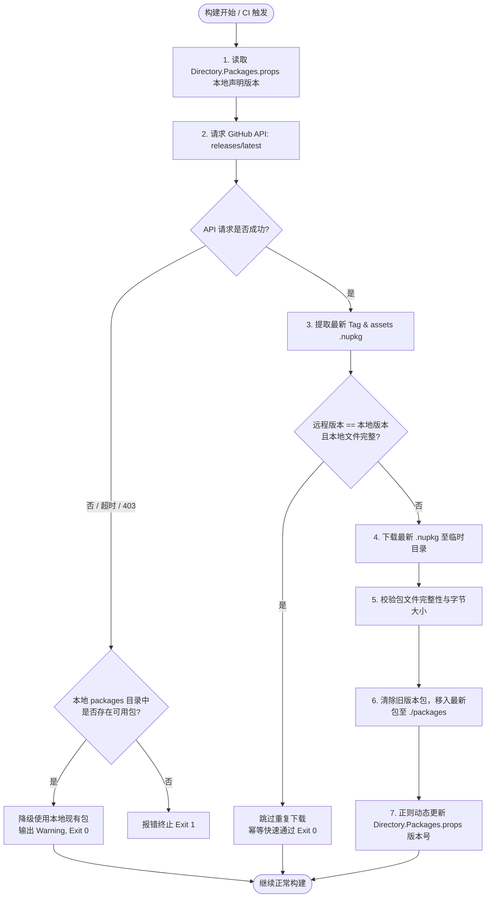

# TemporaryDiagnostics 最新 Release 自动化检测与包同步架构设计 (方案 B)

> **文档状态**：已完成实施与验证  
> **编写日期**：2026-10-22  
> **关联项目**：ReferenceRAG / TemporaryDiagnostics (`https://github.com/csvkse/TemporaryDiagnostics`)

---

## 一、 需求背景与核心痛点

在先前的版本中，ReferenceRAG 通过 `nuget.config` 本地包源机制（`./packages`）接入了 `TemporaryDiagnostics` 诊断中间件，并在 `Directory.Packages.props` 中将版本固定为 `1.0.0`。

随着 `TemporaryDiagnostics` 自身的迭代发布（例如发布了修复并增强的 `v1.0.3`），产生了以下核心诉求：
1. **自动获取最新发布版**：希望 ReferenceRAG 在构建阶段能够自动感知并使用 `TemporaryDiagnostics` 的最新 GitHub Release 版本，无需人工手动下载 nupkg、重命名、替换文件并逐一修改 XML 版本号；
2. **构建确定性与容灾保护（Offline Fallback）**：外部 GitHub 接口可能存在网络抖动、DNS 污染或匿名请求 Rate Limit 限流（403），自动化同步机制必须具备完全的幂等性与优雅降级能力，确保在离线或弱网环境下构建 100% 成功，绝不阻断编译。

---

## 二、 方案 B 核心架构设计

### 1. 架构流转图



### 2. 双轨自动化同步脚本设计

我们在 `support/tools/scripts/` 目录下提供了跨平台的双轨同步工具：

| 脚本路径 | 适用平台 / 环境 | 依赖要求 |
|---|---|---|
| [`sync-temporary-diagnostics.ps1`](file:///e:/WorkProject/CSharp/PrivateProject/Web/ReferenceRAG/support/tools/scripts/sync-temporary-diagnostics.ps1) | Windows PowerShell 5.1 / PowerShell 7 Core / Windows CI / 本地开发者环境 | 无外部依赖，纯 .NET BCL 与 PowerShell 原生 Cmdlet |
| [`sync-temporary-diagnostics.sh`](file:///e:/WorkProject/CSharp/PrivateProject/Web/ReferenceRAG/support/tools/scripts/sync-temporary-diagnostics.sh) | Linux Docker 容器 / Ubuntu GitHub Actions Runner / macOS | `bash` + `curl`（`jq` 可选，缺失时自动降级至 grep/sed） |

#### 核心特性：
1. **GitHub Token 智能注入**：
   优先读取命令行传入的 `-Token / --token` 或环境变量 `$env:GITHUB_TOKEN`。在 GitHub Actions CI 环境中携带 `${{ secrets.GITHUB_TOKEN }}` 发起调用，彻底规避 GitHub API 匿名请求每小时 60 次的 Rate Limit 风险；
2. **零副作用幂等性检测**：
   在发起下载前对比 `Directory.Packages.props` 中当前声明版本与远程 `tag_name`，并核验 `./packages` 下目标文件名与文件大小。若已是最新，耗时严格控制在 **< 0.5s**，跳过冗余的网络流量消耗；
3. **原子替换与旧包清理**：
   新包先下载至临时目录 `.download_tmp`，校验字节完整（> 1KB）后，批量移除旧版 `TemporaryDiagnostics.*.nupkg`，最后原子移入新包，杜绝下载中断导致包损坏；
4. **精确正向环视（Positive Lookbehind/Lookahead）版本替换**：
   利用正则表达式：
   `(?<=<PackageVersion\s+Include="TemporaryDiagnostics\.[^"]+"\s+Version=")[^"]+(?="\s*/>)`
   仅精确替换 `TemporaryDiagnostics` 相关的三项依赖（`AspNetCore`、`Core`、`Infrastructure`），绝不影响文件中其他第三方 NuGet 包。

---

## 三、 CI 流水线深度集成

已在 ReferenceRAG 的两大核心自动化流水线中无缝接入同步步骤：

### 1. Docker 全架构镜像构建流水线 (`.github/workflows/docker-build.yml`)
在检出代码后、启动 Docker 构建前执行：
```yaml
- name: Checkout repository
  uses: actions/checkout@v4

- name: Sync Latest TemporaryDiagnostics Packages
  shell: bash
  run: |
    chmod +x support/tools/scripts/sync-temporary-diagnostics.sh
    support/tools/scripts/sync-temporary-diagnostics.sh --token "${{ secrets.GITHUB_TOKEN }}"
```

### 2. 桌面客户端发布流水线 (`.github/workflows/desktop-release.yml`)
在 Windows 构建矩阵的预处理阶段执行：
```yaml
- name: Checkout repository
  uses: actions/checkout@v4

- name: Sync Latest TemporaryDiagnostics Packages
  shell: powershell
  run: |
    powershell -NoProfile -ExecutionPolicy Bypass -File support/tools/scripts/sync-temporary-diagnostics.ps1 -Token "${{ secrets.GITHUB_TOKEN }}"
```

---

## 四、 本地与离线开发者使用指南

开发者在本地开发机如需一键升级 `TemporaryDiagnostics`，只需在项目根目录运行：

```powershell
# Windows PowerShell
powershell -ExecutionPolicy Bypass -File support/tools/scripts/sync-temporary-diagnostics.ps1

# Linux / macOS
bash support/tools/scripts/sync-temporary-diagnostics.sh
```

若需强制重新拉取最新包，可追加 `-Force` 参数：
```powershell
powershell -ExecutionPolicy Bypass -File support/tools/scripts/sync-temporary-diagnostics.ps1 -Force
```
