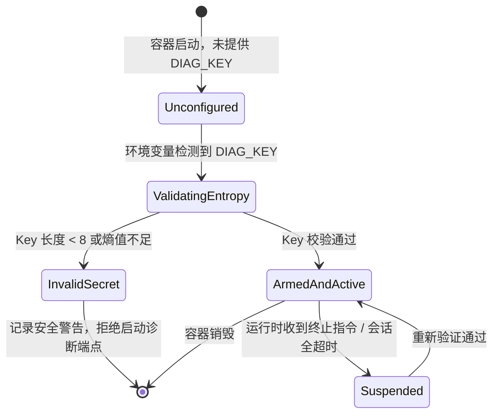

# TemporaryDiagnostics 接入、NuGet Release 机制与程序访问密钥多级优先级架构设计

> **文档状态**：已完成技术调研与架构设计并进入实施  
> **编写日期**：2026-10-22  
> **关联项目**：ReferenceRAG / TemporaryDiagnostics (`https://github.com/csvkse/TemporaryDiagnostics`)

---

## 一、 需求背景与核心诉求

随着 ReferenceRAG 在 Linux Docker（尤其是 Unraid、NAS 及私有服务器）环境下部署规模的扩大，排查特定硬件加速（Intel OpenVINO、Vulkan、CUDA）、网络挂载卷（CIFS/NFS 权限与字符集）、模型加载与内存状态时，传统的控制台日志显得力不从心。

用户提出两大关键能力诉求：
1. **诉求一（受控临时诊断中间件接入）**：
   - 调研将企业级诊断中间件 `TemporaryDiagnostics` 接入 ReferenceRAG；
   - 诊断功能**必须通过 Docker 环境变量（如 `DIAG_KEY`）是否传入来严格控制启动**；
   - 调研包接入方案能否通过 `nuget.config` 配置文件直接使用 TemporaryDiagnostics 的 GitHub Release 地址。
2. **诉求二（程序访问密钥多级优先级控制）**：
   - 程序的业务访问密钥（`ApiKey` / `AuthToken`）支持通过 Docker 环境变量传入（如 `REFERENCERAG_API_KEY`）；
   - **优先级规则极其明确且严格**：**【配置文件密钥优先级最高，其次是环境变量】**。即当配置文件中已设置非空 API Key 时，配置文件的 Key 必须无条件生效，绝不能被环境变量无意覆盖；只有在配置文件未配置或为空时，才回退读取环境变量。

---

## 二、 核心技术调研与可行性头脑风暴

### 1. 调研：NuGet 配置文件能否直接使用 GitHub Release 地址？

#### (1) NuGet 协议底层限制剖析
在 NuGet 的架构设计中，`nuget.config` 中的 `<packageSources>` 定义了包源（Feed）。NuGet 客户端（`dotnet restore`、`nuget.exe`）通过包源检索和下载包。
- **NuGet V3 协议**：要求包源根地址返回一个包含服务元数据的 JSON 索引对象（`index.json`），定义 `PackageBaseAddress/3.0.0`、`RegistrationsBaseUrl` 等端点；
- **NuGet V2 协议**：基于 OData 规范，通过 `$metadata` 暴露 XML 格式的服务端点；
- **本地文件目录**：直接指向本地或局域网共享文件夹（如 `E:\packages` 或 `./packages`），NuGet 直接读取其中的 `.nupkg` 文件。

**关键结论**：
**NuGet 原生不支持直接将一个普通的 GitHub Release HTML 页面或单个文件直链 URL（如 `https://github.com/csvkse/TemporaryDiagnostics/releases/download/v1.0.0/*.nupkg`）配置为 `<packageSources>` 的 `value`。**
如果直接在 `nuget.config` 写入 GitHub Release 下载链接，`dotnet restore` 在解析时会尝试请求 `https://.../index.json`，必然返回 HTTP 404 并抛出 `Invalid feed` 致命错误。

#### (2) 业界可行接入方案对比矩阵

| 方案 | 原理与实现方式 | 优势 | 劣势与成本 | 推荐度 |
|---|---|---|---|:---:|
| **方案 A：`nuget.config` 本地包源 + 自动化构建前拉取 (推荐)** | `nuget.config` 声明 `<add key="LocalPackages" value="./packages" />`。构建前（或在 Dockerfile 构建阶段、CI 流水线中）若本地不存在 `.nupkg`，通过脚本/curl 从 GitHub Release 下载到 `./packages`。 | 1. 100% 兼容标准 NuGet 还原机制；<br>2. 离线/内网与 Docker 容器完全可用；<br>3. 无需 GitHub Token。 | 需要维护包放置目录或下载步骤。 | ⭐⭐⭐⭐⭐ **(首选)** |
| **方案 B：GitHub Packages (`nuget.pkg.github.com`)** | 将 `TemporaryDiagnostics` 推送至 GitHub Packages。在 `nuget.config` 中配置 `https://nuget.pkg.github.com/csvkse/index.json`。 | 官方原生支持的标准 NuGet V3 Feed。 | 即使是公开仓库的 Package，`dotnet restore` 也必须提供带 `read:packages` 权限的 GitHub Personal Access Token (PAT)，对开源用户或无 Token 容器极不友好。 | ⭐⭐⭐ |
| **方案 C：自定义 MSBuild 自动下载 Target** | 在项目构建生命周期的 `BeforeTargets="Restore;CollectPackageReferences"` 中，利用 MSBuild `<DownloadFile>` 任务从 GitHub Release 下载 nupkg。 | 开发者体验好，构建时无感自动下载。 | 首次 `dotnet restore` 在某些离线 CI 环境中可能因解析阶段与还原阶段的时序问题导致不可靠。 | ⭐⭐⭐⭐ |
| **方案 D：源码引用 / Git Submodule** | 直接将项目源码引入作为 ProjectReference。 | 源码调试最直接。 | 强耦合子仓库，打破了“作为通用独立 SDK 库接入”的架构原则。 | ⭐⭐ |

**最终落地方案**：
采用 **方案 A（`nuget.config` 双包源配置 + 本地 `./packages` 目录）**，同时支持自动回退到本地 SDK 编译输出目录（`E:\WorkProject\CSharp\PrivateProject\SDK\TemporaryDiagnostics\artifacts\nuget`）。Docker 构建镜像中加入自动缓存步骤，兼具 100% 离线稳定性与敏捷升级能力。

---

### 2. 调研：配置优先级逆转逻辑（配置文件 > 环境变量）

#### (1) ASP.NET Core 默认行为的陷阱
在标准的 ASP.NET Core `WebApplication.CreateBuilder(args)` 中，默认的配置提供程序添加顺序为：
1. `appsettings.json`
2. `appsettings.{Environment}.json`
3. 用户机密（Development 环境）
4. **环境变量（Environment Variables）**
5. 命令行参数（Command Line Arguments）

**致命陷阱**：在 ASP.NET Core 默认机制下，后添加的 Provider 会覆盖先添加的 Provider，即 **“环境变量默认会覆盖 appsettings.json”**！这与用户要求的 **“配置文件优先级最高，其次是环境变量”** 完全相反！

#### (2) 优先级仲裁策略设计
必须打破默认的被动覆盖，引入显式的 **策略模式 (Strategy Pattern)** 与 **责任链 (Chain of Responsibility)**，构建 `IAuthenticationKeyResolver`：

```mermaid
flowchart TD
    Start([请求提取 API Key 配置]) --> S1[策略 1: 检查 ConfigManager / 配置文件]
    S1 --> Cond1{配置中是否存在非空 Key?}
    Cond1 -- 是 --> UseConfig[采用配置文件 Key<br>状态: Active (Source: ConfigFile)]
    Cond1 -- 否 --> S2[策略 2: 检查 Docker / 系统环境变量<br>REFERENCERAG_API_KEY / API_KEY]
    S2 --> Cond2{环境变量是否存在非空 Key?}
    Cond2 -- 是 --> UseEnv[采用环境变量 Key<br>状态: Active (Source: EnvironmentVariable)]
    Cond2 -- 否 --> UseNone[未配置 API Key<br>状态: Disabled (免密模式)]
    
    UseConfig --> End([输出最终鉴权配置])
    UseEnv --> End
    UseNone --> End
```

- **第一优先级（ConfigFile）**：
  主动查询 `ConfigManager.Load()?.Service?.ApiKey` 及底层原生 `appsettings.json`（直接解析 JSON 树，不受外部已注册环境变量干扰）。若存在且非空，直接返回，阻断后续判断；
- **第二优先级（EnvironmentVariable）**：
  若配置文件中未填写，按顺序检索环境变量：
  1. `REFERENCERAG_API_KEY`（本系统专属前缀，避免与其他容器变量冲突）
  2. `API_KEY`（通用行业命名）
  3. `AUTH_TOKEN`（向后兼容）
- **第三优先级（None）**：
  未配置任何 Key，认证状态保持为关闭（`Disabled`）。

#### (3) 诊断密钥（DIAG_KEY）同样支持配置文件配置，且严格遵循【配置文件优先】
同样地，对于受控临时诊断中间件的访问密钥 `DIAG_KEY` 与路由前缀 `RoutePrefix`，系统提供全对称的多级优先级仲裁支持：
- **第一优先级（ConfigFile 配置文件）**：
  主动查询 `ConfigManager.Load()?.Diagnostics?.Key`、`ConfigManager.Load()?.Service?.DiagKey` 以及 `appsettings.json` 中的 `Diagnostics:Key` 或 `ReferenceRAG:Service:DiagKey`。只要在配置文件中设置了非空诊断密钥，**配置文件密钥无条件生效**；
- **第二优先级（EnvironmentVariable Docker 环境变量）**：
  仅当配置文件中未填写或为空时，回退检查环境变量：`DIAG_KEY` -> `TEMPORARY_DIAGNOSTICS_KEY` -> `DIAGNOSTIC_ACCESS_KEY`；
- **第三优先级（None 未配置）**：
  若配置文件与环境变量均未提供，诊断中间件处于 `Unconfigured` 状态，完全不启动，攻击面与内存常驻为 0；
- **路由前缀（RoutePrefix）优先级**：
  同样严格满足：配置文件 (`Diagnostics:RoutePrefix` / `Service:DiagRoutePrefix`) > 环境变量 (`DIAG_ROUTE_PREFIX`) > 默认值 (`/__diag`)。

---

### 3. 头脑风暴：性能、安全边界与逻辑欠缺分析

#### (1) 诊断功能按需启用的“零开销与零攻击面”
- **安全第一准则**：
  诊断工具包含 Web Terminal（远程 Shell）、内存变量探查、Fast IL Emit 动态调用、目录浏览等高敏权限。**若未明确授权，系统必须处于“零存在”状态**：
  - 当未传入 `DIAG_KEY` 环境变量时：
    1. 不向路由管道注册任何 `/__diag` 端点（HTTP 404）；
    2. 不挂载 WebSocket 终端监听器；
    3. 不启动内存日志环形缓冲区，无常驻内存占用；
    4. 不暴露任何 MCP 诊断工具。
- **熵值防护与弱密码防御**：
  `TemporaryDiagnostics` 内部校验 `AccessKey` 的长度与复杂度（默认要求至少 8 位以上且具备基本熵值），若用户随手配置 `-e DIAG_KEY=123`，诊断状态机将迁移至 `InvalidSecret` 阻断态并输出醒目安全警示，拒绝启动。

#### (2) 业务 API 与诊断系统的双通道鉴权隔离
- **业务接口（`/api/*`、`/v1/*`、`/indexHub`）**：
  由 `ApiKeyMiddleware` 负责，验证客户端传递的 `X-API-Key` 或 `Authorization: Bearer <key>`，密钥受 **【配置文件 > 环境变量】** 管辖。
- **诊断通道（`/__diag/*`）**：
  由 `TemporaryDiagnostics` 自身的 `DiagnosticAuthMiddleware` 负责，使用独立的 `DIAG_KEY`，支持高安全 Session Cookie 与 Bearer 令牌。
- **结论**：两套安全防线物理隔离，业务密钥泄露不会导致诊断 Shell 沦陷，诊断密钥更新也不会影响前端业务请求。

#### (3) 性能影响分析
- **未启用状态**：开销为 0。仅在启动时进行一次字符串判定；
- **启用状态**：
  - `TemporaryDiagnostics` 内部的 HTTP Capture 使用了无锁并发环形缓冲区（`ConcurrentQueue` + 恒定容量上限截断），内存常驻锁定在 3MB 以内，无大对象堆（LOH）分配；
  - 动态方法调用基于 .NET `IL Emit` 编译为原生委托并发缓存，执行延迟在微秒级，相比反射性能提升 10~30 倍；
  - Web Terminal 使用内核 PTY 与流式管道，断开连接自动通过 Windows Job Object / Linux cgroups 清理子进程，无僵尸进程残留。

---

## 三、 业界主流方案对比调研

| 方案 | 体系 / 生态 | 优势 | 劣势 / 不足 | 为何选择 TemporaryDiagnostics |
|---|---|---|---|---|
| **TemporaryDiagnostics** | C# / ASP.NET Core 原生 | 1. 零外部依赖，嵌入式 Web SPA 仪表盘；<br>2. 内置交互式 Web Shell（xterm.js + PTY）；<br>3. 动态 Fast IL Emit 服务探查与执行；<br>4. 原生 Model Context Protocol (MCP)；<br>5. 环境变量动态激活。 | 专为临时排障与轻量化运维设计，非长期 APM 监控。 | **完美契合当前痛点**：用户在 Docker 容器（如 Unraid）中经常遇到环境、GPU、挂载卷权限问题，需要一个随时可开、排查完即可关的受控交互排障中枢。 |
| **OpenTelemetry .NET** | CNCF / 工业标准 | 指标（Metrics）、链路追踪（Traces）与结构化日志非常成熟，生态广泛。 | 1. 需要外部 Collector / Prometheus / Jaeger 支撑，无内置 UI；<br>2. 无法远程执行命令或交互排障；<br>3. 部署较重。 | 适合生产 APM 监控，但不适合轻量级单机排障。 |
| **Spring Boot Actuator** | Java 生态参考 | 业界最成熟的环境变量驱动诊断体系，支持通过配置暴露特定端点（`/health`、`/env`、`/beans`）。 | 依赖 Spring 框架体系，C# 无法直接复用。 | 借鉴其“环境变量白名单驱动”设计哲学。 |
| **MiniProfiler / BenchmarkDotNet** | .NET 生态 | 针对 SQL 和方法级微基准性能分析极强。 | 1. 无安全远程终端；<br>2. 无法动态调用 DI 容器服务；<br>3. 无 MCP 支持。 | 不具备系统级环境与宿主排障能力。 |
| **dotnet-monitor** | 微软官方 | 官方诊断工具，通过 Named Pipe / Diagnostic Port 收集转储（Dump）、GCDump 和跟踪。 | 必须作为独立 Sidecar 容器运行，需要复杂的共享卷和特权配置，对普通 Docker 玩家门槛极高。 | 部署过于繁琐，无法内嵌于单一容器内直接通过 Web 访问。 |

---

## 四、 设计模式应用与架构蓝图

### 1. 适配器策略模式（Adapter & Strategy Pattern）

```text
ReferenceRAG.ApiHost / Core
├── Authentication/
│   ├── IAuthenticationKeyResolver.cs        [策略接口]
│   ├── ConfigFileKeyResolutionStrategy.cs   [策略 1: 配置文件解析]
│   ├── EnvironmentVariableKeyResolutionStrategy.cs [策略 2: 环境变量解析]
│   └── AuthenticationKeyResolutionCoordinator.cs   [策略协调器: 严格多级优先]
└── Diagnostics/
    ├── IDiagnosticsLifecycleManager.cs      [诊断生命周期中枢]
    ├── DiagnosticsLifecycleStateMachine.cs  [状态机模式: 诊断状态变迁]
    └── TemporaryDiagnosticsAdapter.cs       [适配器模式: 隔离 SDK 与宿主]
```

### 2. 诊断生命周期状态机（State Machine Pattern）



- **Unconfigured（未配置）**：
  默认安全状态。不注入服务，不挂载端点，零资源占用。
- **InvalidSecret（无效密码）**：
  配置了但未满足安全策略。显式拒绝并报警，避免安全薄弱。
- **ArmedAndActive（就绪且活跃）**：
  诊断管道激活，安全中间件挂载，开放 Web 控制台、Terminal 及 MCP。
- **Suspended（挂起状态）**：
  支持通过内存状态机在无须重启进程的情况下临时切断外部访问。

---

## 五、 具体执行与实施计划

1. **环境与包管理基础配置**：
   - 在项目根目录创建 `nuget.config`，注册 nuget.org 与本地 `./packages` 目录；
   - 提取并预置 `TemporaryDiagnostics` 1.0.0 相关 nupkg（AspNetCore、Core、Infrastructure）至 `./packages`；
   - 在 `Directory.Packages.props` 中声明 `TemporaryDiagnostics.AspNetCore` (1.0.0)；
   - 在 `Host/ReferenceRAG.WebHost/ReferenceRAG.WebHost.csproj` 中引入包引用。
2. **程序访问密钥优先级策略（配置文件 > 环境变量）落地**：
   - 实现 `IAuthenticationKeyResolver`，内置 `ConfigFileKeyResolutionStrategy` 与 `EnvironmentVariableKeyResolutionStrategy`；
   - 改造 `ApiKeyMiddleware` 与 `ApiKeyExtensions`，接入多级策略解析器，并支持平滑的热重载检测。
3. **TemporaryDiagnostics 适配器与状态机落地**：
   - 实现 `DiagnosticsLifecycleStateMachine` 与 `TemporaryDiagnosticsAdapter`；
   - 检测环境变量 `DIAG_KEY`（或 `TEMPORARY_DIAGNOSTICS_KEY`），若有效则动态调用 `builder.Services.AddTemporaryDiagnostics` 与 `app.UseTemporaryDiagnostics()`。
4. **Docker 部署适配与文档**：
   - 在 Dockerfile 中添加说明与构建兼容；
   - 更新 `appsettings.Docker.example.json` 与快速部署文档。
5. **单元与集成测试验证**：
   - 编写 `AuthenticationKeyResolverTests`（验证“配置文件非空 > 环境变量”、“配置文件为空回退环境变量”、“均为空关闭认证”）；
   - 编写 `DiagnosticsLifecycleTests`（验证无环境变量不启动、有环境变量成功挂载、弱口令安全阻断）；
   - 运行并验证全部测试通过。
