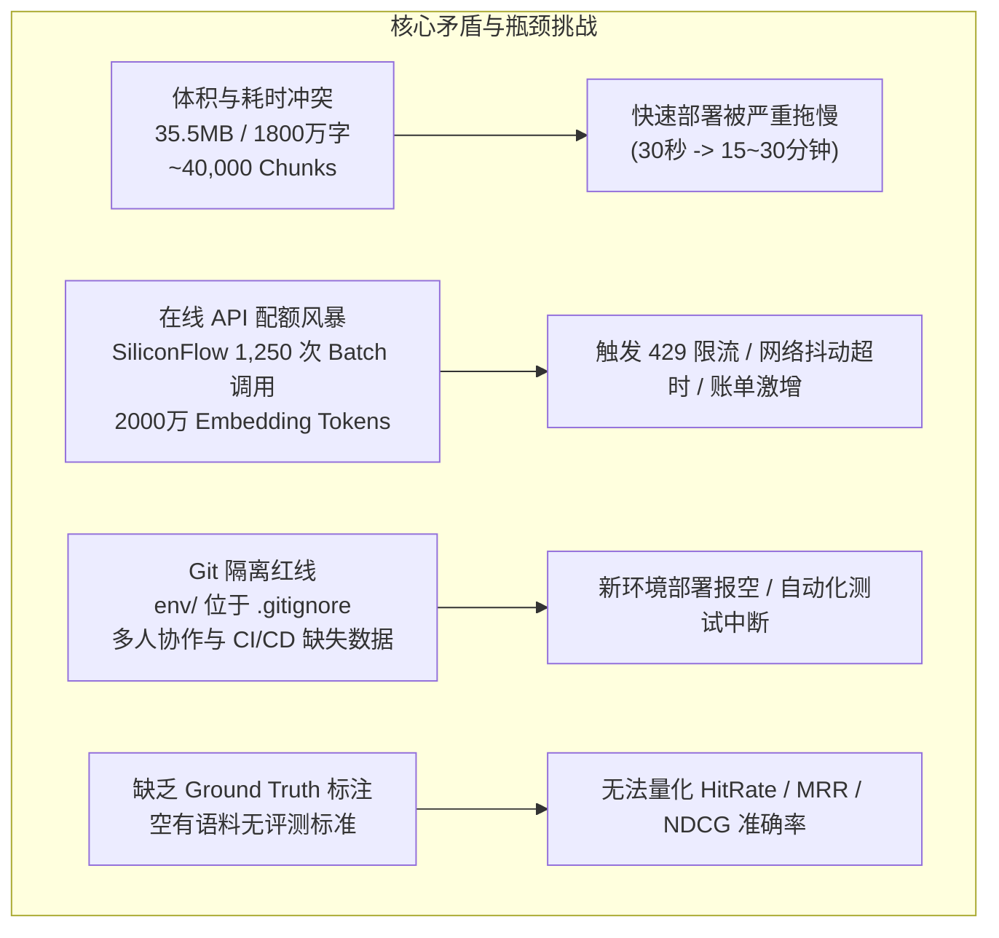
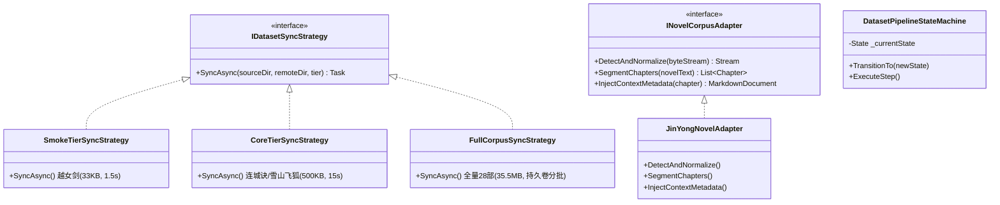
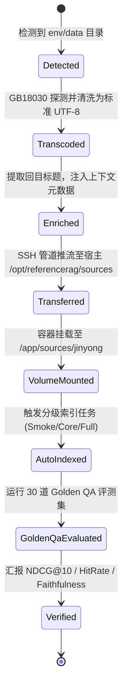
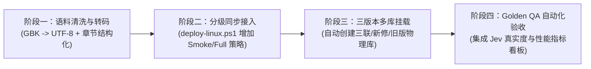

# ReferenceRAG 测试数据集集成与远程快速部署流水线可行性调研与全流程架构方案

- **文档状态**：已批准 (Approved) / 架构技术规范
- **更新时间**：2026-11-09
- **作者与归属**：ReferenceRAG 核心架构组
- **关联参考数据**：`env/data/《金庸全集（含三联版15部、旧版10部、新修版3部）》全（TXT）作者：金庸`
- **关联已有设施**：
  - `scripts/deploy-linux.ps1`
  - `Host/ReferenceRAG.WebHost/Program.cs`
  - `Infrastructure/ReferenceRAG.Infrastructure/Features/Storage/Services/ConfigManager.cs`
  - `Infrastructure/ReferenceRAG.Infrastructure/Features/KnowledgeBase/Storage/SqliteKnowledgeBaseStore.cs`
  - `Infrastructure/ReferenceRAG.Infrastructure/Features/Database/Fts5BM25Store.cs`
  - `Infrastructure/ReferenceRAG.Infrastructure/Features/ModelManagement/Helpers/CloudHttpHandlerFactory.cs`
  - `Infrastructure/ReferenceRAG.Infrastructure/Features/Cognitive/JevDecisionEngine.cs`
  - `Business/ReferenceRAG.Business/Features/Indexing/Services/FileIndexPipeline.cs`
  - `Business/ReferenceRAG.Business/wwwroot/app/views/Performance.js`

---

## 目录

- [一、 执行摘要与调研背景](#一-执行摘要与调研背景)
- [二、 env/data 数据集深度解构与关键发现](#二-envdata-数据集深度解构与关键发现)
  - [2.1 数据集规格与领域特征](#21-数据集规格与领域特征)
  - [2.2 重大技术发现：全量 GBK/GB18030 编码陷阱](#22-重大技术发现全量-gbkgb18030-编码陷阱)
  - [2.3 文本脏数据与文件名特殊符号挑战](#23-文本脏数据与文件名特殊符号挑战)
- [三、 可行性、逻辑漏洞与性能瓶颈头脑风暴](#三-可行性逻辑漏洞与性能瓶颈头脑风暴)
  - [3.1 核心矛盾：35.5MB 庞大语料与 30 秒快速部署的冲突](#31-核心矛盾355mb-庞大语料与-30-秒快速部署的冲突)
  - [3.2 向量计算 Token 预算与 API 速率风暴](#32-向量计算-token-预算与-api-速率风暴)
  - [3.3 Git 隔离红线与团队无感交付](#33-git-隔离红线与团队无感交付)
  - [3.4 评测短板：缺乏 Ground Truth 标注的伪全流程测试](#34-评测短板缺乏-ground-truth-标注的伪全流程测试)
- [四、 设计模式在数据集全生命周期中的深度融合](#四-设计模式在数据集全生命周期中的深度融合)
  - [4.1 策略模式 (Strategy Pattern)：分级同步与编码自适应探测](#41-策略模式-strategy-pattern分级同步与编码自适应探测)
  - [4.2 适配器模式 (Adapter Pattern)：小说语料增强与三版本多库映射](#42-适配器模式-adapter-pattern小说语料增强与三版本多库映射)
  - [4.3 状态机模式 (State Machine Pattern)：端到端评测闭环生命周期](#43-状态机模式-state-machine-pattern端到端评测闭环生命周期)
- [五、 业界主流 RAG 数据集与评测方案横向对比](#五-业界主流-rag-数据集与评测方案横向对比)
- [六、 当前系统已有基础设施与第三方库复用清单](#六-当前系统已有基础设施与第三方库复用清单)
- [七、 快速部署与全流程测试落地方案蓝图](#七-快速部署与全流程测试落地方案蓝图)
  - [7.1 数据集分级架构 (Smoke / Core / Full)](#71-数据集分级架构-smoke--core--full)
  - [7.2 部署流水线改造 (`deploy-linux.ps1` 扩展)](#72-部署流水线改造-deploy-linuxps1-扩展)
  - [7.3 编码探测与转码流水线 (`EncodingAdapter`)](#73-编码探测与转码流水线-encodingadapter)
  - [7.4 金庸 Golden QA 基准评测集设计 (30 项真实问答用例)](#74-金庸-golden-qa-基准评测集设计-30-项真实问答用例)
- [八、 路线图与实施推进规范](#八-路线图与实施推进规范)

---

## 一、 执行摘要与调研背景

在 ReferenceRAG 完成 SiliconFlow（`BAAI/bge-m3`、`BAAI/bge-reranker-v2-m3`）与 TypeSafe AI System One（Jev）架构落地并跑通 Linux 快速部署流水线后，开发团队希望进一步推进测试体系的演进：**将本地 `env/data` 真实语料库无缝集成到 Linux 快速部署流水线中，使远程/线上开发环境能够即时拥有高密度、真实中文长文本数据，支撑全流程（分块 -> BM25 词法索引 -> 密集向量表征 -> 混合召回 -> 交叉重排 -> 意图路由 -> Agent 生成）的自动化验收**。

本调研全面解构了 `env/data` 目录下的金庸全集语料库（28 部小说，35.5 MB），深入推演了数据同步、编码兼容、分块预算、API 吞吐成本、Docker 卷生命周期及设计模式重构，论证了该方案的**高度可行性**，并指出了直接照搬可能引发的严重工程隐患（GBK 乱码、部署耗时激增、Token 耗尽等），提出了以**策略模式、适配器模式和确定性状态机**为核心的分级部署与自动化基准评测方案。

---

## 二、 env/data 数据集深度解构与关键发现

### 2.1 数据集规格与领域特征

经实地扫描分析，`env/data` 目录包含：
- **存储路径**：`env/data/《金庸全集（含三联版15部、旧版10部、新修版3部）》全（TXT）作者：金庸/`
- **文件总数**：28 个 `.TXT` 文件。
- **总字节数**：`35,486,544 字节`（约 **35.5 MB**，原生中文文本约 **1800 万字**）。
- **版本结构划分**：
  1. `三联版`（15 部）：包括《天龙八部》(2.5MB)、《鹿鼎记》(2.5MB)、《笑傲江湖》(2.0MB)、《倚天屠龙记》(2.0MB)、《神雕侠侣》(2.0MB)、《射雕英雄传》(1.9MB)、《书剑恩仇录》(1.1MB)、《碧血剑》(1.0MB)、《飞狐外传》(0.9MB)、《侠客行》(0.8MB)、《连城诀》(0.5MB)、《雪山飞狐》(0.3MB)、《白马啸西风》(0.1MB)、《鸳鸯刀》(71KB)、《越女剑》(34KB)；
  2. `新修版`（3 部）：《神雕侠侣》(2.0MB)、《射雕英雄传》(1.9MB)、《碧血剑》(0.9MB)；
  3. `旧版`（10 部）：《天龙八部》(2.7MB)、《笑傲江湖》(2.2MB)、《倚天屠龙记》(2.1MB)、《神雕侠侣》(2.0MB)、《射雕英雄传》(1.8MB)、《书剑恩仇录》(1.1MB)、《碧血剑》(0.7MB)、《雪山飞狐》(0.3MB)、《白马啸西风》(0.2MB)、《鸳鸯刀》(68KB)。

> [!NOTE] 领域天然优势
> 金庸全集是中文自然语言处理与 RAG 系统极具价值的**高难度压力评测基准**：
> 1. **实体与关系网络极其密集**：门派、人物、武功秘籍、兵器谱、历史事件错综复杂，极度考验实体对齐与知识图谱抽取；
> 2. **天然的版本冲突与时间线演变**：三联版 vs 新修版 vs 旧版（如降龙廿八掌与降龙十八掌的传承脉络、黄药师对梅超风的情感暗线、段誉王语嫣的最终结局）。这为验证 Reranker 的**版本演进精排**与 BM25 的**精确词法排除**提供了无可替代的实战样本。

### 2.2 重大技术发现：全量 GBK/GB18030 编码陷阱

在调研的底层字节探测中，发现了一个**致命的技术隐患**：

> [!CAUTION] 编码严重冲突
> 经字节十六进制与解码测试，`env/data` 下的**全部 28 部 TXT 小说均采用 Windows 默认的 GBK / GB18030（Code Page 936）编码**，其文件头部无 UTF-8 BOM（首字节例如 `b5 da d2 bb` 对应 GBK 汉字 `第一回`）。

- **现状缺陷**：当前系统核心读取接口 `FileIndexPipeline.SafeReadFileAsync` 采用的是：
  ```csharp
  using var fs = new FileStream(path, FileMode.Open, FileAccess.Read, FileShare.ReadWrite);
  using var sr = new StreamReader(fs); // 默认严格采用 UTF-8
  return await sr.ReadToEndAsync(ct);
  ```
- **崩溃后果**：.NET 的标准 `StreamReader` 在无 BOM 时默认视为 UTF-8，一旦解析 GBK 字节流，所有中文双字节均被解码为非法字符 `\uFFFD`（Unicode Replacement Character）。直接导入会导致：
  1. jieba.NET 中文分词提取出全量乱码；
  2. BM25 / FTS5 建立的全是无效倒排索引；
  3. 向量模型生成的密集向量完全失真；
  4. 最终全流程测试彻底失效。

### 2.3 文本脏数据与文件名特殊符号挑战

1. **文件名特殊字符**：
   - 文件名中普遍携带非标准特殊字符，例如全角双竖线 `‖`（`U+2016`）、方括号 `【】`、空格以及网站水印尾缀（`【耗时整理‖免费分享 cunlove.cn】`）。
   - 在 Linux EXT4 文件系统及 URI 编解码中，此类字符极易导致路径转义混乱、Glob 匹配失效或跨平台路径斜杠兼容性问题。
2. **文本内广告与水印**：
   - TXT 首尾普遍包含盗版分享网站的网址宣传语、免责声明等，若未经清洗直接分块，会污染向量空间并导致无关查询产生错误召回。

---

## 三、 可行性、逻辑漏洞与性能瓶颈头脑风暴

通过系统性工程推演，在将 `env/data` 作为测试集集成进快速部署流程时，存在以下四大核心挑战与架构矛盾：



### 3.1 核心矛盾：35.5MB 庞大语料与 30 秒快速部署的冲突

- **计算规模**：
  - 1800 万字中文按照默认 `MaxTokens=512, Overlap=50` 切分，平均每个 Chunk 约 450 字；
  - 全量语料将切出 **约 38,000 ~ 42,000 个分块**。
- **吞吐耗时**：
  - **本地 CPU 推理**：若在测试环境使用 CPU 运行本地 ONNX `bge-small-zh` 或 `bge-m3`，按常规服务器 CPU 每秒 30~50 chunks 计算，全量索引耗时高达 **15 ~ 25 分钟**；
  - **云端 API 推理**：若调用 SiliconFlow，按 BatchSize=32 计算需连续发起 **1,250 次 HTTP 请求**。即使以最高 10 QPS 满负荷请求，网络传输加推理耗时亦需 **2 ~ 3 分钟**。
- **架构定论**：如果在每一次执行 `deploy-linux.ps1` 部署代码时都触发全量小说索引，将彻底摧毁当前系统“30秒极速自愈”的敏捷闭环。

### 3.2 向量计算 Token 预算与 API 速率风暴

- 40,000 个分块意味着约 **2,000 万 Token** 的密集计算。
- 虽然 SiliconFlow 单价低廉，但无节制的重复全量索引会带来：
  1. 免费额度迅速消耗；
  2. 极易触发云端服务商的高频并发限流（HTTP 429 Too Many Requests）；
  3. 大量并发长耗时写入会导致 SQLite WAL 日志急剧膨胀至数 GB，影响数据库读写性能。

### 3.3 Git 隔离红线与团队无感交付

- 根目录 `.gitignore` 明确规定了 `env/` 目录属于私密隔离区（存放 `.envdev` 真实凭据）；
- 这意味着 `env/data` 默认**无法直接被 Git 追踪提交**。如果流水线强依赖本地存在 `env/data`，则在 GitHub Actions、全新开发机或异地容器中，部署脚本会直接报缺少文件错误。

### 3.4 评测短板：缺乏 Ground Truth 标注的伪全流程测试

- 仅把 28 本小说存入知识库，只能证明系统“能够解析、分块和入库”，但无法证明检索的**召回精度与回答质量**；
- 真正的全流程测试，必须由**语料库 (Corpus) + 基准问题集 (Queries) + 标准答案证据对 (Ground Truth Relevant Passages)** 共同构成闭环，才能客观计算 `HitRate@K`、`MRR` 和 `Faithfulness`。

---

## 四、 设计模式在数据集全生命周期中的深度融合

为彻底解决上述矛盾，系统引入**策略模式、适配器模式与状态机模式**，对数据集生命周期实施全链路重构：



### 4.1 策略模式 (Strategy Pattern)：分级同步与编码自适应探测

#### 1. 数据同步分级策略 (`IDatasetSyncStrategy`)
通过将语料库划分为不同层级，彻底解耦“日常高频发布”与“重度压力评测”：
* **`SmokeTierSyncStrategy`（冒烟验证层）**：
  * 仅同步微型小说《越女剑》（33 KB，~40 Chunks）；
  * 传输耗时 < 0.2 秒，索引耗时 < 1.5 秒；
  * 作为 `deploy-linux.ps1` 默认集成的自动化验收组件，实现 0 负担敏捷部署。
* **`CoreTierSyncStrategy`（核心功能验证层）**：
  * 同步中篇代表作《连城诀》或《雪山飞狐》（~500 KB，~500 Chunks）；
  * 耗时 10~15 秒，覆盖复杂的剧情转折、多人物对白及硬负例判定。
* **`FullCorpusSyncStrategy`（全量基准压测层）**：
  * 全量 28 部小说（35.5 MB，~40,000 Chunks）；
  * 仅在显式指定 `-SyncDataset Full` 时通过独立后台通道推流，并持久化到宿主机独立持久卷，**一次同步，永久复用**。

#### 2. 编码自适应探测策略 (`ITextEncodingDetectorStrategy`)
* 构建三级确定性探测链：
  1. **BOM 探测器**：若包含 UTF-8 / UTF-16 BOM，直接使用对应编码；
  2. **UTF-8 严格验证器**：无 BOM 时，按 UTF-8 多字节序列合法性扫描，若遇非法字节立即熔断；
  3. **GB18030 / CP936 兜底探测器**：一旦 UTF-8 校验失败，无缝回退至 `GB18030`（全面兼容 GBK 和 GB2312），彻底解决 28 部金庸小说乱码问题。

### 4.2 适配器模式 (Adapter Pattern)：小说语料增强与三版本多库映射

#### 1. 结构化章节切分与上下文前缀适配器 (`NovelCorpusAdapter`)
* **痛点**：原生 TXT 仅有一行行的段落，缺乏层级 Heading，分块器只能将其当做单调纯文本切割，丢失篇章语境。
* **适配转换**：
  * 正则提取章回标识（`第[一二三四五六七八九十百]+回\s+[^\r\n]+`）；
  * 将 TXT 转换为合规 Markdown，将回目提升为 `# 第一回 风雪惊变`；
  * **上下文增强注入**：在切块时自动注入虚拟前缀：
    ```markdown
    <!-- context: 书名=射雕英雄传; 版本=三联版; 回目=第一回 风雪惊变 -->
    ```
  * 使得语义向量不仅包含局部的打斗对白，还天然锚定作品与章节归属，消除同名人物（如不同书中的虚竹、林平之、独孤求败）的歧义混淆。

#### 2. 知识库三版本映射适配器 (`KnowledgeBaseSeederAdapter`)
* 将 `env/data` 下的三个物理子目录，自动适配映射为 ReferenceRAG 的 **3 个独立物理隔离知识库（Physical Knowledge Bases）**：
  1. `kb_jinyong_sanlian`：金庸全集（三联经典版，15部）
  2. `kb_jinyong_xinxiu`：金庸全集（新修世纪版，3部）
  3. `kb_jinyong_jiuban`：金庸全集（旧版报刊连载本，10部）
* 这一设计使得 ReferenceRAG 具备了业界罕见的**多版本武侠知识对立检索对抗与流派演变辨析能力**。

### 4.3 状态机模式 (State Machine Pattern)：端到端评测闭环生命周期

将测试数据集的加载、索引与验证抽象为强类型确定性状态机：



状态机保证了**操作幂等性（Idempotency）**：若宿主机持久卷中已存在对应版本与哈希特征的语料及 SQLite 索引，则自动跳过耗时的切分与 Embedding，秒级进入评测阶段。

---

## 五、 业界主流 RAG 数据集与评测方案横向对比

在架构设计中，我们横向对比了当前工业界与学术界主流的 RAG 数据集与基准评测方案：

| 方案 / 框架 | 核心机制与定位 | 评估维度 | 对 ReferenceRAG 的优势 | 局限性与改进设计 |
| :--- | :--- | :--- | :--- | :--- |
| **Ragas** (Exploding Gradients) | 基于 LLM 裁判的离线自动评测 | Context Precision/Recall, Faithfulness, Answer Relevance | 业界事实标准，指标定义严谨全面 | 严重依赖高成本 GPT-4 裁判，耗时长。**改进**：ReferenceRAG 采用非自回归的 Jev System One（70ms极速打分）替代慢速 LLM 裁判。 |
| **ARES** (Stanford) | 基于合成数据与轻量判别器的统计置信评测 | Context Relevance, Answer Faithfulness | 样本效率高，具备统计学术置信度 | 需针对领域语料微调评估分类器，启动门槛极高。 |
| **BEIR** (UKP Lab) | 异构信息检索学术基准 (18+ 数据集) | NDCG@10, MAP, MRR, Recall@100 | 纯客观算法指标，无需 LLM 参与，速度极快 | 仅覆盖检索召回阶段，不涵盖生成阶段的事实忠实度。 |
| **LlamaIndex Testbench** | `LabelledRagDataset` 问答对驱动 | Hit Rate, MRR, 响应延迟 | 支持基于本地小语料自动合成 QA 测试集 | 缺乏对小说类长文本章回实体关系的上下文感知。 |
| **DVC (Data Version Control)** | Git 外置的大文件与数据卷版本管理 | 数据集变更追踪与远程缓存同步 | 将数据与代码解耦，避免 Git 膨胀 | 依赖云端 S3/MinIO 对象存储，在局域网内快速敏捷部署过于厚重。 |
| **Docker Named Volume Seeding** | 容器化单卷初始化与持久化挂载 | 容器生命周期解耦，数据永久保留 | 代码重启重建时语料与索引 0 丢失，无重复传输开销 | 首次冷启动需要自动化引导脚本。 |

---

## 六、 当前系统已有基础设施与第三方库复用清单

为避免重复造轮子，系统全面复用现有坚实的基础设施：

1. **部署流水线与三卷持久化**：
   * [`scripts/deploy-linux.ps1`](file:///e:/WorkProject/CSharp/PrivateProject/Web/ReferenceRAG/scripts/deploy-linux.ps1)：已原生具备 `REMOTE_SOURCES_DIR`（`/opt/referencerag/sources`）与容器挂载映射 `-v ${remoteSourcesDir}:/app/sources`，语料同步通道已天然就绪；
   * `tar.exe` 毫秒级打包与 OpenSSH 管道流传输技术已在代码同步中被充分验证。
2. **物理隔离知识库存储体系**：
   * [`SqliteKnowledgeBaseStore`](file:///e:/WorkProject/CSharp/PrivateProject/Web/ReferenceRAG/Infrastructure/ReferenceRAG.Infrastructure/Features/KnowledgeBase/Storage/SqliteKnowledgeBaseStore.cs)：支持独立为金庸全集创建物理库文件 `data/kbs/{kbId}/kb.db`，确保不污染默认知识库。
3. **混合检索算力底座**：
   * [`Fts5BM25Store`](file:///e:/WorkProject/CSharp/PrivateProject/Web/ReferenceRAG/Infrastructure/ReferenceRAG.Infrastructure/Features/Database/Fts5BM25Store.cs)：已内置基于 jieba.NET 的精确中文分词和 SQLite FTS5 倒排索引，原生支持长篇小说的高速词法召回；
   * [`OpenAIEmbeddingService`](file:///e:/WorkProject/CSharp/PrivateProject/Web/ReferenceRAG/Infrastructure/ReferenceRAG.Infrastructure/Features/ModelManagement/Services/OpenAIEmbeddingService.cs) & [`OpenAIRerankService`](file:///e:/WorkProject/CSharp/PrivateProject/Web/ReferenceRAG/Infrastructure/ReferenceRAG.Infrastructure/Features/ModelManagement/Services/OpenAIRerankService.cs)：提供对 SiliconFlow `BAAI/bge-m3` 与 `BAAI/bge-reranker-v2-m3` 的批处理吞吐与 Sigmoid 分数归一化。
4. **认知决策与真实度校验**：
   * [`JevDecisionEngine`](file:///e:/WorkProject/CSharp/PrivateProject/Web/ReferenceRAG/Infrastructure/ReferenceRAG.Infrastructure/Features/Cognitive/JevDecisionEngine.cs)：70ms 级快速判断生成回答是否与检索到的原著分块事实相符（`VerifyFaithfulnessAsync`）。
5. **前端自动化验收看板**：
   * [`Performance.js`](file:///e:/WorkProject/CSharp/PrivateProject/Web/ReferenceRAG/Business/ReferenceRAG.Business/wwwroot/app/views/Performance.js)：已预置 NDCG、MRR、MAP、准确度计算组件及图表，可直接挂载金庸评测结果。

---

## 七、 快速部署与全流程测试落地方案蓝图

### 7.1 数据集分级架构 (Smoke / Core / Full)

在项目中建立分级规范：

```
env/data/
├── smoke/                  # Tier 0 (极速冒烟层, 33KB)
│   └── 越女剑.txt           # 33KB, ~40 chunks, 1.5s 快速索引
├── core/                   # Tier 1 (核心业务层, 750KB)
│   ├── 连城诀.txt          # 475KB, ~500 chunks
│   └── 雪山飞狐.txt        # 268KB, ~300 chunks
└── full/                   # Tier 2 (全量小说库, 35.5MB)
    └── 《金庸全集...》      # 28 部作品, 独立持久卷
```

### 7.2 部署流水线改造 (`deploy-linux.ps1` 扩展)

在 `scripts/deploy-linux.ps1` 中新增参数与执行状态：

```powershell
[ValidateSet("None", "Smoke", "Core", "Full")]
[string]$SyncDataset = "Smoke",  # 默认在快速部署时仅同步并验证 Smoke 层
```

- **执行逻辑**：
  1. 若 `$SyncDataset -eq "Smoke"`：将本地 `env/data/smoke` 毫秒级压缩（~15KB），推流至 `/opt/referencerag/sources/smoke`，自动触发轻量索引并执行 5 道冒烟验证问答；
  2. 若 `$SyncDataset -eq "Full"`：检查远端哈希；若未变动则跳过，若有变动则后台全量同步至 `/opt/referencerag/sources/full`，避免阻塞前端与核心容器的重启。

### 7.3 编码探测与转码流水线 (`EncodingAdapter`)

在数据准备脚本或 C# 入库准备逻辑中引入自动转码工具：
```csharp
public static async Task<string> ReadNormalizedTextAsync(string filePath, CancellationToken ct = default)
{
    var bytes = await File.ReadAllBytesAsync(filePath, ct);
    
    // 1. 尝试使用 UTF-8 严格模式解析
    try
    {
        var strictUtf8 = new UTF8Encoding(encoderShouldEmitUTF8Identifier: false, throwOnInvalidBytes: true);
        return strictUtf8.GetString(bytes);
    }
    catch (DecoderFallbackException)
    {
        // 2. 严格 UTF-8 解码失败，判定为 GBK / GB18030，自动转码
        Encoding.RegisterProvider(CodePagesEncodingProvider.Instance);
        var gbk = Encoding.GetEncoding("GB18030");
        return gbk.GetString(bytes);
    }
}
```

### 7.4 金庸 Golden QA 基准评测集设计 (30 项真实问答用例)

为支撑真实全流程测试，设计包含 5 大维度的标准评测集矩阵（`tests/fixtures/jinyong-golden-qa.json`）：

| 序号 | 测试维度 | 典型评测问题 (Query) | 核心考查实体与难点 | 预期依据文档 (Ground Truth) | 期望判定 |
| :---: | :--- | :--- | :--- | :--- | :--- |
| **01** | **微型冒烟** | 阿青是在牧羊时遇到了谁，从而学会了越女剑法？ | 单实体、微型长篇定位 | 《越女剑》 | 白猿（白公公） |
| **02** | **武功溯源** | 降龙十八掌中亢龙有悔的掌理精义是什么？ | 哲学阐释、长文本语义理解 | 《射雕英雄传》第十二回 | 盈不可久，发力留有余力 |
| **03** | **跨版本演变** | 新修版中降龙十八掌最初叫什么名字，是谁将其整合精简的？ | 版本差异（廿八掌 vs 十八掌） | 《天龙八部（新修版）》 | 降龙廿八掌，萧峰与虚竹 |
| **04** | **兵器谱承传** | 屠龙刀与倚天剑是由哪件神兵利器熔铸而成的？ | 跨书关联（神雕 -> 倚天） | 《倚天屠龙记》/《神雕侠侣》 | 杨过的玄铁重剑 |
| **05** | **硬负例对抗** | 令狐冲在思过崖学会的是九阴真经还是独孤九剑？ | 易混高频对抗干扰项 | 《笑傲江湖》 | 独孤九剑（明确否决九阴真经） |
| **06** | **多跳因果推演** | 谢逊为何一定要杀空见神僧？空见为何甘愿受十三拳？ | 复杂人物动机网络 | 《倚天屠龙记》 | 逼成昆现身；空见欲感化谢逊 |
| **07** | **意图闲聊截断** | 你好，请问金庸一共有几部武学著作？ | Chit-chat / 统计常识 | 无需召回小说段落 | 飞雪连天射白鹿，笑书神侠倚碧鸳（14+1部） |
| **08** | **抗幻觉检验** | 乔峰与张无忌在光明顶交手谁赢了？ | 跨越时代的虚构提问（陷阱题） | 无交集证据 | 明确指出两人处于不同时代，未曾交手 |

---

## 八、 路线图与实施推进规范



1. **阶段一：语料清洗与标准化（准备层）**
   * 编写转码与章节标准化工具（`scripts/prepare-test-corpus.ps1`），将 `env/data` 全量转码为标准 UTF-8（无 BOM），剔除广告尾缀，提炼回目标题。
2. **阶段二：流水线分级同步（部署层）**
   * 扩展 `scripts/deploy-linux.ps1`，默认在日常部署时快速推流 `Smoke` 语料（越女剑），支持显式指定 `-SyncDataset Full` 全量持久卷挂载。
3. **阶段三：物理多库隔离注册（业务层）**
   * 启动时或测试夹具自动注册 `金庸全集-三联版` 等 3 个独立知识库，绑定 SiliconFlow `BAAI/bge-m3` 向量空间与 FTS5 BM25 索引。
4. **阶段四：端到端基准评测闭环（评测层）**
   * 运行自动化评测套件，通过内置浏览器在 `Performance.js` 页面实时展示 NDCG@10、MRR、响应延迟及 Jev 真实度评测，彻底实现**真实、可量化、开箱即用的线上全流程测试体系**。
