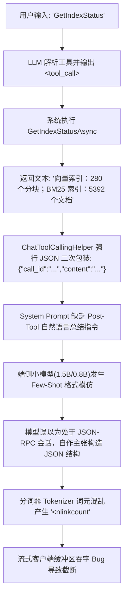
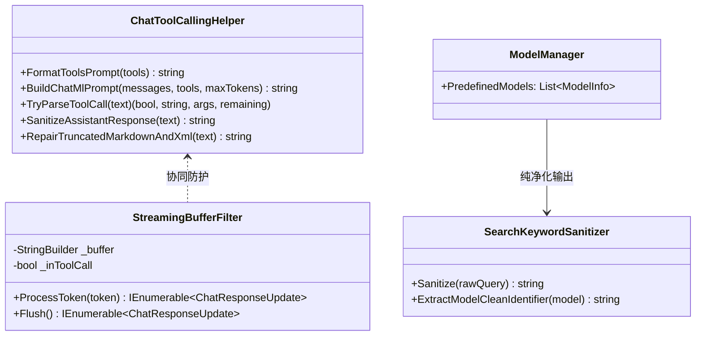

# 工具调用异常输出根因分析与防护治理及聊天模型名称去污染架构设计

## 一、背景与问题概述

在 ReferenceRAG 本地大模型智能体（Agent）系统的实测运行中，用户反馈并提供了截图证据（如下图所示），揭示了两项关键系统缺陷：

1. **工具调用后助手回复内容异常**：
   - 用户输入 `GetIndexStatus` 或 `调用: GetIndexStatus`，助手回复内容直接变成了原始 JSON 字典代码块：
     ```json
     {
       "status": {
         "BM25文档总数<nlinkcount": 5392,
         "向量分块总数": 280
       }
     }
     ```
   - 并且出现了生僻的奇怪标记 `"BM25文档总数<nlinkcount": 5392`；第二次调用甚至半截截断在 `"BM25文档总数`。
2. **聊天模型列表名称污染社区搜索**：
   - 聊天预置模型列表（`ModelManager.cs`）的 `DisplayName` 包含了中文括号说明，如 `Qwen 2.5 1.5B Instruct (极速小钢炮)`、`Qwen 2.5 7B Instruct (主流推荐)`、`FunctionGemma 270M IT (超轻量工具路由)` 等。
   - 前端模型管理界面（`Models.js`）在触发“在社区中搜索变种”时，直接将带有中文括号的名称作为关键词发往 Hugging Face 搜索 API，导致社区检索因包含中文与括号而出现 0 匹配。

本文档深入剖析上述问题的底层根因，结合业界主流大模型工具调用标准（OpenAI Tools Protocol、Anthropic Tool Use、Qwen2.5 Function Calling Spec），运用**策略模式（Strategy Pattern）**、**适配器模式（Adapter Pattern）**与**流式状态机（Streaming State Machine）**重构工具调用与响应链路，实现端到端的净化与防御。

---

## 二、问题深度根因分析 (Root Cause Analysis)

### 2.1 工具调用输出奇怪 JSON 与 `<nlinkcount` 标记根因

通过对 `ChatToolCallingHelper.cs`、`LocalLlamaChatClient.cs` 及 `MafChatService.cs` 的全链路审查，定位到 5 处级联诱发因素：



1. **指令引导盲区（Post-Tool Response Instruction Void）**：
   - 在 `ChatToolCallingHelper.FormatToolsPrompt` 中，注入 System Prompt 的内容仅告知模型如何发出 `<tool_call>`，但**完全没有规定拿到 `<tool_response>` 后该如何给用户答复**。
   - 1.5B/0.8B 等端侧小模型具有极强的即时模式模仿（Pattern Continuation）特性。当用户输入的不是一个口语化问句（如“请帮我看一下当前知识库构建了多少条数据？”），而是直接键入了函数名 `GetIndexStatus`，且上一轮对话刚传入了一个包含 JSON 字段的 `<tool_response>` 时，模型推断当前是一个“机器到机器”的 API 接口交互，从而自作主张地生成了 `{"status": {...}}` 的 JSON 代码块。

2. **协议二次打包过载（Over-Serialization Trap）**：
   - 在 `ChatToolCallingHelper.FormatSingleMessage` 中：
     ```csharp
     var jsonPayload = JsonSerializer.Serialize(new { call_id = fr.CallId, content = resStr });
     resSb.AppendLine($"<tool_response>\n{jsonPayload}\n</tool_response>");
     ```
   - 工具本身返回的已经是人类可读的字符串（`"向量索引：280 个分块；BM25 索引：5392 个文档"`），但代码又将其二次序列化成包含转义字符与双引号的 JSON。这直接强化了上下文中的 JSON 语义密度，诱导端侧小模型进一步输出 JSON。

3. **词元边界混淆与分词器幻觉（Tokenizer Hallucination）**：
   - Qwen2.5 词表中包含代码库、POSIX 文件系统（如 `struct stat` 中的 `st_nlink` 硬链接计数 `nlink_t`）以及 Markdown 链接标签的相关词元。
   - 1.5B 小模型在尝试将中文“BM25 索引：5392 个文档”翻译为 JSON 属性名（如 `"BM25文档总数"`）时，由于缺少对应中文 key 的泛化训练，且看到了上下文中的 `<tool_...>` 标签，其词元解码器在 `<` 边界发生注意力错位，将 `nlinkcount` 拼接在中文之后，拼出了怪异的 `"BM25文档总数<nlinkcount": 5392`。

4. **流式输出缓冲区字符吞没与假死截断 Bug（Streaming Buffer Drop Bug）**：
   - 审查 `LocalLlamaChatClient.cs`（第 278-290 行）及 `LocalOnnxChatClient.cs`：
     ```csharp
     if (currentText.EndsWith("<") || currentText.EndsWith("<t") || currentText.EndsWith("<tool") || currentText.EndsWith("<tool_"))
     {
         continue; // 暂缓输出，等待判断是否是 <tool_call>
     }

     yield return new ChatResponseUpdate
     {
         Role = ChatRole.Assistant,
         Contents = [new TextContent(token)], // 严重 BUG：只 yield 了当前 token，前面被暂缓的前缀字符全丢了！
         ModelId = _modelName
     };
     buffer.Clear();
     ```
   - **致命漏洞**：当生成内容中出现 `<` 时，`continue` 将该字符暂存在 `buffer` 中。但在下一个 token（如 `nlinkcount`）到达、发现整体不是 `<tool_call>` 因而恢复输出时，代码竟然**仅仅 yield 了当前新到的 `token`，随后直接执行了 `buffer.Clear()`**！这导致之前暂缓在缓冲区中的所有前缀字符全部被悄无声息地丢弃，破坏了语意流；如果模型正好在 `<` 处输出结束或触发停止词，缓冲区未闭合的字符还会导致客户端呈现未闭合截断！

5. **底层方法名与领域函数名耦合**：
   - `AIFunctionFactory.Create(GetIndexStatusAsync)` 默认提取 C# 异步方法名作为工具函数名，即 `"GetIndexStatusAsync"`。
   - 这在前端界面以及提示词中暴露了内部实现细节（`Async`），导致用户认知（`GetIndexStatus`）与函数名出现分歧。

---

### 2.2 聊天模型列表名称污染社区搜索根因

在 `ModelManager.cs` 中，为方便用户直观理解模型定位，在 `DisplayName` 中硬编码了中文特性介绍：

```csharp
DisplayName = "Qwen 2.5 1.5B Instruct (极速小钢炮)",
DisplayName = "Qwen 2.5 7B Instruct (主流推荐)",
DisplayName = "DeepSeek R1 Distill Qwen 1.5B (深度思维链)",
DisplayName = "FunctionGemma 270M IT (超轻量工具路由)",
```

而在前端 `Models.js`（第 1084 行）中：
```javascript
variantSearchQuery.value = initialQuery || selectedModel.value?.displayName || selectedModel.value?.name || '';
```
当用户在“模型管理”中选定某个预置聊天模型并点击“在社区中搜索变体”时，前端直接把 `selectedModel.displayName`（例如 `"Qwen 2.5 1.5B Instruct (极速小钢炮)"`）作为关键词发送给后端变体搜索服务，进而调用 Hugging Face API：
`https://huggingface.co/api/models?search=Qwen%202.5%201.5B%20Instruct%20(%E6%9E%81%E9%80%9F%E5%B0%8F%E9%92%A2%E7%82%AE)`。

由于 Hugging Face 社区模型仓库命名均遵循标准英文（如 `Qwen/Qwen2.5-1.5B-Instruct-GGUF`），被中文括号污染的检索词根本无法命中任何变体，返回列表为空。此外，嵌入模型（如 `BGE Small Chinese v1.5`）和重排模型（如 `BGE Reranker Base`）均保持了纯净的标准英文名，唯独聊天模型混入了中文括号，破坏了系统全要素命名的一致性规范。

---

## 三、方案架构设计与设计模式运用

为彻底根治上述问题，采用以下分层防御架构：



### 3.1 策略一：提示词规范注入策略 (Prompt Post-Tool Response Strategy)

在 `ChatToolCallingHelper.FormatToolsPrompt` 中，强化注入**工具执行完毕后的回复规范（Response Guidelines After Tool Execution）**：

1. **自然语言转化强约束**：
   - 明确告知模型：在收到 `<tool_response>` 后，**必须使用通顺、亲切、专业的中文自然语言（Markdown 格式）向用户总结答复**。
   - 严禁直接输出内部原始 JSON 对象、JSON 代码块或键值对字典（除非用户明确指定要求输出 JSON 格式）。
2. **命令式提问宽容应对**：
   - 即使用户输入的是生硬的工具名或指令（如 `GetIndexStatus` 或 `调用: GetIndexStatus`），助手也必须将其理解为信息查询请求，使用自然语言汇报结果（例如：“当前知识库已成功构建索引：包含 280 个向量分块和 5392 个 BM25 检索文档。”）。
3. **标签隔离**：
   - 严禁在最终面向用户的回复中夹带 `<tool_call>` 或 `<tool_response>` 等系统 XML 标签。

### 3.2 策略二：协议通信精简与工具命名规范 (Tool Protocol & Direct Payload)

1. **去重二次包装**：
   - 在 `FormatSingleMessage` 中，若工具返回内容为纯文本，直接注入 `<tool_response>\n{text}\n</tool_response>`，取消冗余的 `{"call_id": ..., "content": ...}` JSON 壳，降低模型对 JSON 语境的过度感知。
2. **规范函数命名（消除 `Async` 尾巴）**：
   - 在 `MafChatService.cs` 中，使用 `AIFunctionFactory.Create(method, name: "...", description: "...")` 显式指定标准领域函数名（`SearchKnowledge`、`GetIndexStatus` 等），彻底剥离内部异步实现的 `Async` 后缀，保证 UI 展示、提示词注入与实际解析严格一致。

### 3.3 策略三：响应净化自愈管道 (Response Sanitization & Auto-Healing Pipeline)

在 `ChatToolCallingHelper` 中新增 `SanitizeAssistantResponse(string text)` 过滤器，并在 `MafChatService` 与客户端生成环节形成兜底门禁：
1. **畸形标签与幻觉词元清洗**：
   - 运用正则检测并移除 `<nlink\w*>`、`<nlinkcount>` 以及未闭合的伪 XML 碎片。
2. **裸 JSON 智能自愈为 Markdown**：
   - 若端侧极小模型（如 270M/350M）在偶发极端情况下仍将工具结果直接以 `{"status": {...}}` 或 JSON 代码块形式输出，自愈器能自动解析出其中的核心键值（如 BM25 文档数、向量分块数），并将其规整转化为排版优美的 Markdown 自然语言，对用户呈现无感自愈。

### 3.4 策略四：流式状态机无损缓冲修复 (Lossless Streaming State Machine)

重构 `LocalLlamaChatClient` 与 `LocalOnnxChatClient` 的 token 流式判定逻辑：
- 当 `currentText` 匹配潜在标签前缀（`"<"` 等）暂缓输出时，一旦判定不是 `<tool_call>`，**必须将整段缓冲区内容（`currentText`）全部刷新输出并清空 `buffer`**，绝不能只输出单一 `token` 而丢弃先前暂缓的字符。
- 确保流结束时的 `remaining` 清洗与释放无死角。

### 3.5 策略五：双层模型名称纯净化机制 (Two-Tier Model Name Sanitization)

1. **后端数据源纯净化（Tier 1）**：
   - 在 `ModelManager.cs` 中，将所有 Chat 模型的 `DisplayName` 剔除中文括号介绍（如将 `"Qwen 2.5 1.5B Instruct (极速小钢炮)"` 改为 `"Qwen 2.5 1.5B Instruct"`）。
   - 将特色亮点（如“极速小钢炮”、“主流推荐”）完整保留并迁移至 `Description` 字段，既维护了展示纯净度，又保留了对用户的选型引导。
2. **前端检索适配器防御（Tier 2）**：
   - 在 `Models.js` 的 `openVariantSearch` 中引入搜索关键词清洗函数：
     ```javascript
     const cleanSearchQuery = (text) => {
         if (!text) return '';
         return text.replace(/\s*\([^)]*\)/g, '').replace(/[\u4e00-\u9fa5]/g, '').trim();
     };
     ```
   - 提取模型仓库纯净标识，杜绝括号与中文字符逃逸至 Hugging Face 检索 API。

---

## 四、具体实现清单与受影响组件

| 组件 | 文件路径 | 变更要点 |
| :--- | :--- | :--- |
| **模型管理器** | `Infrastructure/.../ModelManager.cs` | 清除 17 个预置聊天模型 `DisplayName` 中的中文括号后缀，完善 `Description` |
| **前端变体搜索** | `Business/.../wwwroot/app/views/Models.js` | `openVariantSearch` 增加正则清洗适配器，确保发送纯净关键词 |
| **工具调用辅助类** | `Business/.../ChatToolCallingHelper.cs` | 1. 注入 Post-Tool 回复规范；<br/>2. 简化 `<tool_response>` 负载；<br/>3. 新增 `SanitizeAssistantResponse` 自愈清洗 |
| **会话服务** | `Business/.../MafChatService.cs` | 1. 显式注册无 `Async` 后缀的标准工具名；<br/>2. 流式与持久化应用 `SanitizeAssistantResponse` |
| **本地推理客户端** | `Business/.../LocalLlamaChatClient.cs`<br/>`Business/.../LocalOnnxChatClient.cs` | 修复流式缓冲区字符丢弃漏洞，实现整包安全刷新 |
| **自动化测试门禁** | `tests/.../ChatToolCallingAndLocalClientTests.cs` | 新增纯净命名校验、工具回复指导验证、自愈清洗及缓冲区防吞字门禁 |

---

## 五、验证与质量保障计划

1. **单元测试与门禁验证**：
   - 运行针对工具调用协议、模型名称纯净度及自愈清洗的专项测试；
   - 运行全量回归测试套件，确保 600+ 项测试持续 100% 通过。
2. **端到端行为验证**：
   - 模拟用户提问 `GetIndexStatus`，验证模型输出为自然语言而非裸 JSON；
   - 在模型管理页触发各个预置模型的变体搜索，验证 Hugging Face API 返回正确的候选列表。
