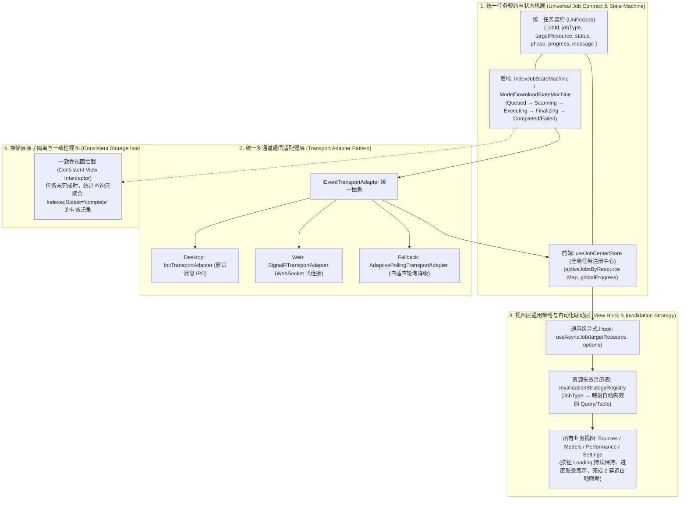

# 通用端到端异步任务与响应式状态同步框架设计方案
(Unified Async Jobs & Reactive State Synchronization Framework)

## 1. 背景与核心痛点

在 ReferenceRAG 系统中，存在大量长耗时或异步生命周期任务：
- **切片与索引构建**：增量索引、源重建切片（Rechunk）、全量向量重建（Full Rebuild）、向量补全（VectorOnly）。
- **模型与硬件管理**：Embedding/Reranker 模型下载、权重校验、格式转换（GGUF/ONNX）、GPU 内存卸载与加载。
- **系统维护与基准测试**：孤立索引数据清理（Cleanup）、噪声分块清理、语义检索评测、性能压测。

此前这些异步任务缺乏全局统一的状态治理与刷新机制，导致以下四个系统性断层：

```
[用户触发] ──POST──> [API 返回 202 Accepted] ──> (请求生命周期终结)
                             │
                             ▼ (后台漫长执行)
               [扫描] ──> [准备] ──> [推理 Embedding] ──> [收尾清理] ──> [完成]
                             │                 │
                             │                 ▼ (瞬态暴露)
                             │       [新旧数据并存: 1,140条]
                             │                 │
                             ▼ (UI 完全不知情)     ▼ (用户盲等并手动刷新)
           [前端按钮 loading 提前消失]    [用户误以为数据翻倍/泄露]
```

### 四大核心断层剖析
1. **控制反转断层（Command vs State Disconnect）**：
   前端发送 `POST` 请求，后端仅在毫秒级内返回 `202 Accepted`（仅表示加入队列），前端在收到 202 后立即结束按钮的 Loading 状态并弹出提示，给用户造成“操作已瞬间完成”的严重错觉。
2. **状态感知断层（Lack of Ubiquitous Job Bus）**：
   任务在后台经历漫长的推理（通常耗时几秒到数分钟），业务页面（如 `Sources.vue`、`Models.vue`）没有统一订阅任务生命周期，不知道后台何时完成，用户只能凭感觉“盲等”。
3. **刷新联动断层（Manual Invalidation Requirement）**：
   后台真正达到 `Completed` 终态后，没有统一的“资源缓存失效与自动重载”机制，必须强依赖用户人工去点“刷新”按钮。
4. **瞬态暴露断层（Transitional State Leaks）**：
   在蓝绿更替（如写入新切片但尚未删除旧切片）过程中，底层的统计接口直接执行了 `SELECT COUNT(*)`，暴露出未完成阶段的混合瞬态（例如 913 + 227 = 1,140 条），引发用户对数据泄露或无限增长的担忧。

---

## 2. 架构设计全景

本框架通过 **状态机模式（State Machine）**、**通信适配器模式（Transport Adapter）**、**依赖失效策略模式（Strategy Pattern）** 构建一个通用的端到端异步任务生命周期治理体系：



---

## 3. 详细设计与核心组件规范

### 3.1 统一任务契约（Universal Job Contract）

无论是索引构建、切片重构、模型下载还是清理维护，统一采用标准化任务定义：

```typescript
// 前后端统一的异步任务结构体
export interface UnifiedJob {
    jobId: string;
    jobType: 'Rechunk' | 'Incremental' | 'FullRebuild' | 'VectorOnly' | 'ModelDownload' | 'Cleanup' | 'SemanticBenchmark';
    
    // 资源标识符，格式为 "命名空间:具体名称"，例如 "source:新建文件夹", "model:Qwen3-Embedding-0.6B", "system:cleanup"
    targetResource: string;
    
    // 核心生命周期状态
    status: 'Queued' | 'Running' | 'Completed' | 'Failed' | 'Cancelled';
    
    // 阶段与可读进度
    phase: string;             // 如 "Scanning", "Preparing", "Embedding", "Finalizing"
    progressPercent: number;   // 0.0 ~ 100.0
    currentMessage: string;    // 如 "正在计算向量 150/227"
    
    startedAt: string;
    completedAt?: string;
    error?: string;
}
```

后端 C# 对应契约位于 `ReferenceRAG.Core.Models.UnifiedJob`，并通过标准事件广播推送：
* `JobStarted(UnifiedJob)`
* `JobProgress(UnifiedJob)`
* `JobCompleted(UnifiedJob)`

---

### 3.2 统一多通道通信适配器（Transport Adapter Pattern）

由于系统同时支持 **桌面端（Photino 进程内 IPC）** 与 **Web 端（ASP.NET Core SignalR）**，且需要应对弱网或长连接断开场景，设计通用通信适配器：

```javascript
// core/transport/UniversalTransportAdapter.js
export class UniversalTransportAdapter {
    constructor() {
        this.listeners = new Map(); // eventName -> Set<callback>
        this.fallbackTimer = null;
    }

    // 自动探测宿主环境并连接
    async initialize() {
        if (window.__PHOTINO_IPC__) {
            this.mode = 'DesktopIPC';
            this.setupDesktopIpc();
        } else {
            this.mode = 'SignalR';
            await this.setupSignalR();
        }
    }

    // 自动重连与降级轮询机制
    startPollingFallback(resource, onTick) { ... }
}
```

**适配器核心能力**：
1. **协议透明**：视图层无需关心是 IPC 还是 WebSocket；
2. **故障自愈**：长连接断开时，自动激活 `AdaptivePollingTransportAdapter`（按 1s -> 2s 探测状态），恢复后自动切回推送通道；
3. **断点状态恢复**：前端页面刷新或切换路由后，初始化时自动拉取 `GET /api/jobs/active`，恢复当前正在运行的任务状态与进度。

---

### 3.3 自动依赖失效策略模式（Auto-Invalidation Strategy Pattern）

建立任务类型与界面依赖数据的映射注册表。任务完成后，框架自动驱动对应资源进行刷新，**视图代码中不再需要手动写 `loadSources()` 或 `loadVectorIndex()`**：

```javascript
// core/jobs/InvalidationStrategyRegistry.js
export const InvalidationStrategyRegistry = {
    // 任务类型 -> 对应需要失效并自动重新加载的资源标签
    Rechunk: ['sources', 'vector_index', 'dashboard_stats'],
    Incremental: ['sources', 'vector_index', 'dashboard_stats'],
    FullRebuild: ['sources', 'vector_index', 'dashboard_stats'],
    VectorOnly: ['vector_index', 'dashboard_stats'],
    ModelDownload: ['models_list', 'model_status', 'cuda_availability'],
    Cleanup: ['vector_index', 'sources', 'dashboard_stats'],
};
```

当收到任意任务的 `JobCompleted` 事件时：
1. 查找对应的资源失效标签；
2. 触发全局事件总线 `refreshResource(tag)`；
3. 正在展示该资源的活跃视图自动执行静默重载，完成界面的毫秒级瞬时同步。

---

### 3.4 视图层极简集成 Hook（`useAsyncJob`）

在业务组件中，将原本分散在数十处、充斥着 `loading` 状态、`try...catch`、`finally` 与手动刷新的样板代码彻底简化为通用声明式 Hook：

```javascript
// 在任意 Vue 视图中使用 (如 Sources.js / Models.js)
import { useAsyncJob } from '/core/jobs/useAsyncJob.js';

// 声明切片重建操作
const { isRunning, progress, phase, runJob } = useAsyncJob({
    targetResource: () => `source:${source.name}`,
    action: () => indexApi.rechunkSource(source.name),
    successMessage: `数据源 "${source.name}" 切片与向量重建已全量生效！`
});
```

**Hook 自动处理的完整闭环**：
1. **触发命令**：调用 `runJob()`，自动拦截重复点击（防抖/锁住按钮）；
2. **状态绑定**：按钮自动呈现 Loading 态与进度百分比（如 `重建切片 (54%)`）；
3. **阶段监听**：通过通用状态中心实时更新 `phase` 与 `progress`；
4. **终态刷新**：后端完成广播到达后，触发失效策略自动静默刷新表格，弹出成功通知，平滑释放 Loading 状态。

---

### 3.5 存储层一致性视图拦截（Consistent View Filter）

针对“写入新向量、清理旧向量”期间统计接口暴露 1,140 瞬态的问题，在后端存储与统计层增加快照隔离策略：

```csharp
// SqliteVectorStore.cs 统计查询优化
public async Task<List<VectorStats>> GetVectorStatsAsync(...)
{
    // 策略：统计向量总数时，仅聚合所属文件状态为 IndexedStatus = 'complete' 的分块关联向量
    // 当文件正处于 'pending' (即正在重构/写入中) 时，只统计上一版本的有效快照或排除正在写入的未提交批次
}
```
* **效果**：即使后台正在将 227 条新向量逐步写入库中，前端发起的任何常规统计查询依然返回稳定版本，直到收尾事务提交（Phase 3 完成并标记 `complete`）瞬间，数字从 913 一跳变为 227，**彻底消除中间多余瞬态值的暴露**。

---

## 4. 实施阶段与落地方案

| 阶段 | 核心任务 | 交付物 |
| :--- | :--- | :--- |
| **阶段 1：后端契约与事件总线** | 1. 规范化统一任务契约 `UnifiedJob` 与广播事件<br/>2. 后端统计接口加入 `IndexedStatus` 瞬态一致性过滤 | `UnifiedJob.cs`<br/>`IndexEventPublisher.cs`<br/>`SqliteVectorStore.cs` 统计隔离 |
| **阶段 2：前端通信适配器与注册中心** | 1. 封装 `UniversalTransportAdapter`（抹平 IPC / SignalR / 轮询降级）<br/>2. 建立全局 `useJobCenterStore`（管理活跃任务与断点恢复） | `core/transport/UniversalTransportAdapter.js`<br/>`app/stores/jobCenter.js` |
| **阶段 3：自动失效策略与组合式 Hook** | 1. 实现 `InvalidationStrategyRegistry`（声明式资源刷新映射）<br/>2. 封装通用 `useAsyncJob` 组合式 Hook | `core/jobs/InvalidationStrategyRegistry.js`<br/>`core/jobs/useAsyncJob.js` |
| **阶段 4：业务视图全面接入与验证** | 1. `Sources.vue` 全面重构接入（单源重建、全局重建、向量补全）<br/>2. `Models.vue` 接入模型下载与切换<br/>3. 编写回归自动化测试 | 业务页面接入<br/>端到端任务联动测试用例 |

---

## 5. 预期收益与架构价值

1. **彻底根治“假完成与盲等”**：按钮 Loading 持续跟随真正的后台物理进度，用户一目了然当前正在跑哪个阶段（扫描、切片、推理、收尾）。
2. **彻底消灭“手动刷新”**：后台收尾事务一旦提交，前端毫秒级自动重载最新数据，零多余等待。
3. **杜绝“瞬态数字误导”**：蓝绿替换过程对外部统计透明隔离，再也不会出现 1,140 这类让人困惑的中间叠加数字。
4. **后续开发零样板代码**：后续新增任何长耗时功能（如新模型格式转换、外部知识库导入等），直接复用 `useAsyncJob` 与失效策略，无需重复编写事件监听和轮询。
