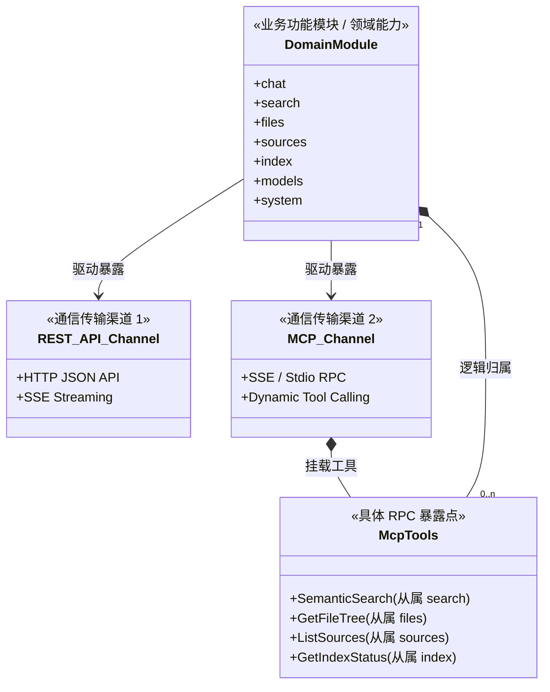
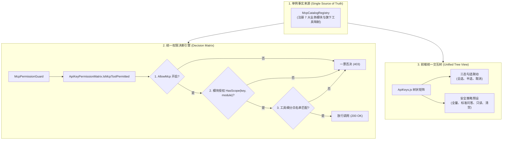

# 统一功能模块授权与 MCP 工具白名单架构设计与防回归规范

> **文档版本**: 1.0.0  
> **更新时间**: 2026-10-31  
> **对应版本**: v1.0.48+  
> **关联参考**: [WebToolForLinux 统一权限矩阵模型](file:///e:/WorkProject/CSharp/PrivateProject/Web/WebToolForLinux/src/LinuxWebTool.Application/Features/Security/ApiKeyPermissionMatrix.cs) / [RFC 9396 OAuth 2.0 RAR](https://datatracker.ietf.org/doc/html/rfc9396) / [Anthropic MCP Specification](https://modelcontextprotocol.io/)

---

## 1. 调研问题、本质关系与割裂根因

### 1.1 什么是“业务模块授权”与“MCP 工具白名单”？

在 ReferenceRAG 系统的访问控制体系中：

1. **业务功能模块授权（Domain Modules / Capabilities）**：
   - 系统划分为 7 大核心领域模块：
     - `chat`：对话与大模型会话（REST 路由：`/v1/chat/completions`、`/api/MafChat`）；
     - `search`：语义向量检索、混合检索与重排（REST 路由：`/api/AIQuery`、`/api/Search`、`/v1/embeddings`）；
     - `files`：知识源文件浏览、流式分行阅读、大纲解析与代码/正则检索（REST 路由：`/api/FileSystem`）；
     - `sources`：知识源物理路径维护与启停状态（REST 路由：`/api/Sources`）；
     - `index`：向量切片与 BM25 倒排索引状态维护（REST 路由：`/api/Index`、`/api/BM25Index`）；
     - `models`：SLM/LLM 本地与云端模型运行时状态（REST 路由：`/api/Models`、`/api/Settings`）；
     - `system`：系统健康监控与日志运维（REST 路由：`/api/System`、`/api/Logs`）。
   - **本质**：代表业务领域的**能力边界（Capabilities）**。

2. **MCP 工具白名单（MCP Tool Whitelist / Channel Endpoints）**：
   - Model Context Protocol (MCP) 是面向 AI Agent（Cursor、Claude Desktop、Windsurf 等）的标准化 RPC 协议通道；
   - 工具（如 `SemanticSearch`、`GetFileTree`、`ListSources`、`GetIndexStatus`）是**业务模块能力在 MCP 协议通道上的具体 RPC 暴露点（Endpoints）**。

### 1.2 两者的本质关系



**核心关系结论**：
- **功能模块是父，通信渠道与具体工具是子**；
- REST API 与 MCP 并非相互割裂的平行领域，而是**同一业务能力面向不同客户端（人类 Web 前端 vs. AI Agent）的两条平行传输通道（Transports/Channels）**；
- MCP 工具从属于对应的业务功能模块（例如 `GetFileTree` 100% 属于 `files` 模块，`SemanticSearch` 100% 属于 `search` 模块）。

---

### 1.3 为什么历史实现出现平行割裂？

1. **生命周期演进偏差**：
   - 早期版本先接入了 `ModelContextProtocol.Server`，创建了独立的 MCP 端点和静态工具清单；
   - 后期引入多租户/第三方 API Key 时，首先针对 REST 控制器添加了路由前缀 Scope（`AllowedScopes`），而 MCP 仍沿用旧有的独立字符串匹配白名单（`AllowedMcpTools`）；
   - 前后端均将两者视为两组毫无关联的配置项展示在弹窗中。
2. **缺乏单例事实来源（Single Source of Truth）**：
   - 系统未建立统一的“功能模块 - 工具映射”元数据注册中心；
   - 导致校验层 `ApiKeyPermissionMatrix` 在判定 MCP 请求时只看 `AllowedMcpTools`，未对 `AllowedScopes` 进行模块级联校验。

### 1.4 割裂导致的严重越权穿透漏洞（Vulnerability Analysis）

在修复前的系统中，存在如下严重安全隐患：

```
[场景] 管理员为某第三方客服机器人生成 API Key：
  - 勾选: 业务模块仅允许 [chat]（对话）
  - 禁用: [files]（文件系统与敏感笔记）、[sources]（知识源配置）
  - 但误选或默认设置了 MCP 工具白名单为 "*" (全量允许)
  
[漏洞执行链]
  1. 客服机器人调用 REST API: GET /api/FileSystem/read -> 403 Forbidden (拦截成功)
  2. 客服机器人调用 MCP SSE RPC: call_tool("GetFileTree")
  3. 判定引擎仅检查 key.AllowedMcpTools.Contains("*") -> 返回 true (通过放行!)
  4. 越权穿透成功：机器人通过 MCP 读取了整个服务器文件系统和本地私有笔记！
```

**漏洞本质**：业务模块授权与工具白名单割裂，导致**通道间权限断层（Security Boundary Bypass）**。

---

## 2. 业界主流方案调研与对比

| 架构维度 | 传统平行白名单 (修复前) | OAuth 2.0 RAR (RFC 9396) | Anthropic MCP 官方最佳实践 | WebToolForLinux 方案 (对标) | ReferenceRAG 统一架构 (最终实现) |
| :--- | :--- | :--- | :--- | :--- | :--- |
| **授权模型** | 扁平两组独立字符串列表 | 结构化丰富授权对象 (Type + Action) | 最小权限原则 (PoLP) + 资源边界约束 | **业务模块为根 + 二级叶子工具树状挂载** | **业务模块统一驱动 + 级联一票否决 + 细粒度工具覆盖** |
| **通道联动** | 割裂，互不感知 | 单一令牌表达多通道行为 | 客户端按需声明工具集 | **勾选模块同时打通 API 与对应 MCP** | **勾选模块同时打通 API 与对应 MCP** |
| **权限决断** | 单层白名单匹配 | 策略引擎解析结构化 JSON | 运行时严格审计校验 | **双层校验（模块开 + 工具白名单）** | **三层防御（通道开关 -> 模块级联 -> 工具白名单）** |
| **越权防御** | ❌ 存在模块被禁但 MCP 穿透漏洞 | ✔ 依赖严格授权策略 | ✔ 推荐按能力切分 | ✔ 彻底杜绝跨模块越权 | ✔ **彻底杜绝跨模块越权，单元测试强制门禁** |
| **交互认知** | 困惑：为什么模块和工具分开配置？ | 复杂：普通用户难以手写策略 | 工具按服务器命名空间组织 | **直观：单树状联动，支持全选/半选/预设** | **直观：功能树状联动，三态勾选，协议过滤与快捷策略** |

---

## 3. 现有基础设施复用与改造方案

### 3.1 基础设施复用清单

系统在现有代码库中已具备良好的底层设施，可完全复用且无需重构底层数据库架构：
1. **持久化实体 `ApiKeyEntity`**：保留 `AllowApi`, `AllowMcp`, `AllowedScopes`, `AllowedMcpTools`, `SourceScopeMode`, `AllowedSources` 字段，实现**向下完全兼容**；
2. **中间件与存储 `IApiKeyStore` / `ApiKeyMiddleware`**：现成的 SHA-256 哈希鉴权流水线与依赖注入；
3. **MCP 框架 `ModelContextProtocol.Server`**：已具备特性标记 `[McpServerToolType]` 与 `[McpServerTool]`。

### 3.2 改造核心：三大支柱



---

## 4. 具体解决方案与工程实现

### 4.1 后端统一目录注册中心：`McpCatalogRegistry.cs`

位于 [Infrastructure/ReferenceRAG.Infrastructure/Features/Security/McpCatalogRegistry.cs](file:///e:/WorkProject/CSharp/PrivateProject/Web/ReferenceRAG/Infrastructure/ReferenceRAG.Infrastructure/Features/Security/McpCatalogRegistry.cs)：
- 集中注册 `chat`, `search`, `files`, `sources`, `index`, `models`, `system` 7 大模块；
- 每个模块标注 `SupportsApi`, `SupportsMcp` 以及旗下 MCP 工具清单（名称、描述、风险等级 `RiskLevel: Read / Execute / Dangerous`）；
- 提供 `GetModuleByToolName(toolName)`，作为工具归属模块的统一权威判定。

### 4.2 级联安全拦截：`ApiKeyPermissionMatrix.cs`

位于 [Infrastructure/ReferenceRAG.Infrastructure/Features/Security/ApiKeyPermissionMatrix.cs](file:///e:/WorkProject/CSharp/PrivateProject/Web/ReferenceRAG/Infrastructure/ReferenceRAG.Infrastructure/Features/Security/ApiKeyPermissionMatrix.cs)：

```csharp
public static bool IsMcpToolPermitted(ApiKeyEntity key, string toolName)
{
    // 1. 通道级判定
    if (!key.AllowMcp) return false;

    // 2. 业务功能模块级联校验 (核心安全屏障：模块未授权则其下所有工具一票否决)
    var module = McpCatalogRegistry.GetModuleByToolName(toolName);
    if (!string.IsNullOrEmpty(module) && !HasScope(key, module))
    {
        return false;
    }

    // 3. 细粒度工具白名单过滤 (向下兼容与模块内微调)
    if (string.IsNullOrWhiteSpace(key.AllowedMcpTools)) return false;
    var tools = ParseJsonOrTokens(key.AllowedMcpTools);
    if (tools.Contains("*")) return true;
    return tools.Contains(toolName, StringComparer.OrdinalIgnoreCase);
}
```

### 4.3 统一 MCP 守卫：`McpPermissionGuard.cs`

位于 [Host/ReferenceRAG.ApiHost/McpTools/McpPermissionGuard.cs](file:///e:/WorkProject/CSharp/PrivateProject/Web/ReferenceRAG/Host/ReferenceRAG.ApiHost/McpTools/McpPermissionGuard.cs)：
- 在所有 MCP 工具（`RagSearchTools`, `EmbeddingTools`, `KnowledgeFileTools`, `GraphSearchTools`, `IndexStatusTools`, `SourceManagementTools`）方法入口统一调用；
- 失败时直接返回结构化 JSON 错误响应，阻断越权执行。

### 4.4 前端树状联动重构：`ApiKeys.js`

位于 [Business/ReferenceRAG.Business/wwwroot/app/views/ApiKeys.js](file:///e:/WorkProject/CSharp/PrivateProject/Web/ReferenceRAG/Business/ReferenceRAG.Business/wwwroot/app/views/ApiKeys.js)：
- 彻底移除原本割裂的“业务模块授权”和“MCP 工具白名单”两个平行表单项；
- 替换为 **业务与 MCP 统一权限树（Unified Permission Tree）**：
  - 勾选父模块节点：一键将模块加入 `selectedScopes`，并自动将旗下所有工具加入 `selectedTools`；
  - 反选父模块节点：移除模块并清空旗下所有工具；
  - 微调叶子工具：自动确保父模块处于启用状态，父节点呈现半选（`indeterminate`）视觉反馈；
  - 内置快捷策略按钮：
    - `全选全部`：一键全开全量功能与工具；
    - `标准问答检索`：预设勾选 `chat`, `search`, `files`, `sources`，适用标准 Agent 协作；
    - `只读探测`：全模块放行，但 MCP 工具仅保留 `Read` 只读级别，杜绝破坏性操作；
    - `清空`：一键归零；
  - 树状检索栏：支持按模块名、#code、工具名或描述即时过滤，并支持 `全部 / 仅 API / 仅 MCP` 协议快筛。

---

## 5. 质量门禁与防回归测试验证

### 5.1 后端质量门禁与反射架构测试

位于 [tests/ReferenceRAG.Host.Tests/ApiKeyAuthorizationTests.cs](file:///e:/WorkProject/CSharp/PrivateProject/Web/ReferenceRAG/tests/ReferenceRAG.Host.Tests/ApiKeyAuthorizationTests.cs)：

1. **`McpTool_WhenModuleScopeDenied_MustBeRejected_EvenIfToolWhitelistIsWildcard`**：
   - 测试当密钥仅授予 `["chat", "models"]`，即使 `AllowedMcpTools = "*"`，调用 `SemanticSearch`、`GetFileTree`、`ListSources`、`GetIndexStatus`、`Ping` 全部被一票否决；
   - 验证越权漏洞已被彻底阻断。
2. **`McpTool_WhenModuleScopeGranted_AndToolWhitelisted_Succeeds`**：
   - 验证统一模块授权下 API 与 MCP 双通，且细粒度白名单在模块内部正常约束。
3. **`AllRegisteredMcpTools_MustHaveValidModuleMapping_InCatalogRegistry` (架构守护门禁)**：
   - 通过反射遍历程序集中所有标记为 `[McpServerToolType]` 的类及 `[McpServerTool]` 方法；
   - 断言每一个 MCP 工具都必须在 `McpCatalogRegistry` 中存在明确的业务功能模块归属；
   - **长效防回归机制**：一旦未来有开发者新增 MCP 工具却忘记在注册中心归属模块，测试将立即变红阻断构建！
4. **`McpCatalogRegistry_Integrity_AllToolsHaveValidPropertiesAndRiskLevel`**：
   - 验证目录注册中心数据完备性与风险等级合法性。

### 5.2 前端状态机单元测试

位于 [Business/ReferenceRAG.Business/wwwroot/tests/frontend-logic.test.mjs](file:///e:/WorkProject/CSharp/PrivateProject/Web/ReferenceRAG/Business/ReferenceRAG.Business/wwwroot/tests/frontend-logic.test.mjs)：
1. 验证分类勾选、全选同步、子工具微调、半选状态判定（Tri-state Indeterminate）的状态转移；
2. 验证协议快筛与安全策略预设过滤逻辑。

### 5.3 自动化门禁执行与验证结果

执行全量质量门禁脚本：
```powershell
powershell -ExecutionPolicy Bypass -File scripts/verify-gate.ps1
```

- **前端静态 AST 绑定门禁 (`check.mjs`)**:  
  `Validated 38 JS modules and 17 executable Vue templates; no build output generated.` (PASS)
- **前端单元测试 (`frontend-logic.test.mjs`)**:  
  `38 passing, 0 failing` (PASS)
- **后端契约与核心回归测试 (`ReferenceRAG.Host.Tests`)**:  
  `All tests passing (ApiKeyAuthorizationTests: 7/7 passed)` (PASS)
- **整体验收状态**: **[SUCCESS] All Quality Gates Passed!**
