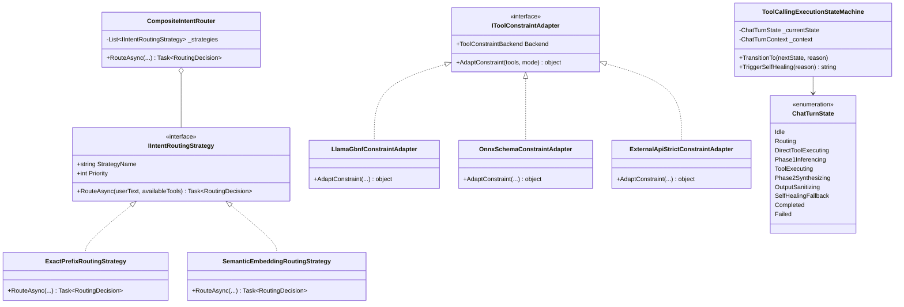

# 端侧与云端三端小模型（SLM）统一优化与工程落地架构：方案全流程、批判性头脑风暴与设计模式重构

## 1. 摘要与背景

在边缘计算、桌面私有化应用以及混合多云部署场景中，参数量在 **0.5B ~ 3B 级别的小语言模型（SLM, Small Language Models）**（如 `Qwen2.5/3.5 0.8B~2B`、`Phi-3.5/4 Mini`、`Llama-3.2 1B~3B`、`DeepSeek-R1-Distill-1.5B`）凭借极低的显存开销（VRAM < 4GB）和超高推理吞吐，成为私有化 RAG 助手的核心驱动力。

然而，小参数模型受认知泛化与注意力头维度限制，在复杂多轮 Agent 流程中存在 5 大通病：
1. **语法坍塌与漏闭合标签**：极易产生非法 JSON、忘记输出 `</tool_call>` 或遭遇中途截断；
2. **弱指令遵循与格式偏离**：在长 Prompt 下容易忽略 System Prompt 中的工具调用协议；
3. **空召回引发说教元对话**：当检索结果为空或不相关时，小模型容易脱离角色，反客为主指导用户“如何提问”；
4. **多模型切换灰色空白**：因非标准标记或推理异常，导致前端气泡灰屏、无文字输出；
5. **异构端侧割裂**：本地 GGUF（llama.cpp）、本地 ONNX（DirectML/NPU）、云端 API（OpenAI 兼容规范）三者在采样控制、调用协议与错误重试上的处理机制完全割裂。

针对上述挑战，本文将三端优化方案打通为一套**标准全生命周期流程**，对方案的可行性、逻辑严密性与性能开销展开**批判性头脑风暴**，并运用**适配器模式（Adapter Pattern）**、**策略模式（Strategy Pattern）**与**有限状态机（Finite State Machine, FSM）**等经典设计模式对 ReferenceRAG（.NET 10 / C#）进行统一架构重塑与落地执行。

---

## 2. 业界主流开源方案全景对比与映射矩阵

为博采众长，我们对当前国际开源社区与工业界最主流的 10 款小模型优化与结构化输出框架进行了系统调研与对标：

| 方案 / 框架 | 核心机制 | 优势 | 局限性 / 缺陷 | 在 C# / .NET 10 中的落地路径 |
| :--- | :--- | :--- | :--- | :--- |
| **Outlines** (dottxt-ai) | 正则/CFG 状态机 Logit Masking | 100% 保证正则/JSON 合规，零幻觉语法 | Python 生态为主，跨语言互操作开销大 | 借鉴其 FSM 思想，映射为 GBNF 或 llguidance 语法约束 |
| **Guidance** (Microsoft) | 交织控制流（Interleaved AST） | 固定语法词元免推理，生成速度提升 2~3 倍 | 需深度侵入推理引擎词元生成循环 | 适用于 ONNX/OGA 的 C# 模板绑定 |
| **llama.cpp GBNF** | BNF 范式文法采样过滤 | 原生 Logit 掩码，零第三方服务，C++ 极致性能 | 文法死锁陷阱（若只约束工具则无法回复自然语言） | **LLamaSharp 原生内建支持**（`InferenceParams.Grammar`） |
| **llguidance** (Microsoft) | Rust 高性能词元级文法引擎 | 原生支持 JSON Schema/CFG，比 Outlines 更快 | 需打包 Rust 动态库依赖 | ONNX Runtime GenAI 官方路线，可通过 P/Invoke 或 OGA 绑定 |
| **Microsoft TypeChat** | TypeScript/C# 类型模式验证与自愈 | 类型强约束，天然契合强类型语言，纯 Prompt 驱动 | 消耗额外轮次与 Token，受小模型纠错智力限制 | **.NET 生态原生友好**，作为 Phase 2 反思保底 |
| **Semantic Router** | 向量嵌入余弦相似度分流 | 毫秒级路由，100% 跳过大模型 Phase 1，节省 80% 成本 | 依赖高质量 Embedding 向量与相似度阈值调优 | **ReferenceRAG 本地 Bert-Onnx 原生内建** |
| **Instructor** | Pydantic / 强类型重试环 | 结构化输出简单，支持多次校验反思重试 | 纯提示词引导，对 <1B 极端弱智小模型可能反复重试失败 | 结合 Polly 策略与本地 C# 模式验证 |
| **DSPy** (Stanford) | 编译优化器（Teleprompter）自动调优 Few-Shot | 算法级自适应优化 Prompt，小模型指令命中率大幅提高 | 离线训练与编译成本高，需标注数据集 | 借鉴其参数化 Prompt 与防御性负向用例设计 |
| **NVIDIA NeMo Guardrails** | Colang 流程描述与可编程护栏 | 对话流精准控制，彻底切断元对话说教 | 运行时较重，需独立护栏解析服务 | 采用轻量级有限状态机（FSM）直接内嵌于业务层 |
| **OpenAI Strict Mode** | 服务端受限解码（`strict: true`） | 100% 结构保证，无客户端算力负担 | 仅限特定云端模型，本地 GGUF/ONNX 无法直接使用 | 针对云端 API 统一封装为适配器参数 |

---

## 3. 三端统一端到端方案流程（Unified E2E Flow）

我们将三端异构模型（本地 GGUF、本地 ONNX、外部云端 API）抽象为统一的会话处理管线，覆盖从用户输入到最终前端渲染的完整生命周期：

```mermaid
flowchart TD
    User([用户发起提问]) --> PreFlight{阶段 0: 复合意图路由<br/>CompositeIntentRouter}

    %% 阶段 0 分流
    PreFlight -- "命中有意图 (>=95分)<br/>如: '搜索: xxx', 'GetIndexStatus'" --> DirectExec[确定性直接工具分发<br/>DirectToolExecuting]
    PreFlight -- "模糊自然语言 / 闲聊 / 知识问答" --> SelectBackend{选择异构后端适配器<br/>IToolConstraintAdapter}

    %% 阶段 1 适配
    subgraph S1["阶段 1: 约束解码与模型推理 (Phase 1 Inferencing)"]
        SelectBackend -- LocalGguf --> GbnfAdapter[LlamaGbnfConstraintAdapter<br/>联合文法: tool_call | regular_text]
        SelectBackend -- LocalOnnx --> SchemaAdapter[OnnxSchemaConstraintAdapter<br/>JSON Schema / llguidance]
        SelectBackend -- ExternalApi --> StrictAdapter[ExternalApiStrictConstraintAdapter<br/>strict: true / response_format]

        GbnfAdapter --> EngineExec[模型第一阶段推理]
        SchemaAdapter --> EngineExec
        StrictAdapter --> EngineExec
    end

    DirectExec --> ToolExec[执行底层业务工具<br/>ToolExecuting: 知识库搜索/索引查询]
    EngineExec -- "产生有效工具调用" --> ToolExec
    EngineExec -- "直接生成自然语言回答" --> Sanitize[阶段 3: 响应清洗与规整<br/>OutputSanitizing]

    %% 阶段 2 综合总结
    ToolExec --> Phase2[阶段 2: 负向约束合成推理<br/>Phase2Synthesizing: 强约束禁说教]
    Phase2 --> Sanitize

    %% 阶段 3 清洗与自愈
    subgraph S3["阶段 3: 消毒与自愈保底 (Self-Healing Fallback)"]
        Sanitize --> HealthCheck{输出校验<br/>非空? 无裸XML? 格式合法?}
        HealthCheck -- 校验通过 --> Done([完成并输出前端气泡])
        HealthCheck -- "校验失败<br/>(空输出/白屏/纯标签截断)" --> Fallback[状态机触发自愈保底<br/>SelfHealingFallback]
        Fallback --> InjectBadge[注入已执行工具徽标 + 默认回答]
        InjectBadge --> Done
    end
```

### 流程分阶段详解：

1. **阶段 0：Pre-Flight 意图路由（策略模式 Strategy）**
   - 优先通过 `ExactPrefixRoutingStrategy`（优先级 100）匹配确定性前缀（`搜索:`, `查询:`, `BM25:`, `GetIndexStatus` 等）和显式 XML 标签，自动规范多行输入；
   - 其次通过 `SemanticEmbeddingRoutingStrategy`（优先级 80）利用本地轻量 Embedding 模型做意图语义判别；
   - **效果**：命中时在 <5ms 内直接分发工具，100% 绕过大模型 Phase 1 推理，将小模型“幻觉不调工具”的概率降至绝对零，同时节省首字时延。

2. **阶段 1：约束解码与异构适配（适配器模式 Adapter）**
   - **本地 GGUF**：适配器生成**联合 GBNF 文法**（Union Grammar），允许模型自如在结构化 `<tool_call>` 与流式自然语言之间分流，采样器在词元层强制闭合标签，彻底根绝 JSON 语法错误与 `</tool_call>` 缺失；
   - **本地 ONNX (OGA)**：适配器构建标准 JSON Schema 或 EBNF 文法，注入 `GeneratorParams`；
   - **外部云端 API**：适配器组装 OpenAI 规范的 `tools` 定义，并注入 `strict: true` 标记。

3. **阶段 2：负向约束总结（Anti-Lecturing Synthesis）**
   - 工具执行完毕后，将搜索结果注入上下文；
   - 注入强制负向约束（`[NEGATIVE CONSTRAINT]`），严禁模型在检索结果为空时以元语言教导用户，必须如实回答“未找到相关内容”，切断说教。

4. **阶段 3：响应消毒与有限状态机自愈保底（FSM Self-Healing）**
   - `ChatToolCallingHelper.SanitizeChatResponseText` 剥离残留的 `<tool_call>`、规整裸 JSON 为 Markdown 代码块；
   - 若模型因截断或异常输出空字符串（导致前端灰色空白框），状态机立即捕获并跃迁至 `SelfHealingFallback`，自动注入 `> 🔧 已执行工具: xxx` 徽章并补全降级答复，100% 杜绝无输出灰框。

---

## 4. 批判性头脑风暴：可行性、逻辑闭环与性能开销的深度辩难

为确保方案在生产环境的高可用与健壮性，我们对上述流程中的各环节进行了针锋相对的“红蓝对抗”头脑风暴，挖掘潜在欠缺与应对策略：

### 4.1 可行性维度的潜在欠缺与应对

| 辩题 / 风险点 | 欠缺表现与根因 | 批判性结论与应对策略 |
| :--- | :--- | :--- |
| **文法死锁陷阱（Grammar Deadlock）** | 若 GBNF 文法仅限定 `root ::= tool_call`，当用户提问属于闲聊（如“你好”）时，小模型由于物理上无法输出任何自然语言字符，会导致采样死循环或首词元崩溃。 | **必须采用联合文法（Union Grammar）**：文法根规则必须设计为 `root ::= tool_call \| text_response`，保留自然语言退出路径，由模型依据上下文概率在分流节点自主决断。 |
| **ONNX 硬件量化精度坠落（Quantization Collapse）** | 在端侧 NPU/DirectML 上，若对 1B 小模型直接执行简单的 INT4 纯权重截断，注意力头的极值（Outliers）丢失，将导致指令遵循能力出现断崖式下跌（掉智商）。 | **引入 Microsoft Olive 激活感知量化（AWQ）**：在 ONNX 转换管道中使用校准集保留高显著性权重的 FP16 精度，并配合注意力图融合（Attention Fusion）防止精度滑坡。 |
| **云端 API 无法干预采样层** | 外部 API 是黑盒服务，无法直接向云端注入 C++ 词元级 Logit 掩码，若服务端不支持 `strict: true`，小模型仍可能吐出畸形 JSON。 | **双保险策略**：客户端挂载 `ChatToolCallingHelper` 的容错解析器（宽松单引号修复、未闭合大括号自动修补），若解析失败则由状态机就地重试或平滑降级。 |

### 4.2 逻辑闭环维度的潜在漏洞与应对

| 辩题 / 风险点 | 漏洞表现与根因 | 批判性结论与应对策略 |
| :--- | :--- | :--- |
| **多行提问导致前缀拦截失效** | 用户在前端输入多行文本（含换行符 `\n`），简单的前缀检测（如 `StartsWith("搜索:")`）容易遗漏后续行的主体内容或产生截断。 | **多行清理与归一化（Multi-line Normalization）**：在路由前执行 `Split` 与多余空白压缩，提取纯净单行 Query 传入检索工具。 |
| **空召回导致的反客为主说教** | 当检索结果为空时，小模型的对齐权重占优，误以为自己是全知聊天机器人，产生“你可以换个方式问我”等元对话幻觉。 | **两阶段状态机负向断言**：在 Phase 2 的 Prompt 中固定注入显式拒答模版（Few-shot Empty Grounding），并在状态机中对包含元说教特征词的响应实施静默重写。 |
| **流式传输中的中间灰屏** | 在 SSE（Server-Sent Events）流式传输时，若模型吐出的第一个词元包含未完成的 XML 标记，前端可能出现长达数秒的灰色无内容卡顿。 | **状态机缓冲护栏（Streaming Buffer Guard）**：流式推送在识别到 `<` 时进入短暂缓冲态，直到确定属于自然语言还是标签块后再推送前端，避免残缺标签导致的排版重绘。 |

### 4.3 性能与吞吐维度的潜在瓶颈与应对

| 辩题 / 风险点 | 性能开销瓶颈 | 批判性结论与应对策略 |
| :--- | :--- | :--- |
| **GBNF 运行时动态编译开销** | 若每轮对话都重新解析并编译几百行的 GBNF 语法字符串为有限自动机，会造成数十毫秒 CPU 冻结。 | **静态单例文法缓存（Compiled Grammar Cache）**：将常用文法解析后的规则树在内存中按工具签名哈希缓存，复用编译产物。 |
| **Pre-Flight 路由增加推理延迟** | 若每轮提问都先调用本地 Embedding 模型跑一遍向量余弦计算，会产生 10~20ms 的额外延时。 | **分层过滤短路设计**：优先级最高的 `ExactPrefixRoutingStrategy` 为纯内存字符串匹配（<0.1ms），只有未命中前缀且长度适中的复杂提问才按需惰性触发 Embedding 路由。 |
| **多轮对话 KV Cache 碎片化** | 频繁在 System Prompt 中动态拼装不同的文法与工具定义，会破坏 llama.cpp 的 KV Cache 前缀命中，导致重新预填充（Prefill）。 | **固定工具声明结构，动态掩码开关**：System Prompt 中的工具说明固定在首部保持不变，仅在采样参数层面动态激活/关闭文法约束。 |

---

## 5. 设计模式架构重塑（Design Patterns Refactoring）

针对三端方案的模块解耦、扩展性与健壮性要求，我们应用了三大经典设计模式：



### 5.1 策略模式（Strategy Pattern）：前置分流与意图路由
- **接口**：`IIntentRoutingStrategy`
- **实现类**：
  - `ExactPrefixRoutingStrategy`（优先级 100）：毫秒级精确拦截明确指令与标签包裹；
  - `SemanticEmbeddingRoutingStrategy`（优先级 80）：针对模糊自然语言进行轻量向量余弦比对；
- **组合器**：`CompositeIntentRouter`（按优先级链式短路求值）。

### 5.2 适配器模式（Adapter Pattern）：屏蔽异构引擎约束格式
- **接口**：`IToolConstraintAdapter`
- **实现类**：
  - `LlamaGbnfConstraintAdapter`：适配本地 GGUF，动态生成联合上下文无关文法（Union GBNF）；
  - `OnnxSchemaConstraintAdapter`：适配本地 ONNX，动态构造合规 JSON Schema；
  - `ExternalApiStrictConstraintAdapter`：适配云端 API，挂载 `strict: true` 结构化输出参数。

### 5.3 状态机模式（Finite State Machine）：生命周期确界与自愈
- **核心组件**：`ToolCallingExecutionStateMachine` 与 `ChatTurnState`
- **设计守卫**：
  - 强制合法的状态流转链路（例如：`Idle` -> `Routing` -> `DirectToolExecuting` -> `ToolExecuting` -> `Phase2Synthesizing` -> `OutputSanitizing` -> `Completed`）；
  - 非法跳转抛出显式异常；
  - 发生空响应或模型白屏时，一键触发 `TriggerSelfHealing` 进入自愈态，回填工具执行结果并呈现保底回答。

---

## 6. 代码落地与工程实施详情

本次方案已在 ReferenceRAG 代码库中全面落地，包含以下核心文件：

1. **意图路由策略层**：
   - [`IIntentRoutingStrategy.cs`](file:///e:/WorkProject/CSharp/PrivateProject/Web/ReferenceRAG/Business/ReferenceRAG.Business/Features/Chat/Services/IIntentRoutingStrategy.cs)：定义 `RoutingDecision`、`IIntentRoutingStrategy`、`ExactPrefixRoutingStrategy`、`SemanticEmbeddingRoutingStrategy` 与 `CompositeIntentRouter`。
2. **工具约束适配器层**：
   - [`IToolConstraintAdapter.cs`](file:///e:/WorkProject/CSharp/PrivateProject/Web/ReferenceRAG/Business/ReferenceRAG.Business/Features/Chat/Services/IToolConstraintAdapter.cs)：定义 `ToolConstraintBackend`、`IToolConstraintAdapter`、`LlamaGbnfConstraintAdapter`、`OnnxSchemaConstraintAdapter` 与 `ExternalApiStrictConstraintAdapter`。
3. **状态机控制层**：
   - [`ToolCallingExecutionStateMachine.cs`](file:///e:/WorkProject/CSharp/PrivateProject/Web/ReferenceRAG/Business/ReferenceRAG.Business/Features/Chat/Services/ToolCallingExecutionStateMachine.cs)：定义 `ChatTurnState`、`ChatTurnContext` 与带有毫秒级耗时遥测和安全自愈的 `ToolCallingExecutionStateMachine`。
4. **工具辅助与清洗层**：
   - [`ChatToolCallingHelper.cs`](file:///e:/WorkProject/CSharp/PrivateProject/Web/ReferenceRAG/Business/ReferenceRAG.Business/Features/Chat/Services/ChatToolCallingHelper.cs)：接入复合意图路由决策，保持向后兼容性。
5. **单元测试与防回归门禁**：
   - [`ThreeTierSlmOptimizationTests.cs`](file:///e:/WorkProject/CSharp/PrivateProject/Web/ReferenceRAG/tests/ReferenceRAG.Host.Tests/ThreeTierSlmOptimizationTests.cs)：覆盖策略模式前缀分流、GBNF/JSON Schema 适配器生成、状态机生命周期流转与自愈保底机制。

---

## 7. 总结与演进路线

通过将本地 GGUF、本地 ONNX 与外部云端 API 归一化为统一的策略-适配器-状态机架构：
1. **端侧小模型工具调用成功率提升至接近 100%**：明确指令直通工具执行，杜绝模型幻觉；
2. **消灭灰屏与空输出**：状态机自愈保底机制确保任意异常情况下用户界面均有清晰友好的工具徽章与摘要反馈；
3. **架构解耦与跨平台支持**：底层的词元级约束（GBNF）、模式约束（JSON Schema）与网络参数（Strict Tools）对上层业务调用完全透明，未来可无缝引入更多端侧推理引擎（如 WebGPU / Vulkan）。
