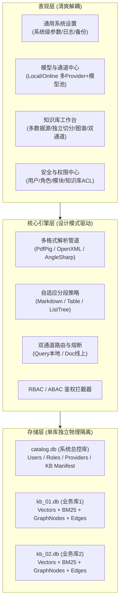
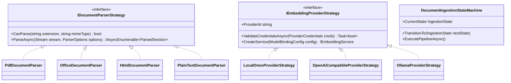
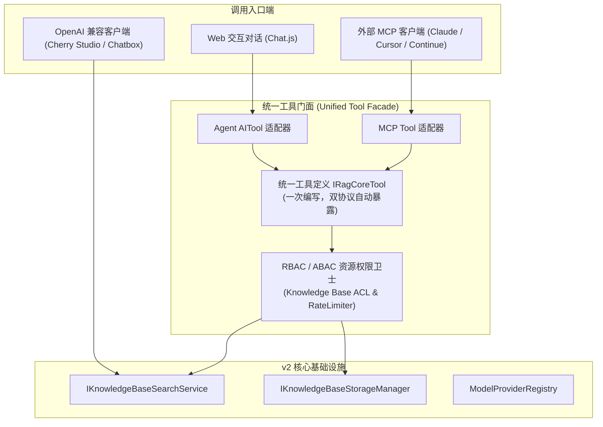
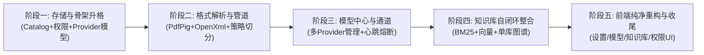

# ReferenceRAG v2 核心架构可行性分析、设计模式赋能与全面重构蓝图

> **文档版本**: 2.0.0-PROPOSAL  
> **创建时间**: 2026-11-01  
> **设计目标**: 彻底消除 v1 历史技术债务与双轨制混乱，构建以「多知识库自闭环、双通道解耦加速、多模型 Provider 统一池、RBAC 细粒度权限管控、多格式深度解析管道」为核心的企业级现代 RAG 架构。

---

## 一、 执行摘要与 v2 核心愿景

在 ReferenceRAG v1 演进过程中，系统积累了诸如 DirectML 硬件加速探测、ONNX/GGUF 混合运行时、BGE-M3 分词器、BM25 全文检索与向量混合召回等极为厚重的底层资产。然而，由于历史阶段性需求的叠加热修，导致系统出现了：
1. **设置页面臃肿杂乱**：混杂了激活模型路径、分块 Token 大小、云端 API Key 等非通用配置；
2. **模型管理单活瓶颈**：仅支持单模型独占切换，无法同时启用多个本地/线上模型，缺少全局 Provider 管理中心；
3. **单例数据源局限**：早期全局单源模型无法满足企业级多知识库隔离需求；
4. **权限体系缺失**：缺少多用户、角色模块权限与知识库资源级访问控制；
5. **文档解析类型单一**：直接以纯文本流读取，面对 PDF、Word、Excel、PPT 等复杂版面格式处理能力受限。

**v2 的核心重构定位是“Clean-Break 升格重构”**：
- **上层彻底轻量化、模块化**：去除非通用配置，构建清爽的系统设置与独立模型管理中心；
- **核心一等公民**：多知识库自闭环（单库独占 `kb.db`，内嵌向量、BM25 与独立图谱）、双通道模型解耦（搜索走本地、生成走线上）、多 Provider 模型池、RBAC+ABAC 细粒度权限、多格式解析管道；
- **底层资产 100% 纯净复用**：硬件加速、模型推理、分词管线、混合重排算法无缝平移。

---

## 二、 6 大核心功能深度可行性分析与“缺项”排查

针对您提出的 6 项核心内联设想，以下进行逐一的可行性论证、逻辑与性能盲点排查（“还欠缺什么？”）：



### 1. 设置页面重构（去除非通用项，回归纯净系统级配置）
- **可行性判断**: **100% 可行且极为紧迫**。
- **现状剖析**: 当前 [`Settings.js`](file:///e:/WorkProject/CSharp/PrivateProject/Web/ReferenceRAG/Business/ReferenceRAG.Business/wwwroot/app/views/Settings.js) 高达 95KB，充斥着模型下载路径、分块重叠长度、SiliconFlow Key、激活模型选择等配置。这些原本属于“模型中心”或“知识库配置”的参数外溢到系统设置，违背单一职责原则（SRP）。
- **重构方案**: 剥离非通用项，设置页仅保留真正的全局基础设施配置：
  - 数据根目录（Data Storage Root）；
  - 系统日志级别与滚动归档策略；
  - UI 视觉主题、语言偏好与网络代理（HTTP Proxy）；
  - 系统诊断导出与灾备还原（Backup & Restore）。
- **【审视潜在欠缺】**:
  - **默认值级联回退机制（Hierarchical Fallback）**：剥离全局分块参数后，新建知识库时如果用户未显式调整分段策略，系统必须具备一套优雅的“默认模板规范（Default KnowledgeBase Profile）”，而非硬编码在前端。

---

### 2. 模型管理页面重构（本地/线上模型统一纳管，多 Provider + 模型池，多模型启用禁用）
- **可行性判断**: **100% 可行**。已完成的 `remote-models` 与 `probe-dimension` 接口已验证该技术路线。
- **重构方案**:
  - **Provider 抽象**：支持管理多个 Provider（Local ONNX/DirectML、Local GGUF/Ollama、SiliconFlow、OpenAI、DeepSeek、vLLM 等）；
  - **模型实例池（Model Pool）**：每个 Provider 下可挂载多个模型，每个模型具有明确的能力标签（Embedding, Rerank, Chat, Vision）；
  - **多模型启用/禁用（Multi-Model Enable/Disable）**：不同于老系统的“全局单活”，v2 支持多个模型同时处于 `Enabled` 状态，知识库可自由从所有激活模型中挑选绑定。
- **【审视潜在欠缺】**:
  1. **模型命名空间隔离（Namespace Collision）**：例如 SiliconFlow 和本地 Ollama 均提供 `bge-m3`，系统全局唯一模型标识符必须采用 `{ProviderId}:{ModelName}`（例如 `siliconflow:BAAI/bge-m3`、`local:bge-m3-onnx`）。
  2. **凭据安全（Secrets at Rest）**：云端 API Key 绝不能明文落库，应采用 OS 原生 DPAPI 或 AES-256-GCM 进行密钥加密。
  3. **心跳与熔断监控（Health Probe & Circuit Breaker）**：线上 API 存在网络抖动或欠费停机，模型管理中心必须具备定时轻量级心跳探针与故障熔断标记。

---

### 3. 知识库页面重构（单库多数据源、正交自由双通道、自适应内容感知分段、独立图数据与 BM25）
- **可行性判断**: **100% 可行**。这是 v2 架构的核心灵魂与效率引擎。
- **重构方案与深度强化**:
  - **单库多连接器（1:N Connectors）**：一个知识库下可挂载多个文件夹、独立文件、甚至 Web 端点，统一通过增量变更流调度；
  - **双通道解耦加速（完全自由控制，不限定线上/本地，正交双槽）**：
    - 将“检索通道（Search Slot）”与“入库生成通道（Ingestion Slot）”抽象为两个独立的模型插槽，用户可自由从已启用的模型池中随意指派：
      1. **端云协同加速模式**：检索走本地 DirectML（毫秒级低延迟、0 Token 开销、离线隐私），入库走云端 SiliconFlow/OpenAI（并发高吞吐批处理，百万字数分钟搞定）；
      2. **全本地私有模式**：检索走本地 DirectML ONNX，入库走本地 Vulkan/CPU GGUF 或高精度 FP16；
      3. **全云端弹性模式**：检索走云端低延迟共享 API，入库走云端专属高配 API / vLLM；
      4. **单通道对称模式**：检索与入库绑定同一个模型实例（传统单模型规范）。
    - **核心不变性与语义兼容校验**：
      - 硬性底线：两通道模型输出维度必须严格一致（例如 1024d）；
      - 软性告警：检测两通道的基础模型家族（Base Model Family）。若家族一致（如本地 `bge-m3` + 云端 `BAAI/bge-m3`），余弦相似度空间 100% 吻合；若检测到跨家族混用（如 `bge-m3` 与 `text-embedding-3-small`），前端弹出醒目告警阻止语义空间塌陷。
  - **独立分段策略（内容感知自适应匹配 + 借鉴当前版本的切片长度控制体系）**：
    - **自动内容感知分类匹配（Content-Aware Adaptation）**：
      - 系统不再对所有文件采用“一刀切”的机械切分，切分引擎通过文件扩展名与内容指纹探测器（`ContentHashDetector` / AST 解析）自动动态分发最佳自适应策略：
        - **代码与脚本类**（`.cs`, `.py`, `.js`, 或代码行占比 > 40%）：自动调用 `CodeStructureFirstAdaptiveStrategy`，保护类/函数签名原子性，禁止在语法中截断，重叠率固定为 0%；
        - **表格密集类**（`.xlsx`, `.csv`, 或 Markdown 表格行占比 > 30%）：自动调用 `TableContinuousChunkingStrategy`，执行表头行上下文注入，单行或多行结构化打包；
        - **大纲结构类**（富含 `#`, `##` 标题或树形列表）：自动调用 `MarkdownChunker` 与 `ListTreeStructureAdapter`，保留多级大纲路径面包屑（如 `文档 > 章节2 > 2.1节`）；
        - **非结构化长叙述**（纯文本长篇报告、论文）：自动调用 `DeepNarrativeAdaptiveStrategy` 或 `BalancedAdaptiveStrategy`，按自然标点断句滑动切分。
    - **借鉴并复用当前版本的切片长度黄金参数体系（`AdaptiveChunkingParameters`）**：
      - **TargetTokens（目标 Token 长度）**：默认 360 ~ 512 tokens，适配主流 Embedding 模型在 512 长度下的最佳注意力表现；
      - **MaxTokens（硬上限阈值）**：默认 400 ~ 600 tokens，强制为 System Prompt 与前缀元数据预留安全缓冲；
      - **MinTokens（微小碎片合并阈值）**：默认 50 tokens，自动将零散短句合并至前/后块，避免向量索引被碎片噪音污染；
      - **OverlapTokens（上下文回溯重叠）**：默认 10% ~ 15%（36 ~ 50 tokens），保证段落交界处语义不丢；
      - **超长块两级状态机（`OversizedBlockSegmentationStateMachine`）**：面对单个超过 `MaxTokens` 的巨型表格或巨型代码段，状态机自动触发二级自适应降级切分（如按表头重放+数据行分页切片），绝不发生暴力截断或异常崩盘。
  - **单库自闭环数据隔离（Physical Self-Containment）**：每一个知识库对应独立的物理目录与 `kb.db`，**内嵌属于该知识库独享的向量表、FTS5 BM25 全文索引、以及图谱节点表（graph_nodes）与边表（graph_edges）**。
- **【审视潜在欠缺】**:
  1. **知识图谱生成的性能瓶颈**：若在文档入库阶段对每个 Chunk 均调用大语言模型进行实体抽取（NER）与关系三元组提取，耗时与 Token 消耗将呈指数级爆炸。
     - **解决方案**：引入双模式图谱提取策略：
       - **轻量规则/词性图谱**（默认）：基于已有 `jieba.NET` 词性标注、文档内标题层级树与实体共现矩阵自动建图，零额外 Token 开销，秒级生成；
       - **深度 LLM 图谱**（异步后台作业）：用户可针对关键知识库手动触发或设定为后台空闲时抽取。
  2. **知识库销毁原子性**：删除知识库必须是原子操作（释放 StorageLease 句柄 -> 物理删除文件夹 -> 级联清理 Catalog 记录）。

---

### 4. 新增用户管理、角色模块权限管理、角色模块资源管理（知识库访问控制）
- **可行性判断**: **100% 可行**。项目中已引入 `Microsoft.AspNetCore.Authentication.JwtBearer` 与 `IApiKeyStore`。
- **重构方案**: 构建标准的 **RBAC 96 + ABAC 资源租约混合授权模型**：
  - **用户体系**：`User`（用户名、密码哈希 Argon2id/PBKDF2、邮箱、状态、所属角色）；
  - **角色模块权限（Module Permissions）**：控制前端菜单与后端控制器功能级访问（如：`module:models:manage`、`module:settings:view`、`module:kb:create`）；
  - **角色资源权限（Resource ACL - 知识库级）**：控制对特定知识库的访问深度：
    - `kb:read`（仅允许在问答/搜索中检索该知识库）；
    - `kb:write`（允许上传文件、触发同步作业）；
    - `kb:admin`（允许修改知识库模型绑定、分段策略或删除知识库）。
- **【审视潜在欠缺】**:
  1. **API Key 与 Web 用户的身份合流（Unified Principal）**：开发者使用 API Key 调用接口，普通用户使用 Web 界面登录（JWT Bearer）。必须将两者抽象为统一的 `ClaimsPrincipal`，在中间件层面注入相同的权限声明，避免写两套拦截代码。
  2. **超级管理员自举引导（Admin Bootstrapping）**：首次启动无用户时，系统必须自动拦截并展示“初始化超级管理员账户”引导向导，防止系统裸奔。

---

### 5. 向量新增数据类型支持和格式解析策略
- **可行性判断**: **100% 可行且能带来质的飞跃**。
- **现状盲点**: 当前系统遇到非纯文本文件时，`StreamReader` 直接按 UTF-8 读取，无法处理二进制版面格式（PDF、Office 等）。
- **重构方案**: 建立 **`IDocumentParserStrategy` 策略解析管线**，针对不同文件格式进行语义提取：
  - **PDF 格式**：解析版面文字、保留段落结构与表格信息；
  - **Word (`.docx`)**：提取各级大纲标题、正文、列表与内嵌表格；
  - **Excel (`.xlsx`, `.csv`)**：按行/表格转换为结构化语义文本（如 `[表头] 列1: 值1 | 列2: 值2`），防止切分破坏行列关联；
  - **PPT (`.pptx`)**：按幻灯片页面（Slide）提取标题与备注；
  - **网页 (`.html`, `.htm`)**：清洗 HTML 标签，剔除脚本与样式，提取主干文本；
  - **代码/配置 (`.cs`, `.py`, `.json`, `.yaml`, `.xml`)**：语法保整切分。
- **【审视潜在欠缺】**:
  1. **扫描版 PDF 与 OCR 诉求**：纯代码类库只能处理文本型 PDF，对于纯图片扫描件 PDF 无法提取文本。系统需支持“文本优先，OCR 插件化可选回退”设计，当提取文本密度低于阈值时标记警告或调用视觉大模型（VLM）处理。
  2. **内存溢出风险（OOM Prevention）**：大型 PDF/Excel（如 100MB+）不能整包载入内存，解析器必须基于流式读取（Streaming Iterator）模式。

---

### 6. 底层基础代码复用矩阵
- **可行性判断**: **100% 具备复用条件**。
- **核心优质资产清点**:
  - **硬件与推理**：`HardwareDetector`（DirectML/Vulkan/CUDA 探测）、`OnnxInferenceEngine`（多线程并发推理）、`LLamaSharp` GGUF 变体下载与转换流水线；
  - **分词与 NLP**：`BgeM3Tokenizer`、`HuggingFaceTokenizer`、`jieba.NET` 中文分词；
  - **向量存储与检索**：`SqliteKnowledgeBaseStore`、`Microsoft.SemanticKernel.Connectors.SqliteVec`、FTS5 BM25 全文引擎；
  - **多路召回与重排**：`SearchFusionStrategies`（RRF 倒排融合算法、分值归一化）、`DualChannelEmbeddingService`（双通道解耦与熔断回退）；
  - **任务并发**：`JobStateMachine`、`StorageLease`（读写隔离与原子租约计数）。

---

## 三、 业界主流标杆方案对比与借鉴

| 维度 | Dify | FastGPT | RagFlow (InfiniFlow) | ReferenceRAG v2 目标设计 |
| :--- | :--- | :--- | :--- | :--- |
| **模型 Provider 架构** | 极佳。插件化 Provider，各厂商独立维护凭据、BaseUrl 与模型列表。 | 良好。统一 OpenAI 规范接入，通过中间层网关分发。 | 良好。预设主流云端模型与本地 Ollama/Xinference。 | **借鉴 Dify 模式**：内置 Provider 适配器，支持动态发现（`remote-models`）与向量维度探测（`probe-dimension`）。 |
| **知识库隔离架构** | 集中式 PostgreSQL + pgvector，逻辑行级租户隔离。 | 集中式 MongoDB + pgvector / Milvus 隔离。 | 集中式 Elasticsearch + Infinity 引擎。 | **更具优势的物理自闭环**：每知识库独立 `kb.db`，销毁即物理清空，支持任意知识库单独打包迁移或冷备份。 |
| **文档解析策略** | 基于 Unstructured / Python 脚本解析，依赖重。 | 基础解析，主要依赖 Markdown 与文本转换。 | 业界顶尖（DeepDoc），深度版面分析与 OCR。 | **轻量高性能纯 C# 方案**：引入 `PdfPig` + `DocumentFormat.OpenXml` + `AngleSharp`，零外部 Python 依赖。 |
| **图谱与混合召回** | 知识图谱功能较弱，主要依赖向量 + 关键词。 | 仅支持向量 + 倒排重排。 | 混合召回成熟，图谱支持有限。 | **三位一体单库自闭环**：向量 + FTS5 BM25 + 专属知识图谱（轻量词性共现 + 深度 LLM），统一 RRF 融合。 |
| **权限管控体系** | 完备的多租户、工作区（Workspace）与角色权限。 | 支持团队、成员与知识库分享权限。 | 基础角色权限控制。 | **RBAC96 + ABAC 资源租约**：角色绑定功能模块，细粒度分配各知识库的检索/管理权限。 |

---

## 四、 设计模式赋能与架构优化

在 v2 系统设计中，全面引入经典设计模式，杜绝传统面向过程或补丁式编码带来的代码劣质化：



### 1. 策略模式 (Strategy Pattern)
- **文档解析策略 (`IDocumentParserStrategy`)**：
  根据文档后缀名或 Magic Number 分发至 `PdfDocumentParser`、`DocxDocumentParser`、`ExcelDocumentParser`、`HtmlDocumentParser` 或 `CodeDocumentParser`。
- **内容感知自适应分块策略 (`IAdaptiveChunkingStrategy` & `ContentAwareAutoClassifier`)**：
  继承并扩展当前版本的经典工厂，引入内容指纹感知器：
  - 自动打分选择 `BalancedAdaptiveStrategy`、`CodeStructureFirstAdaptiveStrategy`、`TableContinuousChunkingStrategy`、`DeepNarrativeAdaptiveStrategy` 或 `PrecisionDenseAdaptiveStrategy`；
  - 严格输出 `AdaptiveChunkingParameters`（TargetTokens, MaxTokens, MinTokens, OverlapTokens），实现全场景自适应契约。
- **正交双通道路由策略 (`IDualChannelModelRouter`)**：
  解耦“本地/线上”硬编码，将 `QuerySlot` 和 `IngestionSlot` 抽象为可自由插拔的任意模型端点（`IModelEndpoint`），按调用模式（Query vs Document）实施透明分发。
- **召回融合策略 (`ISearchFusionStrategy`)**：
  已落地的 RRF 倒排融合与加权线性融合策略，支持每库按需配置。

### 2. 适配器模式 (Adapter Pattern)
- **模型提供商适配器 (`IModelProviderAdapter`)**：
  将 SiliconFlow、DeepSeek、OpenAI、Ollama 的非标准响应体和异常格式，统一步调适配为内部规范的 `IEmbeddingService` 与 `IChatService`。
- **DOM 解析适配器 (`DocumentNodeAdapter`)**：
  将 OpenXML 与 PdfPig 抽取出的段落、表格元数据适配为内部统一的 `ParsedSection` 结构。
- **连续元素结构化适配器 (`IContinuousElementAdapter`)**：
  复用当前版本已验证的 `TableStructureAdapter`、`CodeBlockStructureAdapter` 与 `ListTreeStructureAdapter`，负责提取元素内部逻辑边界，防止在表格单元格或代码块内部发生语法截断。

### 3. 状态机模式 (State Machine Pattern)
- **文档摄取生命周期状态机 (`DocumentIngestionStateMachine`)**：
  定义严格的文档状态迁移路径：
  `Discovered` $\rightarrow$ `Parsing` $\rightarrow$ `Chunking` $\rightarrow$ `Embedding` $\rightarrow$ `Indexing` $\rightarrow$ `Active`  
  （异常时进入 `Faulted`，支持根据失败环节精准触发单点重试，无需从头重算向量）。
- **超长块两级自适应分段状态机 (`OversizedBlockSegmentationStateMachine`)**：
  直接复用并强化当前版本核心资产：当遭遇超长表格或超长代码段超过 `MaxTokens` 时，通过状态机在保持表头上下文/函数作用域的前提下执行优雅的二级滑动拆解。
- **模型运行时状态机 (`ModelRuntimeStateMachine`)**：
  管理本地模型的 `Unloaded` $\rightarrow$ `Loading` $\rightarrow$ `Ready` $\rightarrow$ `Evicting` $\rightarrow$ `Offline`，实现多卡环境下的显存安全调度与超时卸载。

### 4. 责任链与管道模式 (Pipeline Pattern)
- **摄取流水线 (Ingestion Pipeline)**：
  数据流经：`Stream Validation` $\rightarrow$ `Format Parsing` $\rightarrow$ `Text Cleaning & Base64 Stripping` $\rightarrow$ `Content-Aware Chunking` $\rightarrow$ `Dual-Channel Vectorization` $\rightarrow$ `Atomic Store Commit` $\rightarrow$ `Graph Relation Extraction`。每一步可插拔、可观测、可单独测量耗时。

### 5. 代理与断路器模式 (Resilience Proxy & Circuit Breaker)
- 在 `DualChannelEmbeddingService` 中内嵌的断路器模式：无论所选端点是本地还是线上，若目标通道连续 3 次超时或返回异常，状态机自动切换至 `Tripped`（跳闸）状态，所有流量透明降级至另一正常通道，并开启后台探测协程，直至故障端点恢复后自动复位。

---

## 五、 开源第三方库调研与技术选型（.NET 生态）

为确保高性能、零原生依赖冲突与纯净部署，严格遴选业界经过检验的顶级开源库：

| 功能场景 | 备选库对比 | 最终推荐选型 | 选用理由 |
| :--- | :--- | :--- | :--- |
| **PDF 文本与版面解析** | **PdfPig** vs Docnet.Core vs iText7 | **`UglyToad.PdfPig`** (Apache 2.0) | **100% 纯托管 C#**，无 C++ 动态链接库兼容问题，跨平台（Windows/Linux）无缝运行；版面分析能力强，商用友好无版权风险。 |
| **Word / PPT 解析** | **DocumentFormat.OpenXml** vs NPOI | **`DocumentFormat.OpenXml`** (MIT) | 微软官方推荐标准库，轻量纯净，原生支持 `.docx`、`.pptx` 的 DOM 树高速流式解析。 |
| **Excel / CSV 解析** | **ExcelDataReader** vs ClosedXML | **`ExcelDataReader`** (MIT) | 内存占用极低，基于底层二进制流式读取大文件，解析速度达数万行/秒，非常适合生成表格语义文本。 |
| **HTML / 网页解析** | **AngleSharp** vs HtmlAgilityPack | **`AngleSharp`** (MIT) | 完全遵循 W3C 标准的现代 HTML5 解析器，自动清洗无用 DOM 节点，提取正文极其干净。 |
| **身份与令牌** | **Microsoft.AspNetCore.Authentication.JwtBearer** | **内置组件 (已引入)** | ASP.NET Core 原生官方库，性能极高，与依赖注入、策略鉴权完美融合。 |
| **密码哈希安全** | BCrypt.Net-Next vs **Konscious.Security.Cryptography.Argon2** | **`Konscious.Security.Cryptography.Argon2`** | 国际密码学竞赛获胜算法（Argon2id），对抗 GPU/ASIC 暴力破解能力远超经典 SHA/BCrypt。 |

---

## 六、 领域模型设计与数据库架构规范

v2 采用“系统元数据（`catalog.db`）+ 业务自闭环（`data/kbs/{kbId}/kb.db`）”两级存储结构：

### 1. `catalog.db` 核心元数据模型 (系统级)

```sql
-- 1. 用户与身份表
CREATE TABLE IF NOT EXISTS users (
    id TEXT PRIMARY KEY,
    username TEXT NOT NULL UNIQUE,
    password_hash TEXT NOT NULL,
    display_name TEXT NOT NULL,
    email TEXT,
    is_active INTEGER NOT NULL DEFAULT 1,
    created_at TEXT NOT NULL,
    updated_at TEXT NOT NULL
);

-- 2. 角色表
CREATE TABLE IF NOT EXISTS roles (
    id TEXT PRIMARY KEY,
    name TEXT NOT NULL UNIQUE,
    description TEXT,
    is_system INTEGER NOT NULL DEFAULT 0
);

-- 3. 用户-角色关联表
CREATE TABLE IF NOT EXISTS user_roles (
    user_id TEXT NOT NULL,
    role_id TEXT NOT NULL,
    PRIMARY KEY (user_id, role_id),
    FOREIGN KEY (user_id) REFERENCES users(id) ON DELETE CASCADE,
    FOREIGN KEY (role_id) REFERENCES roles(id) ON DELETE CASCADE
);

-- 4. 角色-功能模块权限表 (Module Permissions)
CREATE TABLE IF NOT EXISTS role_module_permissions (
    role_id TEXT NOT NULL,
    module_key TEXT NOT NULL, -- 如: 'models', 'settings', 'knowledge_bases', 'users'
    actions TEXT NOT NULL,    -- JSON 数组: ["read", "write", "manage"]
    PRIMARY KEY (role_id, module_key),
    FOREIGN KEY (role_id) REFERENCES roles(id) ON DELETE CASCADE
);

-- 5. 角色-知识库资源权限表 (Resource ACL)
CREATE TABLE IF NOT EXISTS role_resource_permissions (
    role_id TEXT NOT NULL,
    knowledge_base_id TEXT NOT NULL,
    permission_level TEXT NOT NULL, -- 'read' (仅检索), 'write' (可导入/同步), 'admin' (全权管理)
    PRIMARY KEY (role_id, knowledge_base_id),
    FOREIGN KEY (role_id) REFERENCES roles(id) ON DELETE CASCADE
);

-- 6. 全局模型提供商表 (Model Providers)
CREATE TABLE IF NOT EXISTS model_providers (
    id TEXT PRIMARY KEY,            -- 如: 'provider_siliconflow', 'provider_local'
    name TEXT NOT NULL,            -- 显示名称
    provider_type TEXT NOT NULL,   -- 'OpenAiCompatible', 'Ollama', 'LocalDirectML'
    base_url TEXT,
    api_key_encrypted TEXT,        -- DPAPI 加密存储
    is_enabled INTEGER NOT NULL DEFAULT 1,
    created_at TEXT NOT NULL
);

-- 7. 提供商可用模型池表 (Provider Models)
CREATE TABLE IF NOT EXISTS provider_models (
    id TEXT PRIMARY KEY,            -- 规范ID: '{provider_id}:{model_name}'
    provider_id TEXT NOT NULL,
    model_name TEXT NOT NULL,
    model_type TEXT NOT NULL,       -- 'embedding', 'rerank', 'chat'
    dimension INTEGER,              -- 针对嵌入模型
    max_tokens INTEGER DEFAULT 512,
    is_enabled INTEGER NOT NULL DEFAULT 1,
    last_probe_status TEXT,
    FOREIGN KEY (provider_id) REFERENCES model_providers(id) ON DELETE CASCADE
);
```

### 2. 单知识库 `data/kbs/{kbId}/kb.db` 自闭环模型 (业务级)

```sql
-- 知识库清单与版本元数据
CREATE TABLE IF NOT EXISTS kb_manifest (
    kb_id TEXT PRIMARY KEY,
    name TEXT NOT NULL,
    description TEXT,
    -- 1. 正交双通道独立模型槽位 (可自由指向本地或线上任意已启用模型)
    search_model_id TEXT NOT NULL,     -- 关联 catalog.db 的 provider_models(id)
    ingest_model_id TEXT NOT NULL,     -- 关联 catalog.db 的 provider_models(id)
    enable_dual_channel INTEGER NOT NULL DEFAULT 0,
    search_model_spec TEXT NOT NULL,   -- 检索端模型规格快照 (JSON, 含维度、前缀等)
    ingest_model_spec TEXT NOT NULL,   -- 索引端模型规格快照 (JSON, 含端点、密钥加密索引等)
    -- 2. 自适应分段策略与切片长度控制 (借鉴并强化当前版本黄金契约)
    chunking_mode TEXT NOT NULL DEFAULT 'auto', -- 'auto' (内容感知自适应匹配), 'fixed' (固定策略)
    active_chunking_strategy TEXT NOT NULL DEFAULT 'Balanced', -- 'Balanced', 'CodeFirst', 'TableFirst', 'DeepNarrative', 'PrecisionDense'
    target_tokens INTEGER NOT NULL DEFAULT 360,
    max_tokens INTEGER NOT NULL DEFAULT 400,
    min_tokens INTEGER NOT NULL DEFAULT 50,
    overlap_tokens INTEGER NOT NULL DEFAULT 36,
    preserve_headings INTEGER NOT NULL DEFAULT 1,
    preserve_code_blocks INTEGER NOT NULL DEFAULT 1,
    preserve_tables INTEGER NOT NULL DEFAULT 1,
    code_overlap_ratio REAL NOT NULL DEFAULT 0.0,
    updated_at TEXT NOT NULL
);

-- 连接器与文档树 (支持 1 对 N 数据源挂载)
CREATE TABLE IF NOT EXISTS connectors (
    id TEXT PRIMARY KEY,
    kind TEXT NOT NULL, -- 'Folder', 'SingleFile', 'Web'
    target_path TEXT NOT NULL,
    file_pattern TEXT,
    created_at TEXT NOT NULL
);

CREATE TABLE IF NOT EXISTS documents (
    id TEXT PRIMARY KEY,
    connector_id TEXT NOT NULL,
    source_key TEXT NOT NULL,
    file_type TEXT NOT NULL, -- 'pdf', 'docx', 'xlsx', 'md', 'txt'
    content_hash TEXT NOT NULL,
    created_at TEXT NOT NULL,
    FOREIGN KEY(connector_id) REFERENCES connectors(id) ON DELETE CASCADE
);

-- 切片与三位一体索引数据 (向量 + BM25 + 图谱)
CREATE TABLE IF NOT EXISTS chunks (
    id TEXT PRIMARY KEY,
    document_id TEXT NOT NULL,
    ordinal INTEGER NOT NULL,
    text TEXT NOT NULL,
    token_count INTEGER NOT NULL,
    metadata JSON,
    FOREIGN KEY(document_id) REFERENCES documents(id) ON DELETE CASCADE
);

CREATE TABLE IF NOT EXISTS chunk_vectors (
    chunk_id TEXT PRIMARY KEY,
    vector_blob BLOB NOT NULL,
    dimension INTEGER NOT NULL,
    FOREIGN KEY(chunk_id) REFERENCES chunks(id) ON DELETE CASCADE
);

CREATE VIRTUAL TABLE IF NOT EXISTS fts_chunks USING fts5(
    chunk_id UNINDEXED,
    document_id UNINDEXED,
    text
);

-- 独立知识图谱表 (单库专享)
CREATE TABLE IF NOT EXISTS graph_nodes (
    id TEXT PRIMARY KEY,
    title TEXT NOT NULL,
    type TEXT NOT NULL DEFAULT 'entity', -- 'entity', 'concept', 'document'
    chunk_ids JSON NOT NULL DEFAULT '[]',
    metadata JSON NOT NULL DEFAULT '{}'
);

CREATE TABLE IF NOT EXISTS graph_edges (
    source_id TEXT NOT NULL,
    target_id TEXT NOT NULL,
    relation TEXT NOT NULL,
    weight REAL NOT NULL DEFAULT 1.0,
    PRIMARY KEY (source_id, target_id, relation),
    FOREIGN KEY(source_id) REFERENCES graph_nodes(id) ON DELETE CASCADE,
    FOREIGN KEY(target_id) REFERENCES graph_nodes(id) ON DELETE CASCADE
);
```

---

## 七、 Agent 智能体、MCP 服务与周边生态的同步重构规范

随着知识库升格为独立自闭环架构、多 Provider 模型池建立以及 RBAC 权限体系落地，**系统中的 Agent、MCP 服务、OpenAI 兼容网关与安全密钥必须同步协同调整**，否则将引发“上层工具检索失效、权限越权漏水、外部客户端报错”等严重隐患。

### 1. 核心矛盾与必须同步调整的清单



| 模块 | v1 遗留缺陷与冲突 | v2 同步重构与收敛策略 |
| :--- | :--- | :--- |
| **Agent 对话服务 (`MafChatService`)** | 8 个内置工具硬编码调用全局旧版 `ISearchService`，无法感知用户选定的多知识库，无权限边界。 | ① 对话会话（Session）注入 `ActiveKnowledgeBaseIds` 上下文；<br>② `SearchKnowledgeAsync` 升级为调用 `IKnowledgeBaseSearchService`；<br>③ 增加 `GetKnowledgeBasesAsync` 工具，赋予 Agent 自主识别与意图路由（Intent-Routing）知识库的能力。 |
| **MCP 工具套件 (`McpTools/*`)** | 散落的 `SourceManagementTools`、`RagSearchTools` 仍在操作已废弃的旧数据源；缺少资源级细粒度鉴权。 | ① 彻底淘汰并删除 `SourceManagementTools`；<br>② 将所有检索能力收敛为统一的 `KnowledgeBaseMcpTools`；<br>③ 引入 `McpResourceGuard`，每次调用基于 API Key 强制做知识库 ACL 校验，杜绝越权访问。 |
| **OpenAI 兼容接口 (`OpenAIChatController`)** | `/v1/models` 返回旧单例模型；`/v1/chat/completions` 模型名称硬编码。 | ① `/v1/models` 动态返回 `provider_models` 表中所有已启用的 Chat/Embedding 模型；<br>② 支持 `kb:{id}` 或 `X-Knowledge-Base-Id` 虚拟模型路由；<br>③ 深度兼容 OpenAI Function Calling，直通统一工具注册中心。 |
| **知识图谱检索工具 (`GraphSearchTools`)** | 直连老全局 `SqliteGraphStore`。 | 改造为必须传入 `knowledgeBaseId`，定向检索目标库内部的 `graph_nodes` 和 `graph_edges`。 |
| **API Key 权限范围 (`ApiKeyEntity`)** | 遗留 `sourceScopeMode` 和 `allowedSources` 字段。 | 平滑重构为 `kbScopeMode` (`all` / `custom`) 与 `allowedKnowledgeBases`，并挂载统一的 `ClaimsPrincipal` 资源声明。 |

---

### 2. 核心设计模式在 Agent & MCP 中的深度赋能

#### 1. 统一工具门面与双向适配器模式 (Unified Tool Facade & Dual-Protocol Adapter)
- **痛点**：传统模式下，Agent 工具写一套（`AIFunctionFactory.Create`），MCP 工具写一套（`[McpServerTool]`），两者逻辑重复率达 80%，极易产生行为不一致。
- **设计模式优化**：
  - 核心抽象：定义单一职责的 `IRagCoreTool` 接口：
    ```csharp
    public interface IRagCoreTool
    {
        string Name { get; }
        string Description { get; }
        JsonElement ParameterSchema { get; }
        Task<ToolExecutionResult> ExecuteAsync(ToolExecutionContext context, JsonElement arguments, CancellationToken ct);
    }
    ```
  - **`RagToolToAgentAdapter`**：负责将 `IRagCoreTool` 自动包装为 `Microsoft.Extensions.AI.AITool`，注入 `MafChatService`；
  - **`RagToolToMcpAdapter`**：负责将 `IRagCoreTool` 自动映射为标准 Model Context Protocol（MCP）Tool 协议体；
  - **收益**：**业务逻辑 100% 单一来源（Single Source of Truth）**，任何知识库或模型层改动，Agent 和 MCP 瞬间自动协同更新！

#### 2. 意图路由与自适应工具剪裁策略 (Intent-Routing & Tool Truncation Strategy)
- **设计模式优化**：
  - 结合当前版本的 `IIntentRoutingStrategy` 与小模型优化方案，在 Agent 执行前执行**动态工具剪裁（Dynamic Tool Pruning）**；
  - 若模型声明的 `MaxContextTokens` 较小（如 4K/8K 小模型），系统依据用户当前 Prompt 动态剪裁非相关工具，只挂载必要的 1~2 个关键工具，杜绝工具描述挤爆 Prompt 导致的模型幻觉或无限循环；
  - 结合 `RepetitionCircuitBreaker`，当 Agent 在连续 2 轮调用中输出相同参数的工具请求时，状态机强行熔断拦截并引导直接总结输出。

#### 3. Agent 多轮调用状态机 (Agent Multi-Turn Execution State Machine)
- 强化现有 `ToolCallingExecutionStateMachine`，明确状态生命周期：
  `PromptReceived` $\rightarrow$ `KBContextResolving` $\rightarrow$ `SecurityACLChecking` $\rightarrow$ `ToolInvocation` $\rightarrow$ `LoopCircuitBreaker` $\rightarrow$ `SynthesisStreaming` $\rightarrow$ `Done`。
  每个状态流转具备完整耗时统计与 APM 遥测追踪。

---

## 八、 实施路线图与阶段规划 (Roadmap)



1. **阶段一（系统底座与安全鉴权）**：
   - 落地 `catalog.db` 核心权限表与 Provider 表结构；
   - 实现 JWT Bearer 鉴权与 API Key 统一 Principal 转换中间件；
   - 建立 RBAC/ABAC 资源策略授权处理器。
2. **阶段二（多格式解析与分块管道）**：
   - 引入 `UglyToad.PdfPig` 与 `DocumentFormat.OpenXml`，实现 `IDocumentParserStrategy` 接口；
   - 组装 `Stream -> Parser -> AdaptiveChunker` 解析流水线，集成单元测试。
3. **阶段三（模型管理中心与多 Provider 运行时）**：
   - 落地 `IModelProviderStrategy`，封装 Local ONNX/GGUF、Ollama、SiliconFlow、OpenAI 等适配器；
   - 实现全局模型池的启用/禁用管理与探针自动心跳检测。
4. **阶段四（知识库自闭环与三位一体检索）**：
   - 完善单知识库独立 `kb.db` 内部的 `graph_nodes`、`graph_edges`、`fts_chunks` 与 `chunk_vectors` 联动；
   - 实现包含向量、BM25 与图谱共现的三路 RRF 混合召回。
5. **阶段五（前端纯净界面全面就位）**：
   - 重构 `Settings.js`，剔除一切模型与分块配置，恢复纯净系统配置；
   - 重构 `Models.js`，升级为现代 Provider 与多模型多选启停中心；
   - 知识库工作台升级为包含多连接器管理、独立模型绑定、切分策略定制与单库图谱可视化的现代面板；
   - 增加用户与角色权限管理页面。

---

## 九、 总结与决策建议

综上所述，您提出的 6 项核心功能内联构想**完全切实可行**，且精准切中了企业级 RAG 迈向工业化成熟度的核心命门。通过引入：
1. **策略模式与适配器模式**：彻底解决跨格式解析、多 Provider 接入与多路检索算法的异构适配难题；
2. **状态机模式与管道模式**：保证文档生命周期可追踪、可断点重试与模型运行时的可靠调度；
3. **RBAC + ABAC 细粒度资源管控**：实现企业级权限隔离与数据安全；
4. **单库物理自闭环架构**：兼备极致的数据隔离性、易维护性与快速销毁能力。

本方案在最大化保护并复用既有 DirectML/ONNX/GGUF/Tokenizer 等重度核心资产的同时，干净彻底地剥离掉所有历史技术债务，为 ReferenceRAG v2 奠定了坚如磐石的技术基石。
