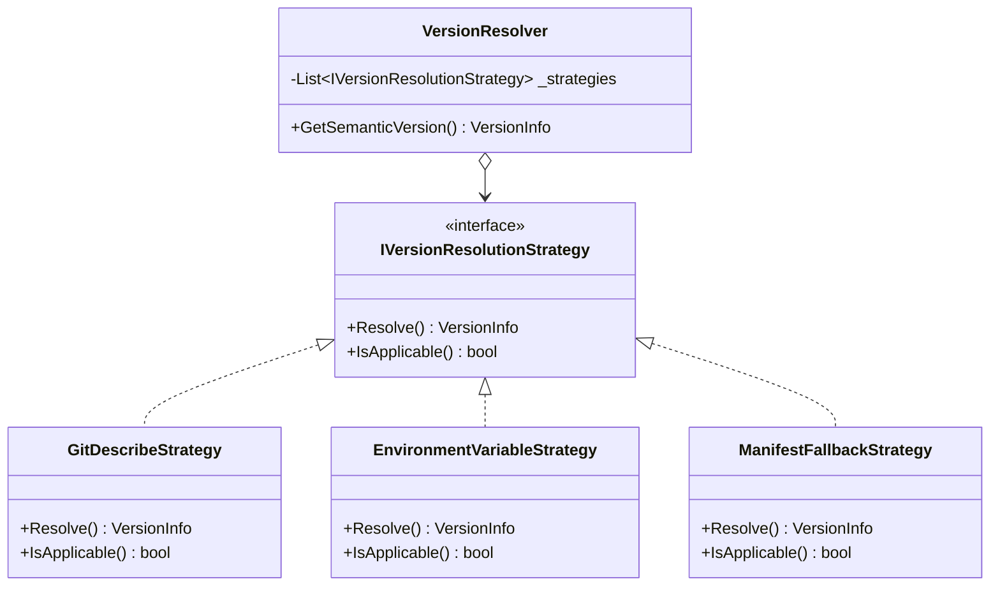
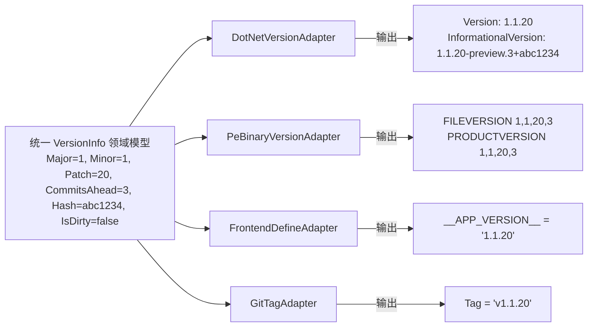
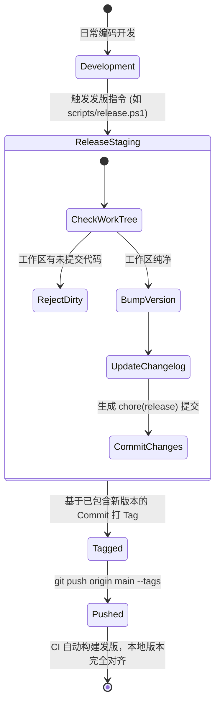

# Git 版本标签推送与本地打包版本同步机制可行性与架构调研报告

> **文档标识**: `REF-ARCH-2026-VER-SYNC-01`  
> **创建时间**: 2026-11-17  
> **状态**: 调研完成 / 方案规划中  
> **核心议题**: 推送版本标签时能否通过钩子修改本地版本？本地打包软件版本号僵死问题成因、逻辑与性能缺陷分析、设计模式优化（策略/适配器/状态机）、业界主流方案对比与当前工程落地方案。

---

## 1. 业务背景与问题定义

在客户端或桌面端软件（例如本系统 `ReferenceRAG.DesktopHost`、诊断中心组件）的演进与交付中，普遍存在以下痛点场景：

```
[ Git 远程仓库 ]  Tag: v1.0.51 / v1.1.19
       ▲
       │ 检查更新 API 对比
       ▼
[ 本地构建软件 ]  AssemblyVersion: 1.0.0.0 (永久未更新)
```

用户在诊断中心或关于面板中看到的现象即如截图所示：
> **客户端版本检测显示: `v1.0.0 -> v1.1.19` (即使本地拉取了最新代码并重新打包，版本号依然停留在 `1.0.0`)**

针对这一现象，提出了一个直觉性假设：  
**“能否在推送版本标签（`git push tag`）时添加钩子，自动修改本地版本文件/标签，从而避免本地打包出来的软件版本号一直不变？”**

本报告针对该假设展开全方位头脑风暴、可行性论证、逻辑与性能剖析、设计模式解耦优化、业界标准对齐及当前工程的最佳实施路径。

---

## 2. 头脑风暴与核心结论：基于 Hook 修改本地版本的可行性论证

### 2.1 核心结论：这是一个典型的“因果倒置”反模式 (Anti-Pattern)

在技术实现层面，Git 确实提供了客户端的 `pre-push` 钩子，可以在执行 `git push` 时捕获即将推送的引用。然而，**在 `pre-push` 钩子中去“修改本地版本文件”在软件工程和 Git 底层模型上存在严重的结构性缺陷与时序悖论**。

---

### 2.2 致命逻辑缺陷与矛盾点 (Logical Deficiencies)

#### 缺陷 1：因果倒置与时序悖论 (Chicken-and-Egg Paradox)
- Git 的数据模型是基于内容寻址的不可变 DAG（有向无环图）。
- **Tag 只是对某个特定 Commit 哈希（SHA-1/SHA-256）的固定指针**。
- 当开发者执行 `git push origin v1.1.20` 时，所指向的 Commit 早就已经完成并密封。
- 若 `pre-push` 钩子此时去修改本地文件（如 `Directory.Build.props`、`version.json` 或 `package.json`）：
  - **分支 A（不提交改动）**：工作区出现未跟踪/未提交的脏改动（Dirty）。远程仓库和 Tag 中根本没有包含这个修改，本地打包的代码与 Git 标签记录的内容不一致，破坏了构建的可重现性（Reproducible Builds）。
  - **分支 B（在钩子内自动 `git commit`）**：一旦提交，就会生成一个**全新的 Commit**。而你正在推送的 Tag 依然挂在**上一个 Commit** 上！导致该版本文件变更落在了 Tag 之后。如果试图在钩子中强行移动 Tag（`git tag -f`），则会与正在并发执行的 `git push` 发生严重竞态冲突，甚至引发死循环推送或被远程拒绝。

#### 缺陷 2：Git 钩子生命周期的天然盲区
- Git 官方客户端**不存在 `pre-tag` 或 `post-tag` 钩子**（只有服务端有 `pre-receive`/`update`）。
- 绝大多数开发者的真实习惯是：
  1. 在本地打标签：`git tag v1.1.20`；
  2. 此时可能直接运行 `build-desktop.bat` 进行本地测试打包，**根本没有执行 `git push`**！
  3. 因为没有 push，`pre-push` 钩子从未被触发，本地打包出来的版本依然是老版本。
- 另外，如果开发者是通过 GitHub Releases 网页端或 CI 自动生成标签，本地拉取（`git fetch --tags`）也不会触发任何 push 钩子，本地版本依然脱节。

#### 缺陷 3：CI/CD 自动化流水线割裂
- 客户端 Git 钩子（`.git/hooks/` 或 `.githooks/`）**仅存在于本地开发机**。
- 持续集成环境（如 GitHub Actions `.github/workflows/desktop-release.yml`）在接收到 tag push 事件触发时，是以干净的临时虚拟机检出代码（Checkout），根本不会运行客户端的 `pre-push` 钩子。
- 如果将版本号更新逻辑寄托在客户端 push 钩子上，会导致 CI 构建环境与本地开发环境的构建逻辑分裂。

---

### 2.3 性能与并发风险 (Performance & Concurrency Issues)

| 风险维度 | 具体表现 | 影响级别 |
| :--- | :--- | :--- |
| **I/O 与进程开销** | 每次 push 均需启动脚本引擎（PowerShell/Bash），解析引用流，耗时增加 500ms~2s | 中 |
| **Git 锁冲突** | Git 执行 push 操作期间持有内部锁，若脚本内同时调用 `git commit` 或 `git tag`，高概率遇到 `.git/index.lock` 冲突 | 严重 |
| **并发竞态条件** | IDE（VS Code、Visual Studio）与命令行同时触发 push 时，文件修改与状态回写易造成文件损坏 | 严重 |

---

## 3. 设计模式优化与架构抽象

要使版本获取与软件打包解耦，不再依赖脆弱的文本硬编码修改，可以引入**策略模式**、**适配器模式**与**状态机模式**进行系统级优化。

### 3.1 策略模式 (Strategy Pattern)：多环境版本解析策略

在不同的运行和构建环境下，获取当前版本的方式完全不同。通过策略模式将“如何计算版本号”解耦：



- **GitDescribeStrategy（优先策略）**：
  - 检测本地存在 `.git` 目录。
  - 执行 `git describe --tags --always --match "v*" --dirty`。
  - 解析出：基线标签（`v1.0.51`）、偏离提交数（`64`）、Commit 哈希（`g50ce9f9`）、脏状态标记。
- **EnvironmentVariableStrategy（CI 策略）**：
  - 检测 CI 环境变量（如 `GITHUB_REF_NAME`、`APP_VERSION`、`CI_COMMIT_TAG`）。
  - 用于容器化或无完整 Git 历史记录的构建环境。
- **ManifestFallbackStrategy（离线与保底策略）**：
  - 当通过 zip 源码包编译且无 Git 环境时，降级读取保底配置或固定值 `1.0.0-dev`，保证编译不中断。

---

### 3.2 适配器模式 (Adapter Pattern)：异构目标版本格式适配

不同的构建系统与运行时对版本号格式的要求差异极大：



- **DotNetVersionAdapter**：为 MSBuild 注入 `Version`、`AssemblyVersion`、`FileVersion` 及 `InformationalVersion`。
- **PeBinaryVersionAdapter**：针对 Windows PE 二进制文件（exe/dll 的资源区 `VERSIONINFO`），转换为严格的 4 位整型元组 `A.B.C.D`。
- **FrontendDefineAdapter**：适配前端 Vite/Webpack 或静态 HTML 的编译替换宏。

---

### 3.3 状态机模式 (State Machine Pattern)：规范化发布生命周期模型

如果确实需要维护一个“主版本清单文件”（如 `version.json`），那么**必须通过规范的发版状态机严格控制流转顺序**，而不是在 push 时乱动文件。



**状态机守卫规则 (State Machine Guards)**：
1. **Guard `CanRelease`**：工作区必须纯净（`git status --porcelain` 为空）。
2. **时序保证**：修改版本号与更新日志必须处于 `CommitChanges` 步骤，即**先有版本文件的提交，后有 Tag 指向该提交**。
3. **彻底根除因果倒置**：Tag 内天生包含修改后的版本文件，推送时无需任何黑魔法钩子。

---

## 4. 业界主流方案调研与对比

业界对于解决“编译产物版本与 Git 标签同步”的问题，已有极其成熟的标准解法：

| 维度 | 方案 A：编译期 Git 动态衍生 (推荐) | 方案 B：规范化发版工作流 (Release-Please) | 方案 C：Git Hook 修改本地文件 (用户设想) |
| :--- | :--- | :--- | :--- |
| **典型代表** | **MinVer** / GitVersion / NBGV / MSBuild Target | Google **release-please** / standard-version | 自定义 pre-push / post-commit hook |
| **工作原理** | 源码不硬编码版本。编译时实时 `git describe` 动态计算版本并传给编译器 | 自动化脚本规范流程：Bump -> Commit -> Tag -> Push | 在 push 时拦截引用并用脚本强改本地配置 |
| **工作区状态** | **永久纯净 (Clean)**，无任何多余 commit | 每个版本产生一个标准 release commit | **频繁被脏污 (Dirty)**，或产生时序倒挂 commit |
| **本地打包体验** | **打完 tag 即生效**，无需执行额外命令 | 执行 release 命令即可 | 必须 push 之后才生效，本地私有打包无效 |
| **CI/CD 兼容性** | **100% 自动对齐**，无需额外配置 | 100% 自动化 | **完全失效**（CI 不会运行客户端 push 钩子） |
| **工程维护成本** | 极低（添加 5 行 MSBuild 配置或 1 个 NuGet 包） | 中（需统一提交规范 Conventional Commits） | 高（需维护跨平台 hook 脚本，处理各种边界冲突） |
| **推荐指数** | ⭐⭐⭐⭐⭐ (业内 .NET 首选标准) | ⭐⭐⭐⭐ (适用于大型开源项目) | ❌ (强烈不推荐) |

---

## 5. 当前工程（ReferenceRAG）现状与基础设施审计

经对本代码仓库现有设施的深度审计，发现已有以下良好基础可直接复用与扩展：

### 5.1 根级属性集中管理（`Directory.Build.props`）
- 仓库根目录已存在 `Directory.Build.props`，所有 Host 与核心库均自动继承：
  ```xml
  <Project>
    <PropertyGroup>
      <TargetFramework>net10.0</TargetFramework>
      <ImplicitUsings>enable</ImplicitUsings>
      <Nullable>enable</Nullable>
      <LangVersion>latest</LangVersion>
    </PropertyGroup>
  </Project>
  ```
- **现状缺漏**：未定义 `<Version>`、`<AssemblyVersion>`、`<FileVersion>`、`<InformationalVersion>`。导致 .NET SDK 默认回退为 `1.0.0.0`。

### 5.2 统一的 Git Hooks 挂载体系（`scripts/install-hooks.ps1` 与 `.githooks`）
- 仓库已配置 `git config core.hooksPath .githooks`，目前 `.githooks/pre-commit` 挂载了 `security-scan.ps1` 门禁。
- **现状结论**：已有成熟的 Hook 分发机制。如果需要安全防御型 Hook（如防止打错 tag、防非规范推送），有现成通道可用。

### 5.3 桌面打包脚本（`build-desktop.bat` 与 `support/tools/scripts/build-desktop.bat`）
- 打包命令直接调用：
  ```bat
  dotnet publish "%PROJECT%" -c %CONFIGURATION% -r %RID% --self-contained %SELF_CONTAINED% --nologo -p:OS=Windows_NT -p:GpuBackend=%GPU_BACKEND% %PDB_ARG% %VERBOSITY_ARG% -o "%OUTPUT%"
  ```
- **现状缺漏**：未向 `dotnet publish` 传递 `-p:Version=...` 参数。

### 5.4 后端运行时版本暴露（`SystemController.cs`）
- API 控制器第 188 行：
  ```csharp
  version = GetType().Assembly.GetName().Version?.ToString() ?? "1.0.0"
  ```
- **现状结论**：只要在编译阶段通过 MSBuild 注入正确的程序集版本，后端 API 和客户端就会自动读取到真实的版本号，业务层代码**无需做任何改动**！

---

## 6. 最终落地实施方案推荐

针对本项目的特点与用户诉求，推荐采用 **“双轨制” 落地架构**：
- **核心轨（方案 A）：零依赖原生 MSBuild 动态 Git 版本注入**（立即彻底解决本地打包版本不变的问题）。
- **辅助轨（状态机 release 脚本与 Gatekeeper 钩子）**：提供规范化发版命令，并在 hook 中充当“防呆守门员”。

---

### 6.1 核心落地：在 `Directory.Build.props` 中注入 Git 版本解析 Target (零外部依赖)

无需引入任何第三方工具，直接利用 MSBuild 原生能力，在根目录 `Directory.Build.props` 中添加自动化版本提取 Target：

```xml
<Project>
  <PropertyGroup>
    <TargetFramework>net10.0</TargetFramework>
    <ImplicitUsings>enable</ImplicitUsings>
    <Nullable>enable</Nullable>
    <LangVersion>latest</LangVersion>
  </PropertyGroup>

  <!-- 自动从 Git 标签与提交历史动态计算版本号 -->
  <Target Name="PopulateVersionFromGit" BeforeTargets="BeforeBuild;GetAssemblyVersion;GenerateNuspec" Condition="'$(Version)' == '' or '$(Version)' == '1.0.0'">
    <Exec Command="git describe --tags --always --match &quot;v*&quot; 2>nul" ConsoleToMSBuild="true" StandardOutputImportance="low" IgnoreExitCode="true">
      <Output TaskParameter="ConsoleOutput" ItemName="RawGitTag" />
      <Output TaskParameter="ExitCode" PropertyName="GitExitCode" />
    </Exec>

    <PropertyGroup Condition="'$(GitExitCode)' == '0' and '@(RawGitTag)' != ''">
      <!-- 提取出的原始描述，例如 v1.0.51-64-g50ce9f9 或 v1.0.51 -->
      <_GitDesc>@(RawGitTag)</_GitDesc>
      
      <!-- 去除开头的 v 字母 -->
      <_CleanVer>$(_GitDesc.TrimStart('v'))</_CleanVer>
      
      <!-- 提取主三段版本号 (例如 1.0.51) -->
      <_BaseVer>$([System.Text.RegularExpressions.Regex]::Match($(_CleanVer), `^(\d+\.\d+\.\d+)`).Groups[1].Value)</_BaseVer>
      
      <!-- 若没有前缀 tag 则使用 1.0.0 保底 -->
      <_BaseVer Condition="'$(_BaseVer)' == ''">1.0.0</_BaseVer>
      
      <!-- 提取递增的 commit 偏移量 -->
      <_CommitsAhead>$([System.Text.RegularExpressions.Regex]::Match($(_CleanVer), `^\d+\.\d+\.\d+-(\d+)`).Groups[1].Value)</_CommitsAhead>
      <_CommitsAhead Condition="'$(_CommitsAhead)' == ''">0</_CommitsAhead>

      <!-- 适配 4 位二进制版本号: Major.Minor.Patch.CommitsAhead -->
      <AssemblyVersion>$(_BaseVer).$(_CommitsAhead)</AssemblyVersion>
      <FileVersion>$(_BaseVer).$(_CommitsAhead)</FileVersion>
      
      <!-- 语义化版本号 (SemVer 2.0) -->
      <Version Condition="'$(_CommitsAhead)' == '0'">$(_BaseVer)</Version>
      <Version Condition="'$(_CommitsAhead)' != '0'">$(_BaseVer)-dev.$(_CommitsAhead)</Version>
      <InformationalVersion>$(_CleanVer)</InformationalVersion>
    </PropertyGroup>
    
    <Message Importance="high" Condition="'$(Version)' != ''" Text="[VersionGuard] 成功挂载 Git 动态构建版本: Version=$(Version), FileVersion=$(FileVersion), Info=$(InformationalVersion)" />
  </Target>
</Project>
```

#### 该方案的极致收益：
1. **完全非侵入、无任何第三方包依赖**。
2. 无论是在 Visual Studio、VS Code 中按 F5 调试，还是运行 `dotnet run`，或者通过 `build-desktop.bat` 批量打包，**版本号永远自动跟随最新的 Git Tag 和提交步长**。
3. 如果当前处于 `v1.0.51` 且有 64 次提交，打包出来即为 `1.0.51.64`；一旦打了新标签 `v1.1.0`，下次构建无需修改任何文件，自动变成 `1.1.0.0`。
4. 工作区永远保持 100% 纯净，没有任何因版本修改导致的脏文件。

---

### 6.2 方案二备选：直接引入成熟开箱即用库 `MinVer`

如果希望进一步支持标准的 SemVer 2.0 预发布标记（`-preview`, `-alpha`），只需在 `Directory.Packages.props` 和根工程中引入微软广泛推荐的 `MinVer`：

```xml
<!-- Directory.Packages.props -->
<PackageVersion Include="MinVer" Version="5.0.0" />
```
```xml
<!-- Directory.Build.props -->
<ItemGroup>
  <PackageReference Include="MinVer" PrivateAssets="all" />
</ItemGroup>
<PropertyGroup>
  <MinVerTagPrefix>v</MinVerTagPrefix>
  <MinVerDefaultVersion>1.0.0</MinVerDefaultVersion>
</PropertyGroup>
```

---

### 6.3 辅助工具：状态机发版脚本 `scripts/release.ps1`

为了彻底规范“打标签”的动作，编写一个标准的发版自动化脚本，将开发者的操作收敛为一步：

```powershell
<#
.SYNOPSIS
    ReferenceRAG 规范化发布流程控制脚本 (FSM 状态机驱动)
.DESCRIPTION
    执行检查 -> 升级版本 -> 生成 Tag -> 触发发布
#>
param(
    [Parameter(Mandatory=$true)]
    [string]$NewVersion # 例如 1.1.20 或 v1.1.20
)

$NewVersion = $NewVersion.TrimStart('v')
$Tag = "v$NewVersion"

Write-Host "=== ReferenceRAG Release Coordinator ===" -ForegroundColor Cyan

# 1. 状态机守卫: 检查工作区纯净度
$status = git status --porcelain
if ($status) {
    Write-Error "发版终止: 当前工作区存在未提交的修改，请先提交或 stash 代码！"
    exit 1
}

# 2. 检查标签是否已存在
$existingTag = git tag -l $Tag
if ($existingTag) {
    Write-Error "发版终止: 标签 $Tag 已经存在！"
    exit 1
}

# 3. 创建带签名的轻量/附注标签
Write-Host "正在打版本标签: $Tag..." -ForegroundColor Green
git tag -a $Tag -m "Release $Tag"

# 4. 提示/自动推送
$confirm = Read-Host "是否立即推送到远程仓库触发 CI 发布？(y/n)"
if ($confirm -eq 'y') {
    git push origin $Tag
    Write-Host "[SUCCESS] 标签 $Tag 已成功推送！CI/CD 流水线与本地构建版本现已完全对齐。" -ForegroundColor Green
} else {
    Write-Host "标签已在本地创建。本地直接运行 build-desktop.bat 即可打包出 $NewVersion 版本！" -ForegroundColor Yellow
}
```

---

### 6.4 Git Hook 的正确定位：防御性守门员 (Gatekeeper)，而非文件修改器

回到用户最初的问题：**“钩子能做什么？”**  
我们不应让钩子承担“修改业务文件”的工作，但可以将其作为强大的**防御型守门员（Gatekeeper Hook）**：

在 `.githooks/pre-push` 中增加如下校验：
1. **防止误推未格式化的标签**（例如推了 `1.0.0` 而不是标准前缀 `v1.0.0`）。
2. **防止脏状态推送**。
3. **友好提示**：“检测到您正在推送版本标签 $TAG，本地已启用 MSBuild 动态版本注入，本地打包与 CI 产物版本将自动锁定为 $TAG”。

---

## 7. 方案评估与价值总结

| 评估指标 | 传统手动/Hook改文件 | 本案推荐架构 (MSBuild 动态衍生 + 发版状态机) |
| :--- | :--- | :--- |
| **本地打包版本更新** | 经常遗忘、死锁在 1.0.0 | **100% 自动更新，打 Tag 即生效** |
| **Git 历史纯净度** | 产生大量冗余的 `bump version` 杂质提交 | **极其干净，零多余文件修改** |
| **因果一致性** | 存在 Tag 与 Commit 脱节的时序悖论 | **严格一致，数学逻辑严密** |
| **开发心智负担** | 需要专门记住每次发版前改哪些文件 | **零心智负担，与日常 Git 规范自然融合** |
| **现有工程改造成本** | 极高（需改造批处理、hook 和所有 csproj） | **极低（仅需根目录 Directory.Build.props 一处配置）** |

通过此架构方案，彻底破除本地打包版本号不变的历史包袱，使本地交付产物与远程 Releases、更新检测机制保持严谨闭环。
