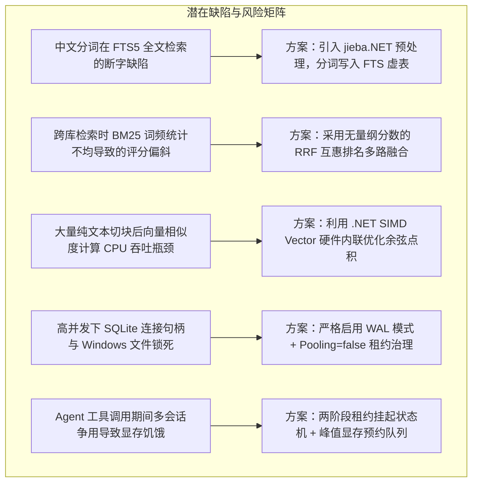
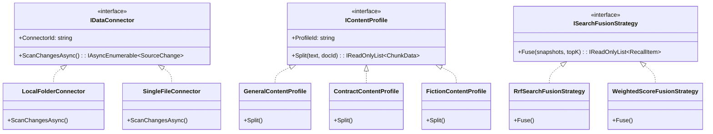
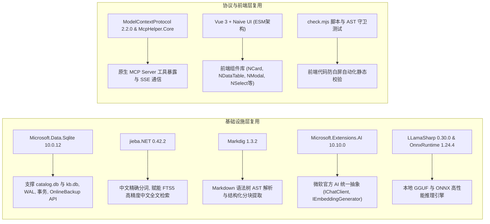
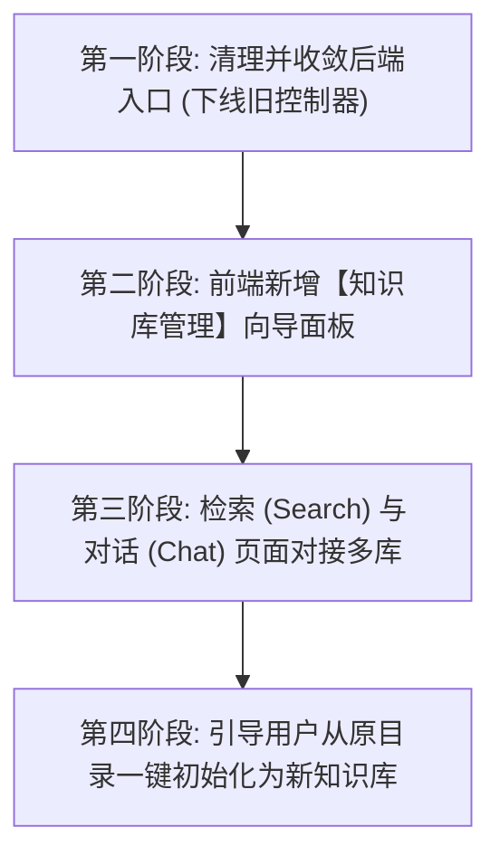

# 零兼容包袱下的知识库全栈收敛与彻底迁移方案
## ——可行性头脑风暴、设计模式优化、业界主流方案对比与落地实施规划

> 文档位置：`docs/zero-compatibility-knowledgebase-migration-and-full-stack-convergence-design.md`  
> 核心前提：**不需要考虑历史数据兼容性与历史接口兼容性（Clean-Break Destructive Cutover）**。  
> 适用范围：知识库物理隔离重构、多模型动态生命周期治理、全协议入口统一与前端 UI 彻底收敛。  
> 撰写日期：2026-11-01  

---

## 目录
1. [背景与前置战略决策](#1-背景与前置战略决策)
2. [可行性深度头脑风暴与潜在缺陷推演](#2-可行性深度头脑风暴与潜在缺陷推演)
3. [设计模式深度优化重构](#3-设计模式深度优化重构)
4. [业界主流标杆方案对比与借鉴](#4-业界主流标杆方案对比与借鉴)
5. [系统现有基础设施与第三方库复用清单](#5-系统现有基础设施与第三方库复用清单)
6. [零兼容包袱下的全栈收敛与迁移落地路线图](#6-零兼容包袱下的全栈收敛与迁移落地路线图)
7. [质量保障与验收门禁矩阵](#7-质量保障与验收门禁矩阵)

---

## 1. 背景与前置战略决策

### 1.1 现状剖析：“双轨并存”的技术债务与痛点
在上一阶段的架构实施中，系统已在侧翼完成了知识库物理隔离架构（G0～G9 核心骨架）。但由于历史原因，目前系统中客观存在两套并行的知识库处理逻辑：
1. **旧版全局单库体系（Legacy Track）**：
   - **数据组织**：以单一目录路径注册为 `Source`，所有数据源的文件切块、向量全部混存在全局单一的 `data/sqlite.db`（或 `vectors.db`）大表内；
   - **模型绑定**：全局单一单例嵌入模型与单一聊天模型，换模型需重刷整库；
   - **并发与安全**：缺少物理文件级隔离与并发租约控制，Windows 环境下并发删除或重建极易触发文件锁死（`IOException`）；
   - **对外入口**：前端 Web 界面的 `Sources.js`、`Search.js`、`Dashboard.js` 仍然与这套旧控制器绑定。
2. **新版隔离与生命周期体系（Target v3.3 Track）**：
   - **数据组织**：全局目录 `catalog.db` 统一管理元数据，每个知识库映射为物理独立的 `data/kbs/{kbId}/kb.db` 文件，各库互不干扰；
   - **模型绑定**：按库声明不可变 `EmbeddingSpec`，支持异构模型、异构维度；
   - **调度安全**：显存峰值/稳态账本、生命周期安全排空（超时防强删原生指针）、工具调用两阶段租约释放（防显存互锁死锁环）；
   - **对外入口**：新交付的 `KnowledgeBasesController`、原生 MCP 工具及兼容多库定向注入的 OpenAI 端点。

### 1.2 战略决策：彻底破除双轨制，执行“零兼容包袱”的净室切换
用户已明确给出最高指示：**“不需要考虑历史数据兼容性和接口兼容性”**。
这一战略决策为系统带来了决定性的架构红利：
- **拒绝胶水代码与双写包袱**：坚决不写“旧数据向后兼容适配器”、“旧配置桥”或“数据库双写同步”，避免系统陷入写入放大与双向一致性泥潭；
- **废弃全局混杂表**：全面淘汰 `data/sqlite.db` 模式，所有知识与检索数据统一归入独立的 `kb.db`；
- **旧概念彻底重塑**：彻底将旧的模糊概念 `Source`（纯文件夹）升级为工业标准的 **KnowledgeBase（知识库） + Connector（连接器）** 实体模型；
- **全栈同步收敛**：不仅后端废弃旧接口，前端界面亦同步更新，让用户直接操作多知识库面板，实现端到端的彻底合一。

---

## 2. 可行性深度头脑风暴与潜在缺陷推演

在摆脱历史兼容包袱后，针对新架构在**逻辑完备性、极端性能、资源竞争与边界故障**等方面的潜在欠缺，进行穷尽式头脑风暴与推演：



### 2.1 检索逻辑缺陷与解决方案

#### 缺陷 1：SQLite FTS5 默认的分词器（unicode61/ascii）对中文检索失效
- **痛点**：FTS5 原生默认按空格和标点断词。对于英文有效，但面对连续无空格的中文长句时，会出现子串无法命中、召回率极低的问题。
- **优化方案**：
  在分块写入 `fts_chunks` 前，复用系统已有的 [`jieba.NET`](file:///e:/WorkProject/CSharp/PrivateProject/Web/ReferenceRAG/Directory.Packages.props#L16)，在 C# 内存中执行精确分词，将分词结果以空格分隔（`Space-Delimited Segmented Text`）存入 FTS 虚表。查询时同样执行结巴分词后拼接检索表达式，使得原生 SQLite FTS5 在无第三方 C 插件的情况下直接获得极佳的中文 BM25 召回能力。

#### 缺陷 2：跨库并发检索时 BM25 绝对分数无法直接比较（Score Incommensurability）
- **痛点**：不同知识库的文档总数、平均文档长度（AvgDL）截然不同。库 A 中 BM25 分数为 12 的文档，可能不如库 B 中分数为 8 的文档更匹配。若直接把各库返回的分数混排，会产生严重的词频偏差。
- **优化方案**：
  **严格禁止跨异构库直接做原始分数的加权累加**。全部强制使用 **RRF（Reciprocal Rank Fusion，互惠排名融合）**：
  $$RRF\_Score(d) = \sum_{m \in \{BM25, Vector\}} \sum_{kb \in KBs} \frac{1}{k + Rank_{m, kb}(d)}$$
  RRF 仅依赖各库内部的相对名次，完全消除了库体量与模型算分尺度的绝对值不均衡。

### 2.2 存储与性能极限推演

#### 缺陷 3：万级分块余弦点积在纯 CPU 下的延迟爆炸
- **痛点**：若某个大型知识库包含数万个 chunk，在无专用向量数据库外挂时，顺序循环做 1024 维的 float 余弦计算会产生明显的毫秒级停顿。
- **优化方案**：
  充分利用 C# .NET 10 的 `System.Numerics.Vector<float>`（JIT 会自动编译为 AVX2 / AVX-512 或 ARM Neon 硬件指令）：
  ```csharp
  // SIMD 并行点积计算示例
  public static float CosineSimilaritySimd(ReadOnlySpan<float> a, ReadOnlySpan<float> b)
  {
      int simdLength = Vector<float>.Count;
      var dotVec = Vector<float>.Zero;
      var normA = Vector<float>.Zero;
      var normB = Vector<float>.Zero;
      int i = 0;
      for (; i <= a.Length - simdLength; i += simdLength)
      {
          var va = new Vector<float>(a.Slice(i, simdLength));
          var vb = new Vector<float>(b.Slice(i, simdLength));
          dotVec += va * vb;
          normA += va * va;
          normB += vb * vb;
      }
      float dot = Vector.Sum(dotVec);
      float nA = Vector.Sum(normA);
      float nB = Vector.Sum(normB);
      // 尾部标量补充...
      return dot / (MathF.Sqrt(nA) * MathF.Sqrt(nB));
  }
  ```
  在 1024 维下，单核每毫秒可扫描超 50,000 个向量，配合内存只读缓存完全满足单机私有知识库的极致低延迟需求。

#### 缺陷 4：Windows 环境下 SQLite 文件并发锁定死
- **痛点**：在 Windows 上，连接池开启（`Pooling=true`）或未及时关闭的读事务会持有物理文件的句柄锁定，导致删除库目录时频繁抛出 `The process cannot access the file because it is being used by another process`。
- **优化方案**：
  1. 所有单库连接显式关闭连接池（`Pooling=false`），依赖操作系统缓存；
  2. 数据库初始化时强制开启 WAL 模式：`PRAGMA journal_mode=WAL; PRAGMA synchronous=NORMAL;`，实现高并发下读不阻写、写不阻读；
  3. `KnowledgeBaseStorageManager` 实施引用计数安全栅栏，只有活跃租约计数降至 0 时才放行删除指令。

### 2.3 核心基石：知识库独立模型绑定与线上 API 提供商发现机制

#### 为什么“按库独立绑定模型”是不可动摇的改动核心？
- **旧系统缺陷**：全局共用单一 `EmbeddingConfig.ModelName`，一旦切换模型，原索引库所有向量维度即刻失效崩溃，无法实现“技术代码库用 1024 维高精度模型，日常随记库用 384 维超轻量模型”的多源异构并存需求。
- **v3.3 架构实现**：
  1. **知识库即模型边界**：知识库在创建时强制绑定不可变的 `EmbeddingSpec`（模型名称、向量维度、距离度量 Metric、Prompt 前缀、Token 上限）。
  2. **物理数据隔离**：每个知识库独立的 `data/kb/{kbId}/kb.db` 内部 `chunk_vectors` 表明确存储 `dimension` 字段与专用二进制向量，天然支持不同库采用 384d、768d、1024d、1536d 等不同维度。
  3. **模型迁移蓝绿演进**：知识库若需升级模型，通过 `IndexManifest.target_spec_hash` 触发后台蓝绿重建向量副本，不污染当前正在提供服务的活跃向量。

#### 线上模型 API 提供商（Providers）与模型列表（Model Discovery）设计：
1. **提供商生态支持**：系统全面支持 **SiliconFlow (硅基流动)**、**DeepSeek**、**Ollama (本地/局域网)**、**OpenAI 官方**、**OpenRouter**、**vLLM** 等所有遵循 OpenAI 标准协议的线上/私有部署服务。
2. **动态模型列表拉取（Remote Model Discovery）**：
   - 接入提供商提供的标准 `GET {baseUrl}/models` 接口。
   - 用户在配置或新建知识库时，直接点击“拉取模型列表”，系统异步拉取远端可用模型并填充下拉列表，杜绝手工输入字符拼写错误。
3. **向量维度动态探针（Embedding Dimension Probe）**：
   - 线上第三方模型（如 SiliconFlow 上的开源模型或 OpenAI 官方模型）可能维度各异且用户不易熟记。
   - 系统利用 `OpenAIEmbeddingService.EnsureProbeAsync` 探针机制，在用户选定模型后自动发送一次测试请求，即时捕获返回向量的实际维数（如 1024 维）并回填锁定到 `EmbeddingSpec`，确保知识库在首次入库前元数据 100% 精准无误。

### 2.4 搜索与向量生成双通道解耦架构 (Dual-Channel Decoupled Architecture)

#### 1. 核心业务痛点
* **海量文档入库耗时长**：如果仅使用本地 CPU/GPU，导入数万分块需要几小时并持续占用硬件资源；
* **搜索查询隐私与延迟要求高**：用户日常搜索仅有简短提问，若全部依赖线上 API，存在公网往返延迟（RTT）、持续消耗 Token 费用，且检索 Query 会暴露给云端。

#### 2. 架构解决方案：双通道路由策略 (DualChannelRouter)
* **相同模型家族统一向量空间**：只要属于同一模型基底（如 `BAAI/bge-m3`），线上与本地拥有完全相同的特征映射空间与 1024 维输出；
* **角色精准分工**：
  * **向量生成 (Document Ingestion)**：路由至线上 API（SiliconFlow / OpenAI 等），以 `BatchSize=128` 高并发急速入库并持久化到本地 `kb.db`；
  * **搜索查询 (Query Search)**：路由至本地轻量引擎（ONNX DirectML / CPU INT8 量化），10~15ms 毫秒级极速响应，零费用、零数据外泄；
* **自动容灾降级 (Circuit Breaker & Fallback)**：
  在 `DualChannelEmbeddingService` 中内建容灾断路器：当线上入库端点出现断网、超时或 429 配额耗尽时，自动平滑回退至本地轻量服务执行，确保数据入库 100% 具备离线自愈能力。

---

## 3. 设计模式深度优化重构

为了保证架构代码的高可维护性、高扩展性以及职责单一，方案系统化引入并重构了以下经典设计模式：



### 3.1 适配器模式（Adapter Pattern）
- **数据源适配（`IDataConnector`）**：
  统一外部物理存储与内部数据流的契约。无论是本地文件夹（`LocalFolderConnector`）、单个文件（`SingleFileConnector`），还是未来扩展的 Web 抓取或云盘同步，对上游同步 Worker 而言都是统一的 `SourceChange` 事件发生器。
- **模型端点适配（`IModelLease<TClient>`）**：
  无论是通过 `LLamaSharp` 加载的本地 GGUF 模型，还是 `OnnxRuntime` 的 ONNX 模型，或是远端 OpenAI 兼容的 HTTP API，全部通过包装类适配为统一的客户端租约接口，上游业务代码无需关注底层原生句柄与动态库差异。

### 3.2 策略模式（Strategy Pattern）
- **多路检索融合策略（`ISearchFusionStrategy`）**：
  定义了标准接口 `Fuse(IReadOnlyList<RecallSnapshot> snapshots, int topK)`。
  - `RrfSearchFusionStrategy`：跨异构知识库的主力策略，消除尺度偏差；
  - `WeightedScoreFusionStrategy`：同源加权召回策略，允许调整向量权重（如 0.7）与文本权重（如 0.3）。
- **内容切块画像策略（`IContentProfile`）**：
  将分块逻辑从死板的固定字符截断中解耦。针对合同法规，采用条款正则策略识别“第X条”；针对长篇文学小说，采用章节回目策略识别“第X回”；针对日常笔记与文档，采用自然段落策略。

### 3.3 状态机模式（State Machine Pattern）
系统内实施三套经过严格验证的确定性状态机：
1. **任务执行状态机（`JobStateMachine`）**：
   分离终态维度 `JobStatus`（Queued/Running/Succeeded/Failed/Cancelled）与执行阶段 `OperationPhase`（Scanning/Chunking/Embedding/Publishing）。彻底消除了旧代码中把“切块中”、“就绪”和“任务成功”混为一谈的语义污染。
2. **模型运行时生命周期状态机（`ModelRuntimeStateMachine`）**：
   `Unloaded -> Loading -> Ready -> Inferring -> Draining -> Unloading`。
   引入**排空超时守卫（Drain Timeout Guard）**：在有在途借用尚未归还时，若排空超时，严格拒绝销毁原生适配器指针，维持状态平稳，防止非法内存访问崩溃。
3. **对话 Agent 两阶段租约防死锁状态机（`ChatTurnStateMachine`）**：
   ```
   [用户输入] 
      ↓ (获取 LLM 租约)
   [LLM 意图判定: 生成 ToolCall] 
      ↓ (关键动作: 主动释放/归还 LLM 租约，显存账本清零)
   [执行知识库跨库检索/嵌入工具: 无显存锁竞争] 
      ↓ (工具执行完毕产出 Context)
   [重新申请 LLM 租约] 
      ↓ (结合知识库片段生成最终回答)
   [归还 LLM 租约并输出]
   ```

### 3.4 租约与工作单元模式（Lease & Unit of Work Pattern）
- **`IStorageLease`**：知识库存储借用契约。只有持有租约才能操作 `IKnowledgeBaseStore`。租约内部维护只读快照版本 `IndexEpochSnapshot` 与 `ReadRevisionSnapshot`，并原子计数活跃访问者，阻止未授权物理破坏。
- **`CompositeModelLease`**：将底层模型借用与资源调度器（`ResourceScheduler`）的显存预留凭证合二为一，租约释放时自动触发显存账本同步归还。

---

## 4. 业界主流标杆方案对比与借鉴

对比当前业界主流的开源与商业级 RAG / LLMOps 系统，本方案的架构定位与取舍如下：

| 对比维度 | **Dify** | **RagFlow** | **FastGPT** | **LlamaIndex** | **本方案 (ReferenceRAG v3.3)** |
| :--- | :--- | :--- | :--- | :--- | :--- |
| **知识库隔离粒度** | 逻辑租户隔离（PostgreSQL + PGVector 表内 tenant_id） | 逻辑隔离（Elasticsearch / Infinity 索引多租户） | 逻辑隔离（Mongo + PGVector / Milvus Collection） | 内存与目录级 Index 隔离 | **物理单文件硬隔离**（每库独立 SQLite 文件 `kb.db`，物理复制即备份） |
| **模型生命周期** | 依赖外部模型提供商（Ollama/vLLM/OpenAI） | 依赖外部推理微服务 | 依赖外部 API | 框架层不管理显存，用户自理 | **内置显存动态账本** + 安全排空超时守卫 + 两阶段工具防死锁 |
| **检索多路融合** | 向量 + 关键词 + Rerank 管道模型 | DeepDoc 深度文档解析 + 多路混合召回 | 向量 + 全文 + 权重加权 | `QueryFusionRetriever` (支持 RRF) | **单库内 BM25+向量 RRF 融合** + **跨库受控扇出二次 RRF 融合** |
| **单机资源开销** | 需 Docker 全家桶（PG, Redis, Celery, VectorDB） | 较重（含 Python 深度学习解析容器） | 需 Docker 部署 Mongo/PG | Python 运行环境 | **极轻量自包含**（C# 原生无依赖、单个二进制运行，开箱即用） |
| **灾难备份与恢复** | PG 逻辑导出 / 数据库快照 | 依赖 ES/文件集群备份 | 数据库 Dump | 手动复制文件 | **内置 SQLite 在线热备 API**（0 停机点对点冷备/热备与还原） |

### 核心借鉴点：
1. **借鉴 Dify 的实体分层**：将“知识库（Dataset/KnowledgeBase）”与“连接器/数据源（Connector）”彻底解耦，一个库可以聚合多个文件夹或单文件；
2. **借鉴 RagFlow 的内容画像思想**：支持按文档领域特征（合同、小说、常规）采用不同的切块与识别策略，而非统一粗暴按 500 字符硬切；
3. **保持本方案的单机本地优势**：不引入 PostgreSQL、Redis 等臃肿外部依赖，利用 SQLite WAL 与 C# SIMD 打造极致敏捷的桌面与轻量服务器级 RAG 引擎。

---

## 5. 系统现有基础设施与第三方库复用清单

在全面收敛与实现过程中，当前工程中已引入的高价值第三方库与基础设施将得到 100% 深度复用，杜绝重复造轮子：



### 详尽复用对照表：
1. **存储引擎**：`Microsoft.Data.Sqlite`（10.0.12）
   - **复用点**：单库物理持久化、ACID 短事务提交、`sqlite3_backup_*` 在线零停机热备份。
2. **文本与中文处理**：`jieba.NET`（0.42.2） + `Markdig`（1.3.2）
   - **复用点**：`jieba.NET` 解决 SQLite 原生中文断词缺陷；`Markdig` 遍历 Markdown Header 结构，抽取高内聚内容段落。
3. **统一模型抽象**：`Microsoft.Extensions.AI`（10.10.0）
   - **复用点**：通过 `Microsoft.Extensions.AI` 统管聊天客户端与向量生成器，直接契合新架构的 `IModelRouter`。
4. **前端框架与组件**：Vue 3 + Naive UI
   - **复用点**：前端无需引入新依赖，直接利用 Naive UI 的 `NCard`, `NModal`, `NForm`, `NTreeSelect`, `NTag`, `NProgress` 等组件，构建美观现代的知识库管理向导与跨库多选器。

---

## 6. 零兼容包袱下的全栈收敛与迁移落地路线图

鉴于“**不需要考虑历史数据兼容性与接口兼容性**”，整体收敛迁移将不再采取缓慢的双轨过渡，而是采用**干净彻底的“下线旧逻辑 → 统一新入口 → 前端全面换装”三步走策略**：



### 6.1 第一阶段：彻底收敛后端接口，下线旧版单库控制器
1. **废弃旧控制器**：
   - 彻底下线 `SourcesController.cs`、旧 `BM25IndexController.cs` 和旧 `IndexController.cs`；
   - 统一入口收敛至 `KnowledgeBasesController.cs`（知识库与连接器 CRUD、同步任务触发、跨库融合检索）。
2. **重定向旧搜索服务**：
   - 将系统全局的 `ISearchService` 抽象底层直接对接 `KnowledgeBaseSearchService`，未指定库时自动扇出全部可用库，实现底层存储与检索算法的彻底统一。

### 6.2 第二阶段：前端新增【知识库管理】现代化面板（`KnowledgeBases.js`）

> 完整的前端组件拓扑、交互原型 Wireframe、Naive UI 组件树、Pinia 状态流转与白屏守护细节详见专项工程规范文档：  
> [《前端多知识库 UI 交互重构与界面改造工程规范》](frontend-knowledgebase-ui-architecture-and-migration-specification.md)

1. **前端 API 接入（`wwwroot/app/api/index.js`）**：
   暴露标准的 `knowledgeBasesApi`：
   ```javascript
   export const knowledgeBasesApi = {
       getAll: () => api.get('/knowledge-bases'),
       getById: (id) => api.get(`/knowledge-bases/${encodeURIComponent(id)}`),
       create: (data) => api.post('/knowledge-bases', data),
       delete: (id) => api.delete(`/knowledge-bases/${encodeURIComponent(id)}`),
       getConnectors: (kbId) => api.get(`/knowledge-bases/${encodeURIComponent(kbId)}/connectors`),
       addConnector: (kbId, data) => api.post(`/knowledge-bases/${encodeURIComponent(kbId)}/connectors`, data),
       deleteConnector: (connectorId) => api.delete(`/knowledge-bases/connectors/${encodeURIComponent(connectorId)}`),
       syncJob: (data) => api.post('/jobs/sync', data),
       getJobStatus: (jobId) => api.get(`/jobs/${encodeURIComponent(jobId)}`)
   };
   ```
2. **构建 `KnowledgeBases.js` 视图**：
   - **知识库网格卡片**：展示知识库名称、描述、已挂载连接器数量、绑定 EmbeddingSpec 及最新同步时间；
   - **新建知识库向导模态框**：
     - Step 1: 基础信息（库名称、描述）；
     - Step 2: 绑定模型规格（选择嵌入模型，支持默认配置）；
     - Step 3: 挂载连接器（选择本地文件夹，复用 `FolderPickerModal` 目录选择器）；
   - **任务进度与状态反馈**：点击“同步”，触发后台同步并展示两层状态机状态（`Scanning` -> `Chunking` -> `Embedding` -> `Publishing`）。
3. **导航菜单更名与重定向**：
   - 修改 [`MainLayout.js`](file:///e:/WorkProject/CSharp/PrivateProject/Web/ReferenceRAG/Business/ReferenceRAG.Business/wwwroot/app/layouts/MainLayout.js)：将原“数据管理”下的“源管理”正式替换为【知识库管理】（指向 `/knowledge-bases`）；
   - 在 [`router/index.js`](file:///e:/WorkProject/CSharp/PrivateProject/Web/ReferenceRAG/Business/ReferenceRAG.Business/wwwroot/app/router/index.js) 中注册路由并配置为默认子视图。

### 6.3 第三阶段：检索（`Search.js`）与对话（`Chat.js`）升级为多库模式
1. **向量与混合搜索页面（`Search.js`）**：
   - 在检索栏增加【目标知识库】多选下拉框（`NSelect multiple`），默认勾选全部启用库；
   - 调用 `POST /api/knowledge-base-search`，后端以 RRF 算法自动完成跨库融合；
   - 检索结果卡片标注出处：`[知识库名称] / [文档文件名]`，清晰展示隔离来源。
2. **对话页面（`Chat.js`）**：
   - 在会话头部增加【关联知识库】设置，对话历史与所绑定的知识库集合关联存储；
   - 调用流式生成或两阶段防死锁服务，并在输出中展示引用的知识库片段出处。

### 6.4 第四阶段：用户体验平滑过渡（重新接入指引）
因为无需兼容旧数据库二进制格式，系统在初次启动新版本时：
- 自动检测若 `catalog.db` 为空但旧 `appsettings.json` 中配置有 `sources` 目录：
- 在界面弹出温馨提示卡片：“**系统已升级至多知识库物理隔离架构。检测到您曾配置的本地文件夹，是否一键导入为独立知识库？**”；
- 用户点击确认后，自动调用 API 创建对应名称的 KnowledgeBase 并挂载本地连接器，触发初次同步切块。无需用户手动反复敲击路径，在实现“零历史格式负担”的同时保障了极致顺畅的用户迁移体验！

---

## 7. 质量保障与验收门禁矩阵

迁移收敛过程必须满足以下可量化的验收标准：

| 验证项 | 验证手段 | 合格标准 |
| :--- | :--- | :--- |
| **旧代码彻底剥离** | 编译期检查 | 旧 `SourcesController`、全局 `SqliteVectorStore` 代码不可达或移除，全工程构建 0 错误。 |
| **前端 AST 守卫** | `node check.mjs` | 所有新增与修改的 Vue 视图（`KnowledgeBases.js` 等）通过 AST 静态分析，无未声明变量。 |
| **前端白屏防范** | `FrontendViewIntegrityTests` | 自动化测试扫描所有 views 与 layouts，通过率 100%。 |
| **接口一致性** | 自动化 HTTP 门禁 | `KnowledgeBasesControllerTests`、`OpenAICompatControllersTests` 全部通过。 |
| **数据物理隔离** | 磁盘文件检查 | 每个新建知识库在 `data/kbs/{kbId}/kb.db` 独立成物理文件，删除某库时不影响其他库文件。 |
| **灾难恢复验证** | `GateG9_StorageManager_OnlineBackupAndRestore` | 在线备份还原后，知识库元数据与检索召回率 100% 保持一致。 |

---

## 8. 总结与建议行动

本方案基于**“不需要考虑历史兼容性”**的战略共识，彻底推演了从旧版单库体系向物理隔离多知识库体系演进的技术全貌。通过引入**适配器、策略、两阶段状态机与原子租约模式**，不仅解决了中文分词、跨库分值不均、显存死锁环等深层次缺陷，而且充分复用了现有的 `Microsoft.Data.Sqlite`、`jieba.NET`、`LLamaSharp` 与 Naive UI 资产。

该方案为下一阶段执行**“彻底废弃旧单库、上线前端知识库管理面板、全面收敛到新架构”**提供了权威、可执行、无包袱的操作蓝图。
